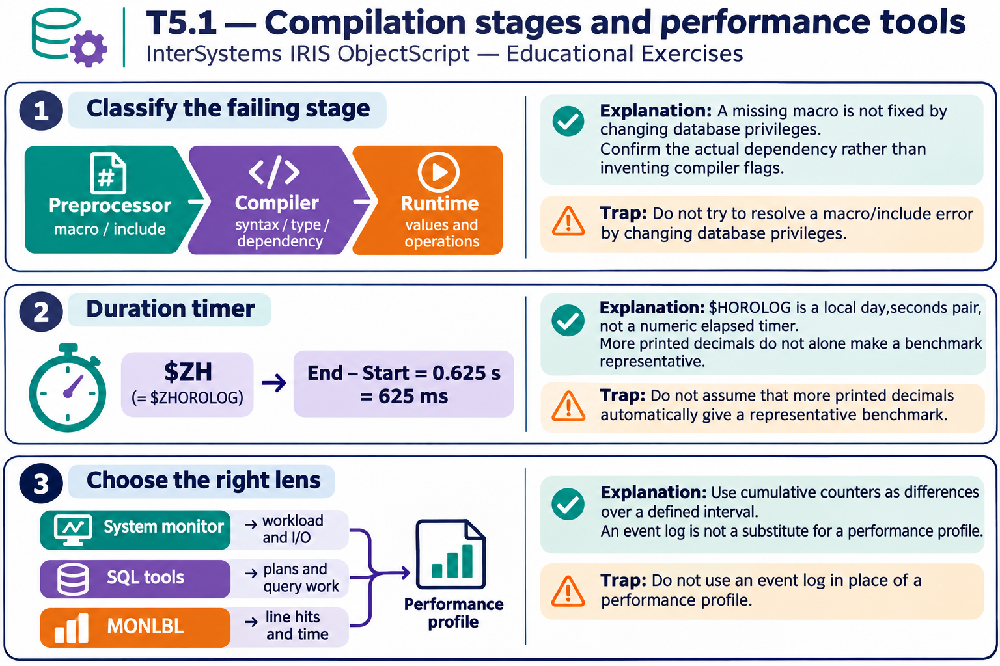

# T5.1 · 02 — Il timer deve misurare un intervallo reale

[Indice degli approfondimenti](README.md) · [Quiz originale](../quiz.md) · [Teoria](../study.md)

**Esercizi di partenza:** [Q3](../quiz.md#question-3-single) · [Q4](../quiz.md#question-4-single). L’approfondimento rielabora il concetto e aggiunge una variante; non riproduce soltanto la risposta del quiz.

## Il caso concreto

Una trasformazione va cronometrata con un contatore di secondi, non con la rappresentazione data,orario usata come numero.

```objectscript
set start=$ZHOROLOG
; trasformazione
set elapsed=$ZHOROLOG-start
```

## Ragionamento passo per passo

$ZH abbrevia $ZHOROLOG e comprende frazioni di secondo dall’avvio. La sottrazione di due $HOROLOG forza invece una conversione del prefisso giorno e perde la componente oraria: non rappresenta la durata voluta. Documenta anche la piattaforma e il carico se il benchmark deve essere ripetibile.

## Perché il distrattore è plausibile

Usare il formato di stampa di una data come se fosse un cronometro o attribuire significato a un numero senza unità.

## Lo spunto da portare oltre l’esercizio

Prima della sottrazione verifica che i due operandi siano grandezze nella stessa unità.



*Leggi il pannello 2; gli altri due collegano il caso agli altri approfondimenti del capitolo.*

## Variante: prova prima di leggere la soluzione

Inizio 100,250 secondi dall’avvio e fine 100,875: quanto dura il blocco?

<details>
<summary>Soluzione ragionata</summary>

0,625 secondi. I numeri qui sono espressi come quantità decimali, non come coppie $HOROLOG.

</details>

## Riferimenti e precisazioni

- [$ZHOROLOG](https://docs.intersystems.com/irislatest/csp/docbook/DocBook.UI.Page.cls?KEY=RCOS_vzhorolog)
- [Macro](https://docs.intersystems.com/irislatest/csp/docbook/DocBook.UI.Page.cls?KEY=GCOS_macros)
- [Monitoraggio prestazioni](https://docs.intersystems.com/irislatest/csp/docbook/DocBook.UI.Page.cls?KEY=GCM_perfmon)

[Note specifiche del capitolo](README.md#precisazioni-rispetto-al-quiz) · [Metodo e limiti della revisione](../../../approfondimenti-esercizi.md#metodo-e-limiti)
