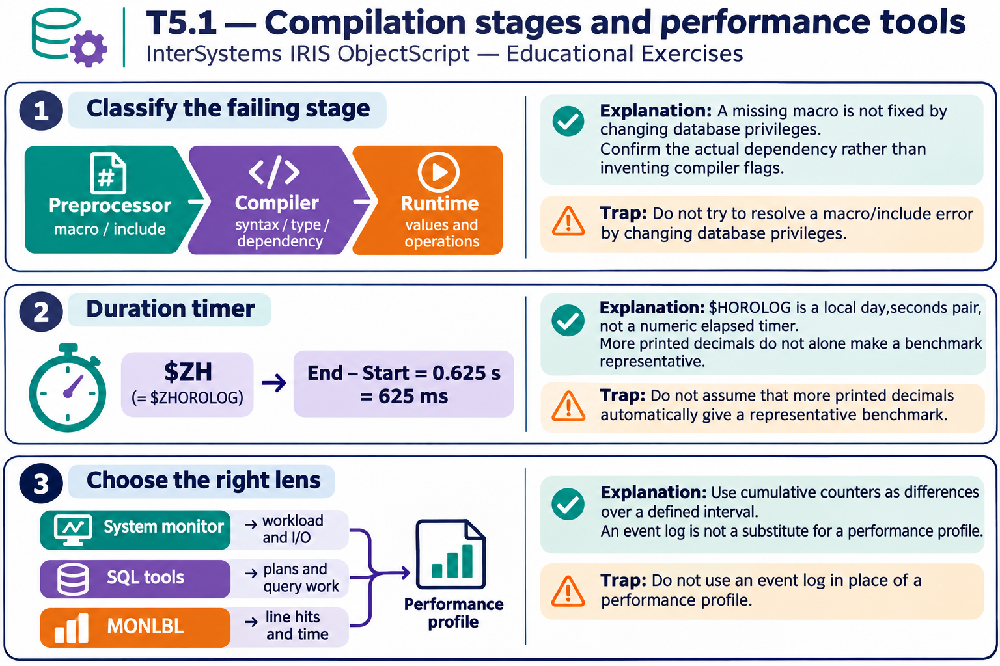

# T5.1 · 03 — Ogni strumento risponde a una scala diversa

[Indice degli approfondimenti](README.md) · [Quiz originale](../quiz.md) · [Teoria](../study.md)

**Esercizi di partenza:** [Q5](../quiz.md#question-5-single) · [Q8](../quiz.md#question-8-single) · [Q9](../quiz.md#question-9-single) · [Q14](../quiz.md#question-14-single) · [Q15](../quiz.md#question-15-single). L’approfondimento rielabora il concetto e aggiunge una variante; non riproduce soltanto la risposta del quiz.

## Il caso concreto

Il sistema è lento: una dashboard mostra il quadro globale, mentre il costo può concentrarsi in una riga o in una query.

## Ragionamento passo per passo

Usa metriche di sistema per capire il tipo di pressione; piano e statistiche SQL per una query; un profiler di righe per un metodo. Correlare tempi, letture e frequenza aiuta a individuare la causa. Un singolo rapporto di cache non dimostra da solo il numero di letture fisiche né identifica la riga responsabile.

## Perché il distrattore è plausibile

Scegliere lo strumento prima della domanda o trattare una correlazione aggregata come prova della causa applicativa.

## Lo spunto da portare oltre l’esercizio

Passa dal sintomo generale al punto specifico mantenendo misure confrontabili.

*Leggi il pannello 3; gli altri due collegano il caso agli altri approfondimenti del capitolo.*

## Variante: prova prima di leggere la soluzione

Il processo usa molto tempo ma la query è breve. È sensato insistere solo sul piano SQL?

Soluzione ragionata

No: amplia la misura al codice e alle altre attese del processo.

## Riferimenti e precisazioni

- [$ZHOROLOG](https://docs.intersystems.com/irislatest/csp/docbook/DocBook.UI.Page.cls?KEY=RCOS_vzhorolog)
- [Macro](https://docs.intersystems.com/irislatest/csp/docbook/DocBook.UI.Page.cls?KEY=GCOS_macros)
- [Monitoraggio prestazioni](https://docs.intersystems.com/irislatest/csp/docbook/DocBook.UI.Page.cls?KEY=GCM_perfmon)

[Note specifiche del capitolo](README.md#precisazioni-rispetto-al-quiz) · [Metodo e limiti della revisione](../../../approfondimenti-esercizi.md#metodo-e-limiti)
