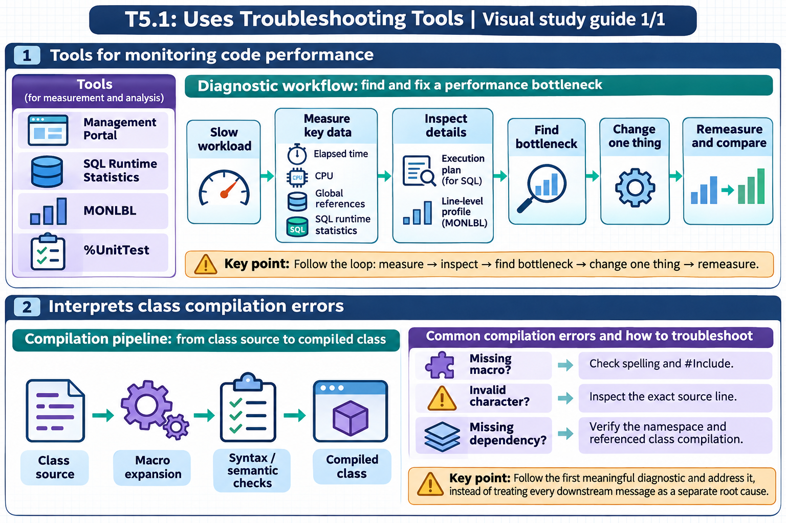

[All topics](../../index.md) · [Practice quiz](quiz.md)

# T5.1: Uses Troubleshooting Tools

[Approfondimenti dagli esercizi](<Approfondimenti esercizi/README.md>)

Saved 2 November 2026 from [exam-prep.es](https://exam-prep.es/exams/objectscript/knowledge/T5.1.html). Reference links require internet access.

### Contents

1. [Tools for monitoring code performance](#1-tools-for-monitoring-code-performance)
2. [Interprets class compilation errors](#2-interprets-class-compilation-errors)

### Visual study guide — sections 1–2



[View all chapter diagrams](visuals.md) · [Technical review notes](../../visual-technical-notes.md)

## 1. Tools for monitoring code performance

### Key Points

- **^PERFMON**: System-level performance monitoring utility capturing global references, commands, and routine statistics
- **%SYS.PTools**: SQL query performance analysis framework for identifying slow queries and optimizing execution plans
- **$ZH**: High-resolution timestamp (seconds with fractional precision) for measuring elapsed execution time
- **Management Portal**: System Operation pages provide real-time dashboards for processes, locks, and system health
- **^MONLBL**: Line-by-line monitoring utility that profiles execution time and hit counts for individual lines of code
- **^%SYS.MONLBL**: Enhanced line-by-line monitor available in modern IRIS versions

### Detailed Notes

#### Overview

InterSystems IRIS provides a rich set of performance monitoring tools, from coarse-grained system dashboards to fine-grained line-by-line profilers. Choosing the right tool depends on whether you are investigating a system-wide bottleneck, a slow SQL query, or a specific ObjectScript routine.

#### Using $ZH for Timing Code

The simplest and most direct way to measure performance is using the `$ZH` special variable, which returns the current timestamp as a high-resolution floating-point number of seconds. By capturing `$ZH` before and after a code block, you can calculate elapsed wall-clock time with sub-millisecond precision.

```objectscript
ClassMethod TimedOperation() As %String
{
    Set start = $ZH

    // Code to measure
    For i = 1:1:100000 {
        Set ^TempData(i) = $RANDOM(1000000)
    }

    Set elapsed = $ZH - start
    Write "Elapsed time: ", elapsed, " seconds", !
    Return elapsed
}
```

For comparing two approaches:

```objectscript
ClassMethod CompareApproaches()
{
    // Approach 1: String concatenation
    Set start1 = $ZH
    Set str = ""
    For i = 1:1:10000 {
        Set str = str _ "X"
    }
    Set time1 = $ZH - start1

    // Approach 2: $JUSTIFY pre-allocation
    Set start2 = $ZH
    Set str = $JUSTIFY("", 10000)
    Set str = $TRANSLATE(str, " ", "X")
    Set time2 = $ZH - start2

    Write "Concatenation: ", time1, " seconds", !
    Write "$JUSTIFY:       ", time2, " seconds", !
}
```

#### ^PERFMON System Performance Monitor

The `^PERFMON` utility is a system-level performance monitor that collects metrics including global references, routine calls, lines executed, and other counters. It runs as a background process sampling at configurable intervals. The routine lives in the `%SYS` namespace, so all invocations must be preceded by `zn "%SYS"`.

```objectscript
// Switch to %SYS namespace, then start the performance monitor (from Terminal)
zn "%SYS"
Do ^PERFMON

// Programmatic control
// Start collecting with 5-second sample interval
Do Start^PERFMON(5)

// Let it run for a period...
Hang 60

// Stop collecting
Do Stop^PERFMON

// Display collected results
Do Report^PERFMON
```

Key metrics captured by ^PERFMON include:

- **GloRef**: Number of global references (reads and sets)
- **GloSet**: Number of global SET operations
- **GloKill**: Number of global KILL operations
- **RouLine**: Lines of ObjectScript executed
- **RouLoad**: Number of routine loads from disk into cache

#### %SYS.PTools for SQL Performance

The `%SYS.PTools` package provides SQL query performance analysis. It captures execution plans, timing, and statistics for SQL queries.

```objectscript
// Enable SQL statistics collection
Do ##class(%SYS.PTools.SQLStats).SetSQLStatsJob(3)

// Execute your SQL queries...
Set rs = ##class(%SQL.Statement).%ExecDirect(,
    "SELECT Name, DOB FROM Sample.Person WHERE Age > 50")

// View collected statistics
Do ##class(%SYS.PTools.SQLStats).DisplayStats()

// Disable collection
Do ##class(%SYS.PTools.SQLStats).SetSQLStatsJob(0)
```

You can also analyze query plans directly:

```objectscript
// Show the query plan for a specific query
Set stmt = ##class(%SQL.Statement).%New()
Set sc = stmt.%Prepare("SELECT Name FROM Sample.Person WHERE SSN = ?")
Do stmt.%ShowPlan()
```

#### ^MONLBL Line-by-Line Monitoring

The `^MONLBL` utility provides line-by-line execution profiling, showing exactly how many times each line executed and how long each line took. This is invaluable for identifying hot spots within a routine.

```objectscript
// Start line-by-line monitoring for a specific routine
Do Start^%MONLBL("MyApp.MyClass.1")

// Execute the code you want to profile
Do ##class(MyApp.MyClass).MyMethod()

// Stop monitoring
Do Stop^%MONLBL

// Display results - shows each line with execution count and time
Do Report^%MONLBL
```

The report output shows columns for:

- **Line**: The source code line
- **Count**: Number of times the line executed
- **Total Time**: Cumulative time spent on the line
- **Average Time**: Average time per execution

#### Management Portal System Operation Pages

The Management Portal provides several key pages under **System Operation**:

- **System Dashboard**: Real-time overview of CPU, memory, disk, and cache utilization
- **Processes**: List of all active processes with CPU time, state, namespace, and current routine
- **Locks**: Current lock table showing all held locks and any lock conflicts
- **Task Manager**: Scheduled and running tasks with execution history
- **System Usage**: Detailed resource consumption breakdown

Navigate to: **System Operation &gt; System Dashboard** for the main overview. From the **Processes** page, you can drill into individual processes to see their call stack, variables, and resource usage.

### Documentation References

- [Monitoring Performance](https://docs.intersystems.com/irislatest/csp/docbook/DocBook.UI.Page.cls?KEY=GCM_dashboard)
- [SQL Performance Analysis Tools](https://docs.intersystems.com/irislatest/csp/docbook/DocBook.UI.Page.cls?KEY=GSQLOPT)
- [$ZH Special Variable](https://docs.intersystems.com/irislatest/csp/docbook/DocBook.UI.Page.cls?KEY=RCOS_vzh)
- [Line-by-Line Monitor ^%MONLBL](https://docs.intersystems.com/irislatest/csp/docbook/DocBook.UI.Page.cls?KEY=GCM_monlbl)
- [System Monitor](https://docs.intersystems.com/irislatest/csp/docbook/DocBook.UI.Page.cls?KEY=GCM_healthmon)

## 2. Interprets class compilation errors

### Key Points

- **MPP errors**: Macro Pre-Processor errors occur during the first phase of compilation before ObjectScript parsing
- **"Referenced macro not defined"**: Missing or misspelled macro name, or missing #Include statement
- **"Invalid character"**: Illegal character in source code, often from copy-paste from external editors
- **Dependency compilation order**: Classes that reference other classes must be compiled after their dependencies
- **#Include issues**: Include files (.inc) must exist and be accessible; case-sensitive on some platforms
- **Compilation flags**: Use "ck" flags to compile with keep-generated and dependency checking

### Detailed Notes

#### Overview

Class compilation in InterSystems IRIS involves multiple phases: macro pre-processing, syntax analysis, code generation, and final compilation of the generated intermediate routines. Errors can occur at any phase, and understanding which phase produced an error is critical to diagnosing the issue.

#### Common MPP (Macro Pre-Processor) Errors

MPP errors occur before the ObjectScript code is even parsed. They relate to macros, #Include directives, and preprocessor instructions.

**"Referenced macro not defined"** - This error occurs when code uses a macro (`$$$MacroName`) that the compiler cannot find:

```objectscript
// ERROR: Missing #Include
Class MyApp.Example Extends %Persistent
{
    Method Save() As %Status
    {
        Set sc = ..%Save()
        // ERROR: $$$ISERR is defined in %occStatus.inc
        // but we forgot to include it
        If $$$ISERR(sc) {
            Write "Error!", !
        }
    }
}
```

**Fix**: Add the appropriate #Include directive at the top of the class:

```objectscript
Include %occStatus

Class MyApp.Example Extends %Persistent
{
    Method Save() As %Status
    {
        Set sc = ..%Save()
        If $$$ISERR(sc) {
            Write "Error!", !
        }
    }
}
```

For multiple include files:

```objectscript
Include (%occStatus, %occErrors, MyApp.Macros)

Class MyApp.Example Extends %Persistent
{
    // Can now use macros from all three include files
}
```

#### Invalid Character Errors

These typically arise from invisible Unicode characters introduced by copy-paste from web pages, word processors, or external editors:

```objectscript
// ERROR: "Invalid character" - smart quotes instead of regular quotes
Set name = "John"    // Uses Unicode curly quotes (U+201C, U+201D)

// FIX: Use standard ASCII quotes
Set name = "John"    // Uses standard double quotes (U+0022)
```

Common culprits:

- Smart/curly quotes (" " instead of ")
- En-dash or em-dash (-- or --- instead of -)
- Non-breaking spaces (U+00A0 instead of regular space)
- Zero-width characters

#### Dependency Compilation Order

When classes reference each other, compilation order matters. If Class A extends Class B, then Class B must be compiled first.

```objectscript
// Class B must be compiled BEFORE Class A
Class MyApp.Base Extends %Persistent
{
    Property Name As %String;
}

Class MyApp.Child Extends MyApp.Base
{
    Property Age As %Integer;
}
```

Compiling with dependency checking:

```objectscript
// Compile a single class with dependency checking
Do $SYSTEM.OBJ.Compile("MyApp.Child", "ck")

// Compile an entire package (handles dependencies automatically)
Do $SYSTEM.OBJ.CompilePackage("MyApp", "ck")

// Compile all classes in namespace
Do $SYSTEM.OBJ.CompileAll("ck")
```

Compilation flag reference:

- **c**: Compile
- **k**: Keep generated source (useful for debugging)
- **d**: Display compilation output
- **b**: Include subclasses
- **u**: Update only (skip unchanged classes)

#### Diagnosing Compilation Errors in Practice

```objectscript
// Capture compilation status programmatically
Set sc = $SYSTEM.OBJ.Compile("MyApp.Problem", "ck")
If $$$ISERR(sc) {
    // Display the full error text
    Do $SYSTEM.Status.DisplayError(sc)
}

// View errors in the Management Portal:
// System Explorer > Classes > select class > Compile
// Errors appear in the Output pane
```

Common compilation error patterns and their causes:

| Error Message | Likely Cause |
| --- | --- |
| "Referenced macro not defined" | Missing #Include or typo in macro name |
| "Invalid character" | Non-ASCII characters from copy-paste |
| "Class 'X' does not exist" | Dependency not compiled or typo in class name |
| "Method 'X' does not exist in class 'Y'" | Wrong method name or class not recompiled |
| "Property 'X' does not exist" | Typo in property name or referencing wrong class |
| "Datatype class 'X' does not exist" | Missing or misspelled datatype class |

### Documentation References

- [Compiling Classes](https://docs.intersystems.com/irislatest/csp/docbook/DocBook.UI.Page.cls?KEY=GOBJ_classdef_modifying)
- [Using Macros and Include Files](https://docs.intersystems.com/irislatest/csp/docbook/DocBook.UI.Page.cls?KEY=GCOS_macros)
- [#Include Directive](https://docs.intersystems.com/irislatest/csp/docbook/DocBook.UI.Page.cls?KEY=RCOS_mppinclude)
- [$SYSTEM.OBJ Class](https://docs.intersystems.com/irislatest/csp/docbook/DocBook.UI.Page.cls?KEY=RCOS_dsystem_obj)

## Exam Preparation Summary

### Critical Concepts to Master:

1. **$ZH timing**: Know how to bracket code with `$ZH` to measure elapsed time; understand it returns seconds with fractional precision
2. **^PERFMON**: Understand its role as a system-level sampling profiler and the key metrics it captures (GloRef, GloSet, RouLine)
3. **%SYS.PTools**: Know how to enable SQL statistics collection and view query plans
4. **^MONLBL**: Understand line-by-line profiling and how to interpret the output (count, total time, average time)
5. **Management Portal**: Know the key System Operation pages (Dashboard, Processes, Locks)
6. **#Include**: Understand that macros require the correct Include file and that missing includes cause MPP errors
7. **Compilation flags**: Know the common flags (c, k, d, b, u) and when to use dependency checking
8. **Compilation order**: Understand that superclasses must be compiled before subclasses

### Common Exam Scenarios:

- Identifying why `$$$ISERR` causes a compilation error (missing `Include %occStatus`)
- Choosing the right tool: $ZH for simple timing, ^MONLBL for line-level profiling, ^PERFMON for system-wide monitoring
- Reading a compilation error message and determining the root cause
- Selecting appropriate compilation flags for a given situation
- Diagnosing performance issues using Management Portal System Operation pages

### Hands-On Practice Recommendations:

- Time a loop using `$ZH` and experiment with different loop sizes to see precision
- Deliberately omit an #Include and observe the compiler error message
- Compile a subclass before its superclass to see the dependency error
- Use ^MONLBL to profile a method and identify the slowest lines
- Navigate the Management Portal System Operation pages to understand available metrics
- Copy text from a word processor into Studio/VS Code and observe invalid character errors
- Use `$SYSTEM.OBJ.Compile()` with different flag combinations and compare output
