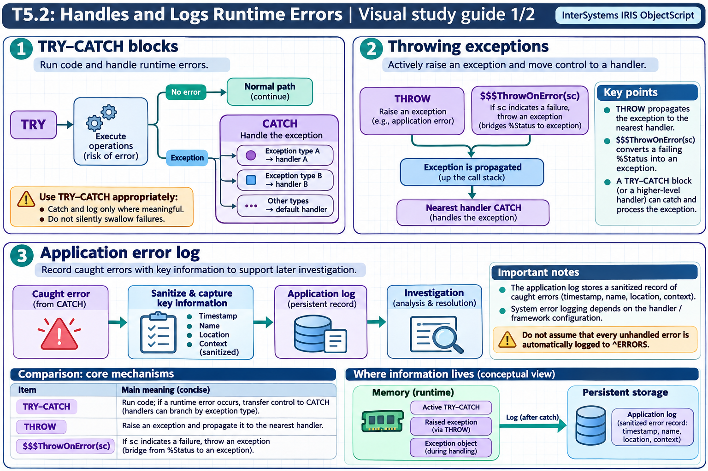

[Topic contents](../index.md) · [Full topic guide](../study.md) · [All topics](../../../index.md)

# T5.2: Handles and Logs Runtime Errors

Saved 2 November 2026 from [exam-prep.es](https://exam-prep.es/exams/objectscript/knowledge/T5.2.html). Reference links require internet access.

## 1. TRY-CATCH blocks



*This diagram covers sections 1–3; use the matching numbered panel for this page.* [Chapter diagrams](../visuals.md) · [Technical review notes](../../../visual-technical-notes.md)

### Key Points

- **TRY block**: Contains protected code that may generate errors
- **CATCH block**: Receives an exception object derived from %Exception.AbstractException
- **Exception properties**: ex.Name (error name), ex.Code (error code), ex.Data (additional data), ex.Location (where error occurred)
- **Multiple CATCH**: Only one CATCH block per TRY; use IF/ELSEIF inside CATCH to handle different error types
- **Nesting**: TRY-CATCH blocks can be nested for granular error handling
- **No stack level**: TRY blocks do not create a new stack level

### Detailed Notes

#### Overview

TRY-CATCH is the recommended error handling mechanism in modern ObjectScript. It provides structured, readable, and maintainable error handling using exception objects that carry detailed information about what went wrong and where.

#### Basic TRY-CATCH Syntax

```objectscript
ClassMethod BasicExample()
{
    TRY {
        // Protected code
        Set x = 1 / 0  // Will cause <DIVIDE> error
        Write "This line never executes", !
    }
    CATCH ex {
        Write "Error: ", ex.Name, !           // <DIVIDE>
        Write "Code: ", ex.Code, !            // Error code
        Write "Location: ", ex.Location, !    // Where it happened
        Write "Data: ", ex.Data, !            // Additional info
    }
    Write "Execution continues here", !
}
```

#### Exception Object Properties and Methods

The CATCH variable is an instance of `%Exception.AbstractException` (or a subclass). Key properties and methods:

```objectscript
ClassMethod ExamineException()
{
    TRY {
        Set ^ReadOnlyGlobal(1) = "test"  // Assuming <PROTECT> error
    }
    CATCH ex {
        // Properties
        Write "Name:     ", ex.Name, !        // Error name (e.g., <PROTECT>)
        Write "Code:     ", ex.Code, !        // Numeric error code
        Write "Location: ", ex.Location, !    // label+offset^routine
        Write "Data:     ", ex.Data, !        // Context-specific data

        // Methods
        Write "Display:  ", ex.DisplayString(), !  // Full formatted string
        Set sc = ex.AsStatus()                     // Convert to %Status
        Write "Status:   ", $SYSTEM.Status.GetErrorText(sc), !

        // As a SQL code
        Write "SQL Code: ", ex.AsSQLCODE(), !
        Write "SQL Msg:  ", ex.AsSQLMessage(), !
    }
}
```

#### Nested TRY-CATCH Blocks

```objectscript
ClassMethod NestedExample()
{
    TRY {
        Write "Outer TRY", !

        TRY {
            Write "Inner TRY", !
            // Generate an error
            Set x = $PIECE("", ",", -1)  // <FUNCTION> error
        }
        CATCH innerEx {
            Write "Inner CATCH: ", innerEx.Name, !
            // Can rethrow to outer CATCH
            If innerEx.Name = "<SERIOUS>" {
                THROW innerEx
            }
            // Otherwise handle it here
        }

        Write "Continues in outer TRY", !
    }
    CATCH outerEx {
        Write "Outer CATCH: ", outerEx.Name, !
    }
}
```

#### Handling Different Error Types Within CATCH

```objectscript
ClassMethod HandleByType()
{
    TRY {
        Do ..RiskyOperation()
    }
    CATCH ex {
        If ex.Name = "<DIVIDE>" {
            Write "Division by zero detected", !
        }
        ElseIf ex.Name = "<UNDEFINED>" {
            Write "Undefined variable: ", ex.Data, !
        }
        ElseIf ex.Name = "<SUBSCRIPT>" {
            Write "Invalid subscript access", !
        }
        Else {
            Write "Unexpected error: ", ex.DisplayString(), !
            // Rethrow unexpected errors
            THROW ex
        }
    }
}
```

### Documentation References

- [The TRY-CATCH Mechanism](https://docs.intersystems.com/irislatest/csp/docbook/DocBook.UI.Page.cls?KEY=GCOS_errors#GCOS_errors_trycatch)
- [TRY Command](https://docs.intersystems.com/irislatest/csp/docbook/DocBook.UI.Page.cls?KEY=RCOS_ctry)
- [CATCH Command](https://docs.intersystems.com/irislatest/csp/docbook/DocBook.UI.Page.cls?KEY=RCOS_ccatch)
- [%Exception.AbstractException](https://docs.intersystems.com/irislatest/csp/documatic/%25CSP.Documatic.cls?LIBRARY=%25SYS&CLASSNAME=%25Exception.AbstractException)
