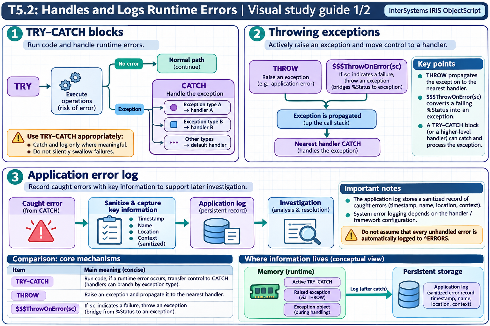

[Topic contents](../index.md) · [Full topic guide](../study.md) · [All topics](../../../index.md)

# T5.2: Handles and Logs Runtime Errors

Saved 2 November 2026 from [exam-prep.es](https://exam-prep.es/exams/objectscript/knowledge/T5.2.html). Reference links require internet access.

## 2. Throwing exceptions



*This diagram covers sections 1–3; use the matching numbered panel for this page.* [Chapter diagrams](../visuals.md) · [Technical review notes](../../../visual-technical-notes.md)

### Key Points

- **THROW command**: Throws an exception object, transferring control to the nearest CATCH block
- **%Exception.General**: General-purpose exception class for user-defined errors
- **$$$ThrowStatus**: Macro that throws an exception created from a %Status value
- **$$$ThrowOnError**: Macro that throws only if the status is an error (does nothing if OK)
- **Custom exception classes**: Can extend %Exception.AbstractException for application-specific errors
- **Rethrow**: Catch an exception and THROW it again to propagate to an outer handler

### Detailed Notes

#### Overview

Throwing exceptions allows you to signal error conditions explicitly, rather than relying only on system-generated errors. This is essential for creating robust applications with clear error boundaries.

#### Throwing %Exception.General

```objectscript
ClassMethod ValidateAge(age As %Integer) As %Status
{
    TRY {
        If age < 0 {
            Throw ##class(%Exception.General).%New(
                "InvalidAge",    // Name
                5001,            // Code (application-defined)
                ,                // Location (auto-filled)
                "Age cannot be negative: " _ age)  // Data
        }
        If age > 150 {
            Throw ##class(%Exception.General).%New(
                "InvalidAge", 5001, , "Unrealistic age: " _ age)
        }
        Write "Age is valid: ", age, !
        Return $$$OK
    }
    CATCH ex {
        Write "Validation error: ", ex.Name, !
        Write "Details: ", ex.Data, !
        Return ex.AsStatus()
    }
}
```

#### Using $$$ThrowStatus Macro

The `$$$ThrowStatus` macro converts a `%Status` value into an exception and throws it. This is essential for bridging status-based code and exception-based code.

```objectscript
Include %occStatus

ClassMethod SaveRecord() As %Status
{
    TRY {
        Set obj = ##class(MyApp.Person).%New()
        Set obj.Name = "John Doe"
        Set sc = obj.%Save()

        // If sc is an error, throw it as an exception
        $$$ThrowOnError(sc)

        Write "Saved successfully with ID: ", obj.%Id(), !
        Return $$$OK
    }
    CATCH ex {
        Write "Save failed: ", ex.DisplayString(), !
        Return ex.AsStatus()
    }
}
```

#### $$$ThrowOnError vs $$$ThrowStatus

```objectscript
Include %occStatus

ClassMethod CompareThrowMacros()
{
    TRY {
        Set sc = $$$OK

        // $$$ThrowOnError: Only throws if sc is an error
        // Does NOTHING if sc is $$$OK -- safe to use always
        $$$ThrowOnError(sc)   // No effect, sc is OK

        Set sc = $$$ERROR($$$GeneralError, "Something went wrong")

        // $$$ThrowStatus: ALWAYS throws, even if sc is OK
        // Use this only when you KNOW sc is an error
        // $$$ThrowStatus(sc)  // Would always throw

        // $$$ThrowOnError: Throws because sc is now an error
        $$$ThrowOnError(sc)   // This throws!

        Write "Never reached", !
    }
    CATCH ex {
        Write "Caught: ", ex.DisplayString(), !
    }
}
```

#### Rethrowing Exceptions

```objectscript
ClassMethod OuterMethod()
{
    TRY {
        Do ..InnerMethod()
    }
    CATCH ex {
        Write "Final handler: ", ex.DisplayString(), !
    }
}

ClassMethod InnerMethod() [ Private ]
{
    TRY {
        // Some risky operation
        Set value = $LISTGET($LISTBUILD(), 5)
    }
    CATCH ex {
        // Log the error
        Set ^ErrorLog($INCREMENT(^ErrorLog)) = ex.DisplayString()
        // Rethrow to let caller handle it
        THROW ex
    }
}
```

### Documentation References

- [THROW Command](https://docs.intersystems.com/irislatest/csp/docbook/DocBook.UI.Page.cls?KEY=RCOS_cthrow)
- [%Exception.General](https://docs.intersystems.com/irislatest/csp/documatic/%25CSP.Documatic.cls?LIBRARY=%25SYS&CLASSNAME=%25Exception.General)
- [%Exception.StatusException](https://docs.intersystems.com/irislatest/csp/documatic/%25CSP.Documatic.cls?LIBRARY=%25SYS&CLASSNAME=%25Exception.StatusException)
- [Error Handling Macros](https://docs.intersystems.com/irislatest/csp/docbook/DocBook.UI.Page.cls?KEY=GCOS_errors)
