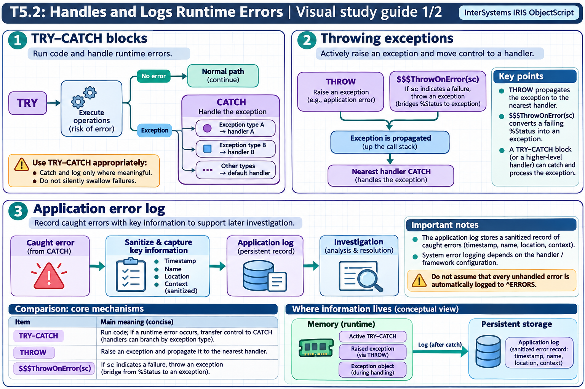

[Topic contents](../index.md) · [Full topic guide](../study.md) · [All topics](../../../index.md)

# T5.2: Handles and Logs Runtime Errors

Saved 2 November 2026 from [exam-prep.es](https://exam-prep.es/exams/objectscript/knowledge/T5.2.html). Reference links require internet access.

## 3. Application error log



*This diagram covers sections 1–3; use the matching numbered panel for this page.* [Chapter diagrams](../visuals.md) · [Technical review notes](../../../visual-technical-notes.md)

### Key Points

- **^ERRORS global**: System global that stores application errors automatically when unhandled errors occur
- **$SYSTEM.OBJ.DisplayError()**: Displays human-readable error text from a %Status value
- **Management Portal**: Application Error Log viewer at System Operation &gt; System Logs &gt; Application Error Log
- **Error structure**: ^ERRORS stores error name, location, stack trace, variables, and timestamp
- **^%ERN**: Counter global tracking the number of errors per namespace
- **Custom logging**: Best practice is to supplement system logging with application-specific error logs

### Detailed Notes

#### Overview

InterSystems IRIS automatically logs unhandled errors in the `^ERRORS` global. Additionally, developers should implement structured error logging within their applications for comprehensive diagnostics.

#### The ^ERRORS Global

When an unhandled error occurs (no TRY-CATCH or $ZTRAP in effect), IRIS logs the error in the `^ERRORS` global in the current namespace. The structure contains:

```objectscript
// Viewing the error log from Terminal
ZWrite ^ERRORS

// Structure of ^ERRORS:
// ^ERRORS(date, index) = errorName
// ^ERRORS(date, index, "m") = stack trace details
// where date is in $HOROLOG format and index is sequential
```

#### Management Portal Application Error Log

Navigate to **System Operation &gt; System Logs &gt; Application Error Log** to view a formatted table of application errors. This page shows:

- Date and time of each error
- Error name (e.g., `<UNDEFINED>`, `<SUBSCRIPT>`)
- Location where the error occurred
- Namespace where the error happened
- Process ID and username

#### Using $SYSTEM.Status Methods for Error Display

```objectscript
Include %occStatus

ClassMethod DemonstrateErrorDisplay()
{
    // Create an error status
    Set sc = $$$ERROR($$$GeneralError, "Database connection failed")

    // DisplayError - writes to current device
    Do $SYSTEM.Status.DisplayError(sc)
    // Output: ERROR #5001: Database connection failed

    // GetErrorText - returns error as a string
    Set errorText = $SYSTEM.Status.GetErrorText(sc)
    Write "Error text: ", errorText, !

    // For multi-status errors, get individual components
    Set sc2 = $$$ERROR($$$GeneralError, "Additional problem")
    Set combinedSc = $SYSTEM.Status.AppendStatus(sc, sc2)

    // GetOneStatusText gets a specific error from a compound status
    Set firstError = $SYSTEM.Status.GetOneStatusText(combinedSc, 1)
    Set secondError = $SYSTEM.Status.GetOneStatusText(combinedSc, 2)
    Write "First:  ", firstError, !
    Write "Second: ", secondError, !
}
```

#### Logging Exceptions to the Application Error Log

The simplest way to log a caught exception to `^ERRORS` (viewable in the Management Portal and via `Do ^%ER`) is to call the `.Log()` method on the exception object:

```objectscript
TRY {
    // Business logic
    Set result = 100 / 0
}
CATCH ex {
    // Log to ^ERRORS (calls LOG^%ETN internally)
    Do ex.Log()
    // Continue with error handling...
    Return ex.AsStatus()
}
```

The `%Exception.AbstractException.Log()` method calls `LOG^%ETN` to record the exception in the system error log. You can then view logged errors:

- **Terminal**: `Do ^%ER` utility
- **Management Portal**: System Operation &gt; System Logs &gt; Application Error Log

This is the recommended approach for logging caught exceptions, since unhandled exceptions are logged automatically but caught exceptions are not unless you explicitly call `.Log()`.

#### Building a Custom Application Error Log

```objectscript
ClassMethod LogError(
    className As %String,
    methodName As %String,
    ex As %Exception.AbstractException)
{
    Set timestamp = $ZDATETIME($HOROLOG, 3)
    Set key = $INCREMENT(^MyApp.ErrorLog)

    Set ^MyApp.ErrorLog(key, "timestamp") = timestamp
    Set ^MyApp.ErrorLog(key, "class") = className
    Set ^MyApp.ErrorLog(key, "method") = methodName
    Set ^MyApp.ErrorLog(key, "error") = ex.DisplayString()
    Set ^MyApp.ErrorLog(key, "name") = ex.Name
    Set ^MyApp.ErrorLog(key, "code") = ex.Code
    Set ^MyApp.ErrorLog(key, "location") = ex.Location
    Set ^MyApp.ErrorLog(key, "data") = ex.Data

    // Also log the stack trace
    For level = 0:1:$STACK(-1) {
        Set ^MyApp.ErrorLog(key, "stack", level) =
            $STACK(level, "PLACE") _ " : " _ $STACK(level, "MCODE")
    }
}

ClassMethod ProcessData()
{
    TRY {
        // Business logic here
        Set result = 100 / 0
    }
    CATCH ex {
        Do ..LogError("MyApp.Processor", "ProcessData", ex)
        // Optionally rethrow or return error status
        Return ex.AsStatus()
    }
}
```

### Documentation References

- [Application Error Log](https://docs.intersystems.com/irislatest/csp/docbook/DocBook.UI.Page.cls?KEY=GCM_monitor)
- [%SYSTEM.Status Class](https://docs.intersystems.com/irislatest/csp/documatic/%25CSP.Documatic.cls?LIBRARY=%25SYS&CLASSNAME=%25SYSTEM.Status)
- [$SYSTEM.OBJ.DisplayError](https://docs.intersystems.com/irislatest/csp/docbook/DocBook.UI.Page.cls?KEY=RERR_gen)
