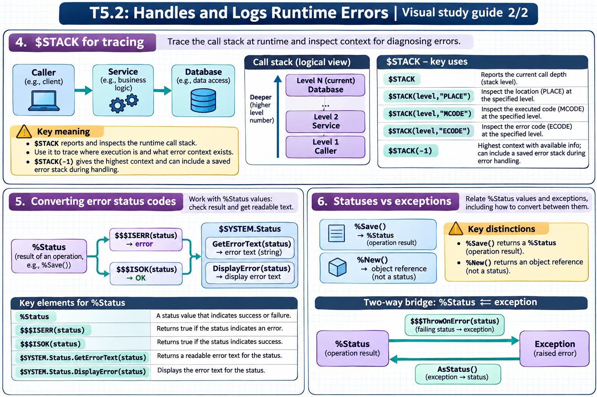

[Topic contents](../index.md) · [Full topic guide](../study.md) · [All topics](../../../index.md)

# T5.2: Handles and Logs Runtime Errors

Saved 2 November 2026 from [exam-prep.es](https://exam-prep.es/exams/objectscript/knowledge/T5.2.html). Reference links require internet access.

## 4. $STACK for tracing



*This diagram covers sections 4–6; use the matching numbered panel for this page.* [Chapter diagrams](../visuals.md) · [Technical review notes](../../../visual-technical-notes.md)

### Key Points

- **$STACK(-1)**: Returns the current stack depth (number of levels on the execution stack)
- **$STACK(level, "PLACE")**: Returns the location (label+offset^routine) at the specified stack level
- **$STACK(level, "MCODE")**: Returns the actual source code at the specified stack level
- **$STACK(level, "ECODE")**: Returns the error code at a given level (if an error occurred there)
- **Loop pattern**: Loop from 0 to $STACK(-1) to dump the full call stack
- **Diagnostic use**: Essential for understanding call chains during error handling

### Detailed Notes

#### Overview

The `$STACK` special variable provides programmatic access to the execution call stack. During error handling, `$STACK` lets you capture a complete trace of the call chain that led to the error, which is invaluable for debugging.

#### Basic $STACK Usage

```objectscript
ClassMethod ShowStack()
{
    Write "Current stack depth: ", $STACK(-1), !
    Write !
    For level = 0:1:$STACK(-1) {
        Write "Level ", level, ": "
        Write $STACK(level, "PLACE")
        Write !
    }
}
```

#### Full Stack Dump During Error Handling

```objectscript
ClassMethod MethodA()
{
    TRY {
        Do ..MethodB()
    }
    CATCH ex {
        Write "Error: ", ex.DisplayString(), !
        Write "--- Stack Trace ---", !
        Do ..DumpStack()
    }
}

ClassMethod MethodB() [ Private ]
{
    Do ..MethodC()
}

ClassMethod MethodC() [ Private ]
{
    // Cause an error
    Set x = undefinedVariable  // <UNDEFINED> error
}

ClassMethod DumpStack()
{
    Set depth = $STACK(-1)
    Write "Stack depth: ", depth, !
    For level = 0:1:depth {
        Write "  Level ", level, ":", !
        Write "    PLACE: ", $STACK(level, "PLACE"), !
        Write "    MCODE: ", $STACK(level, "MCODE"), !
        Set ecode = $STACK(level, "ECODE")
        If ecode '= "" {
            Write "    ECODE: ", ecode, !
        }
    }
}
```

Output would look like:

```text
Error: <UNDEFINED>zMethodC+1^MyApp.Debug.1 *undefinedVariable
--- Stack Trace ---
Stack depth: 3
  Level 0:
    PLACE: +1^MyApp.Debug.1
    MCODE: Do ..MethodB()
  Level 1:
    PLACE: zMethodB+1^MyApp.Debug.1
    MCODE: Do ..MethodC()
  Level 2:
    PLACE: zMethodC+1^MyApp.Debug.1
    MCODE: Set x = undefinedVariable
    ECODE: <UNDEFINED>
```

#### $STACK Parameters Reference

| Syntax | Returns |
| --- | --- |
| `$STACK(-1)` | Current stack depth (integer) |
| `$STACK(n, "PLACE")` | Location at level n (label+offset^routine) |
| `$STACK(n, "MCODE")` | Source code at level n |
| `$STACK(n, "ECODE")` | Error code at level n (empty if no error) |

#### Integrating $STACK with Error Logging

```objectscript
ClassMethod CaptureStackTrace() As %String
{
    Set trace = ""
    Set depth = $STACK(-1)
    For level = 0:1:depth {
        Set line = "Level " _ level _ ": "
        Set line = line _ $STACK(level, "PLACE")
        Set mcode = $STACK(level, "MCODE")
        If mcode '= "" {
            Set line = line _ " [" _ mcode _ "]"
        }
        Set trace = trace _ line _ $CHAR(10)
    }
    Return trace
}

ClassMethod HandleError()
{
    TRY {
        Do ..SomeOperation()
    }
    CATCH ex {
        Set stackTrace = ..CaptureStackTrace()
        // Store in error log global
        Set key = $INCREMENT(^ErrorLog)
        Set ^ErrorLog(key) = ex.DisplayString()
        Set ^ErrorLog(key, "stack") = stackTrace
        Set ^ErrorLog(key, "time") = $ZDATETIME($HOROLOG, 3)
    }
}
```

### Documentation References

- [$STACK Special Variable](https://docs.intersystems.com/irislatest/csp/docbook/DocBook.UI.Page.cls?KEY=RCOS_vstack)
- [Error Processing Context](https://docs.intersystems.com/irislatest/csp/docbook/DocBook.UI.Page.cls?KEY=GCOS_errors#GCOS_errors_context)
