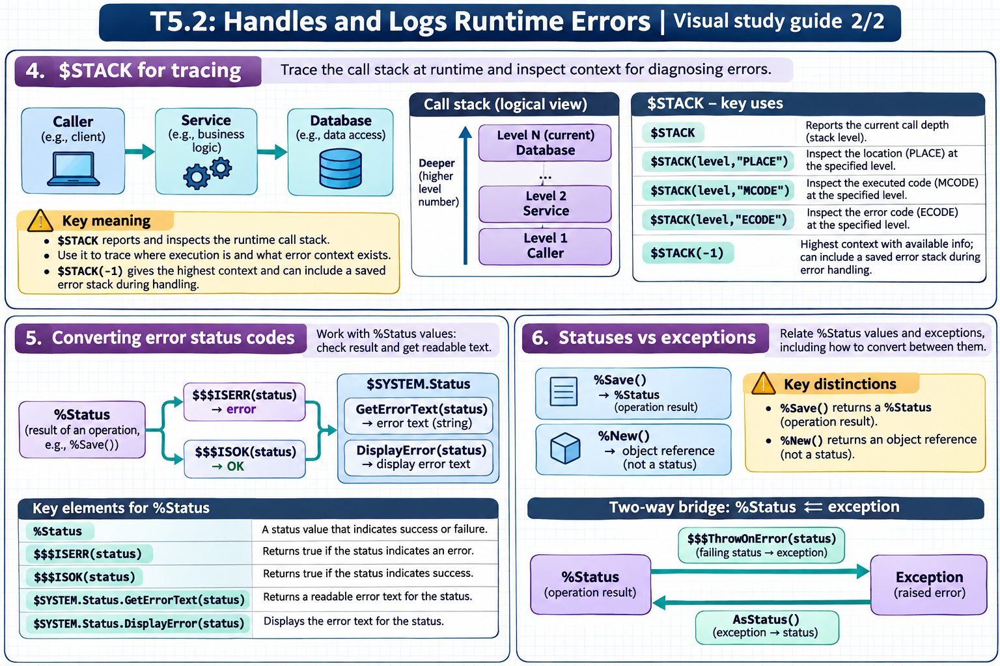

[Topic contents](../index.md) · [Full topic guide](../study.md) · [All topics](../../../index.md)

# T5.2: Handles and Logs Runtime Errors

Saved 2 November 2026 from [exam-prep.es](https://exam-prep.es/exams/objectscript/knowledge/T5.2.html). Reference links require internet access.

## 5. Converting error status codes



*This diagram covers sections 4–6; use the matching numbered panel for this page.* [Chapter diagrams](../visuals.md) · [Technical review notes](../../../visual-technical-notes.md)

### Key Points

- **$$$ISERR(sc)**: Macro that returns true (1) if the status represents an error
- **$$$ISOK(sc)**: Macro that returns true (1) if the status represents success
- **$SYSTEM.Status.GetErrorText(sc)**: Returns a human-readable error string
- **$SYSTEM.Status.DisplayError(sc)**: Writes the error text to the current device
- **$SYSTEM.Status.GetOneStatusText(sc, n)**: Returns the nth error from a compound status
- **$$$ERROR()**: Macro to create a new error %Status value with a specific error code and message

### Detailed Notes

#### Overview

`%Status` is a fundamental data type in InterSystems IRIS used throughout the class library to indicate success or failure of operations. Methods like `%Save()`, `%New()`, `%Open()`, and many others return `%Status` values. Understanding how to test, display, and create status values is essential.

#### Testing Status Values

```objectscript
Include %occStatus

ClassMethod TestStatus()
{
    Set obj = ##class(Sample.Person).%New()
    Set obj.Name = "Test Person"
    Set sc = obj.%Save()

    // Test if the operation succeeded
    If $$$ISOK(sc) {
        Write "Save succeeded, ID: ", obj.%Id(), !
    }

    // Test if the operation failed
    If $$$ISERR(sc) {
        Write "Save failed!", !
    }

    // IMPORTANT: Never compare %Status directly to 1 or 0
    // WRONG: If sc = 1 { ... }
    // RIGHT: If $$$ISOK(sc) { ... }
}
```

#### Displaying and Extracting Error Text

```objectscript
Include %occStatus

ClassMethod DisplayStatusExamples()
{
    // Create an error status for demonstration
    Set sc = $$$ERROR($$$GeneralError, "Connection timeout after 30 seconds")

    // Method 1: Display to current device
    Do $SYSTEM.Status.DisplayError(sc)
    // Output: ERROR #5001: Connection timeout after 30 seconds

    // Method 2: Get as a string (for logging, display elsewhere)
    Set text = $SYSTEM.Status.GetErrorText(sc)
    Write "Error: ", text, !

    // Method 3: Compound status with multiple errors
    Set sc1 = $$$ERROR($$$GeneralError, "First error")
    Set sc2 = $$$ERROR($$$GeneralError, "Second error")
    Set combined = $SYSTEM.Status.AppendStatus(sc1, sc2)

    // Get individual error messages
    Set first = $SYSTEM.Status.GetOneStatusText(combined, 1)
    Set second = $SYSTEM.Status.GetOneStatusText(combined, 2)
    Write "Error 1: ", first, !
    Write "Error 2: ", second, !

    // Get count of errors
    Set count = $SYSTEM.Status.GetErrorCodes(combined)
    Write "Total errors: ", count, !
}
```

#### Creating Error Status Values

```objectscript
Include (%occStatus, %occErrors)

ClassMethod CreateErrors()
{
    // General error with custom message
    Set sc = $$$ERROR($$$GeneralError, "Custom error message")

    // Error with specific error code
    Set sc = $$$ERROR($$$InvalidArgument, "paramName")

    // Compound status: append multiple errors
    Set sc = $$$OK
    If 'condition1 {
        Set sc = $SYSTEM.Status.AppendStatus(sc,
            $$$ERROR($$$GeneralError, "Condition 1 failed"))
    }
    If 'condition2 {
        Set sc = $SYSTEM.Status.AppendStatus(sc,
            $$$ERROR($$$GeneralError, "Condition 2 failed"))
    }

    Return sc  // Contains all accumulated errors
}
```

#### Common Pattern: Checking Return Status

```objectscript
Include %occStatus

ClassMethod RobustSave() As %Status
{
    Set sc = $$$OK

    Set obj = ##class(MyApp.Data).%New()
    Set obj.Field1 = "value1"

    Set sc = obj.%Save()
    If $$$ISERR(sc) {
        // Log and return
        Do $SYSTEM.Status.DisplayError(sc)
        Return sc
    }

    // Continue with more operations
    Set sc = ..AdditionalProcessing(obj.%Id())
    If $$$ISERR(sc) Return sc

    Return $$$OK
}
```

### Documentation References

- [%Status Values](https://docs.intersystems.com/irislatest/csp/docbook/DocBook.UI.Page.cls?KEY=GCOS_errors#GCOS_errors_status)
- [%SYSTEM.Status Class](https://docs.intersystems.com/irislatest/csp/documatic/%25CSP.Documatic.cls?LIBRARY=%25SYS&CLASSNAME=%25SYSTEM.Status)
- [Status Macros](https://docs.intersystems.com/irislatest/csp/docbook/DocBook.UI.Page.cls?KEY=GCOS_errors#GCOS_errors_macros)
