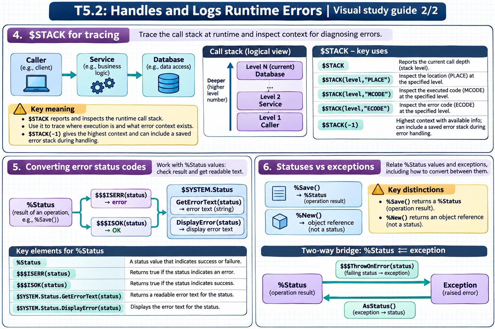

[Topic contents](../index.md) · [Full topic guide](../study.md) · [All topics](../../../index.md)

# T5.2: Handles and Logs Runtime Errors

Saved 2 November 2026 from [exam-prep.es](https://exam-prep.es/exams/objectscript/knowledge/T5.2.html). Reference links require internet access.

## 6. Statuses vs exceptions



*This diagram covers sections 4–6; use the matching numbered panel for this page.* [Chapter diagrams](../visuals.md) · [Technical review notes](../../../visual-technical-notes.md)

### Key Points

- **%Status pattern**: Methods return %Status, caller checks with $$$ISERR/$$$ISOK -- used by %Save, %New, %Open
- **Exception pattern**: Errors thrown as exceptions, caught by TRY-CATCH -- used for system errors and explicit THROW
- **$$$ThrowOnError(sc)**: Converts a %Status error into an exception (bridge from status to exception world)
- **ex.AsStatus()**: Converts an exception back to a %Status value (bridge from exception to status world)
- **%Exception.StatusException**: Exception subclass created from a %Status value
- **Mixing patterns**: Common to use exceptions internally but return %Status to callers

### Detailed Notes

#### Overview

InterSystems IRIS uses two distinct error signaling patterns: `%Status` return values and exceptions. The `%Status` pattern is pervasive in the class library (e.g., `%Save()`, `%Open()`), while exceptions are used for runtime errors and modern structured error handling. Real-world code must bridge both patterns fluently.

#### The %Status Pattern

```objectscript
Include %occStatus

/// Pure %Status style - check every return value
ClassMethod StatusStyle() As %Status
{
    Set sc = $$$OK

    Set obj = ##class(MyApp.Person).%New()
    Set obj.Name = "Test"

    // %Save returns %Status
    Set sc = obj.%Save()
    If $$$ISERR(sc) {
        Do $SYSTEM.Status.DisplayError(sc)
        Return sc
    }

    // %OpenId returns object or "" (with status in second arg)
    Set obj2 = ##class(MyApp.Person).%OpenId(999, , .sc)
    If $$$ISERR(sc) {
        Return sc
    }

    Return $$$OK
}
```

#### The Exception Pattern

```objectscript
/// Pure exception style - everything in TRY-CATCH
ClassMethod ExceptionStyle()
{
    TRY {
        Set x = 100 / 0           // <DIVIDE> - system exception
        Set ^data(1) = "value"    // <PROTECT> - system exception
    }
    CATCH ex {
        Write "Caught: ", ex.DisplayString(), !
    }
}
```

#### Converting %Status to Exception with $$$ThrowOnError

```objectscript
Include %occStatus

/// Recommended hybrid: Use exceptions internally, return %Status
ClassMethod RecommendedPattern() As %Status
{
    TRY {
        Set obj = ##class(MyApp.Person).%New()
        Set obj.Name = "Test"

        // %Save returns %Status -- convert to exception if error
        Set sc = obj.%Save()
        $$$ThrowOnError(sc)

        // %OpenId with status -- convert to exception if error
        Set obj2 = ##class(MyApp.Person).%OpenId(42, , .sc)
        $$$ThrowOnError(sc)

        // Now both system errors AND status errors are
        // caught by the same CATCH block
        Set result = obj2.Name _ " processed"

        Return $$$OK
    }
    CATCH ex {
        // Single error handling point
        // Convert exception back to %Status for the caller
        Return ex.AsStatus()
    }
}
```

#### Converting Exception to %Status

```objectscript
Include %occStatus

ClassMethod ExceptionToStatus() As %Status
{
    TRY {
        // Some operation that may throw
        Do ..RiskyOperation()
        Return $$$OK
    }
    CATCH ex {
        // ex.AsStatus() converts any exception to %Status
        Return ex.AsStatus()
    }
}
```

#### Creating Exception from %Status (Explicitly)

```objectscript
Include %occStatus

ClassMethod CreateStatusException()
{
    Set sc = $$$ERROR($$$GeneralError, "Something failed")

    // Create an exception from a status (without throwing)
    Set ex = ##class(%Exception.StatusException).CreateFromStatus(sc)

    // Now you have an exception object you can inspect
    Write "Name: ", ex.Name, !
    Write "Code: ", ex.Code, !
    Write "Display: ", ex.DisplayString(), !

    // Or throw it
    // THROW ex
}
```

#### Side-by-Side Comparison

```objectscript
Include %occStatus

/// Side-by-side: same logic, different patterns
ClassMethod ComparePatterns()
{
    // ===== STATUS PATTERN =====
    Set sc = ..DoWork1()
    If $$$ISERR(sc) {
        Set sc2 = ..DoCleanup()
        If $$$ISERR(sc2) {
            // Compound error - append
            Set sc = $SYSTEM.Status.AppendStatus(sc, sc2)
        }
        Do $SYSTEM.Status.DisplayError(sc)
        Quit
    }

    // ===== EXCEPTION PATTERN =====
    TRY {
        Do ..DoWork2()
    }
    CATCH ex {
        TRY {
            Do ..DoCleanup()
        }
        CATCH cleanupEx {
            // Log cleanup failure too
        }
        Write ex.DisplayString(), !
    }
}
```

#### The Standard Method Template

```objectscript
Include %occStatus

/// This is the standard recommended pattern for methods
/// that need to return %Status
ClassMethod StandardTemplate(input As %String) As %Status
{
    TRY {
        // Validate input
        If input = "" {
            $$$ThrowStatus($$$ERROR($$$GeneralError, "Input required"))
        }

        // Call methods that return %Status
        Set sc = ..Step1(input)
        $$$ThrowOnError(sc)

        Set sc = ..Step2(input)
        $$$ThrowOnError(sc)

        // Any system error (<UNDEFINED>, <SUBSCRIPT>, etc.)
        // is also caught automatically

        Return $$$OK
    }
    CATCH ex {
        Return ex.AsStatus()
    }
}
```

### Documentation References

- [Error Handling Overview](https://docs.intersystems.com/irislatest/csp/docbook/DocBook.UI.Page.cls?KEY=GCOS_errors)
- [%Exception.StatusException](https://docs.intersystems.com/irislatest/csp/documatic/%25CSP.Documatic.cls?LIBRARY=%25SYS&CLASSNAME=%25Exception.StatusException)
- [%Exception.AbstractException](https://docs.intersystems.com/irislatest/csp/documatic/%25CSP.Documatic.cls?LIBRARY=%25SYS&CLASSNAME=%25Exception.AbstractException)
- [Status Macros and Methods](https://docs.intersystems.com/irislatest/csp/docbook/DocBook.UI.Page.cls?KEY=GCOS_errors#GCOS_errors_status)
