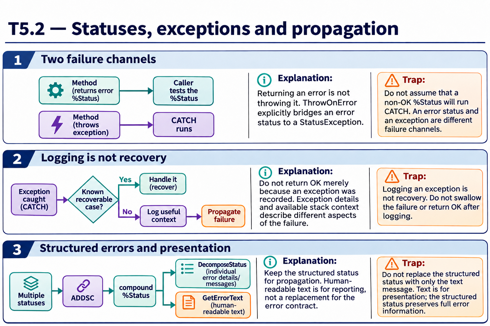

# T5.2 · 01 — Uno status di errore non salta da solo nel CATCH

[Indice degli approfondimenti](README.md) · [Quiz originale](../quiz.md) · [Teoria](../study.md)

**Esercizi di partenza:** [Q2](../quiz.md#question-2-single) · [Q4](../quiz.md#question-4-single) · [Q6](../quiz.md#question-6-multiple) · [Q7](../quiz.md#question-7-single) · [Q9](../quiz.md#question-9-multiple) · [Q11](../quiz.md#question-11-multiple) · [Q16](../quiz.md#question-16-single). L’approfondimento rielabora il concetto e aggiunge una variante; non riproduce soltanto la risposta del quiz.

## Il caso concreto

Step1 restituisce un %Status di errore dentro TRY. Il chiamante può restituirlo subito oppure convertirlo in un’eccezione.

## Ragionamento passo per passo

TRY intercetta eccezioni, non ogni valore che rappresenta un fallimento. Se il codice esegue IF $$$ISERR(sc) RETURN sc, termina normalmente con uno status d’errore e non entra nel CATCH. Una conversione esplicita con le API/macro previste permette invece di usare il percorso delle eccezioni.

## Perché il distrattore è plausibile

Considerare TRY una verifica automatica di tutti i valori restituiti o confondere $$$ISERR con un comando che lancia errori.

## Lo spunto da portare oltre l’esercizio

Scegli un contratto e rendi esplicite le conversioni al confine fra status ed eccezioni.

*Leggi il pannello 1; gli altri due collegano il caso agli altri approfondimenti del capitolo.*

## Variante: prova prima di leggere la soluzione

Un metodo restituisce sc di errore senza THROW. Il solo fatto che sia in TRY garantisce il CATCH?

Soluzione ragionata

No.

## Riferimenti e precisazioni

- [%Status](https://docs.intersystems.com/irislatest/csp/docbook/DocBook.UI.Page.cls?KEY=GCOS_status)
- [$STACK](https://docs.intersystems.com/irislatest/csp/docbook/DocBook.UI.Page.cls?KEY=RCOS_fstack)
- [TRY/CATCH](https://docs.intersystems.com/irislatest/csp/docbook/DocBook.UI.Page.cls?KEY=RCOS_ctrycatch)

[Note specifiche del capitolo](README.md#precisazioni-rispetto-al-quiz) · [Metodo e limiti della revisione](../../../approfondimenti-esercizi.md#metodo-e-limiti)
