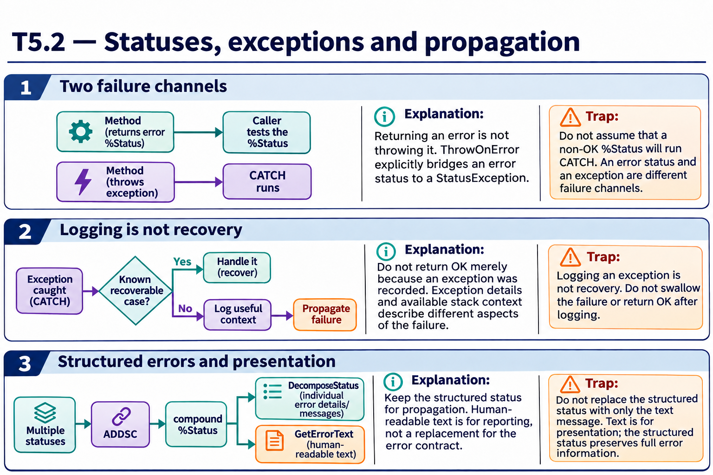

# T5.2 · 02 — Conservare contesto senza inghiottire l’errore

[Indice degli approfondimenti](README.md) · [Quiz originale](../quiz.md) · [Teoria](../study.md)

**Esercizi di partenza:** [Q1](../quiz.md#question-1-single) · [Q5](../quiz.md#question-5-single) · [Q8](../quiz.md#question-8-single) · [Q10](../quiz.md#question-10-single) · [Q12](../quiz.md#question-12-single) · [Q13](../quiz.md#question-13-multiple) · [Q17](../quiz.md#question-17-multiple) · [Q18](../quiz.md#question-18-single). L’approfondimento rielabora il concetto e aggiunge una variante; non riproduce soltanto la risposta del quiz.

## Il caso concreto

Il gestore vuole registrare il fallimento e poi lasciare al chiamante la decisione finale.

```objectscript
try {
  ; operazione che può lanciare un’eccezione
} catch ex {
  ; registrare nome, posizione e contesto utile
  throw ex
}
```

## Ragionamento passo per passo

Rilanciare lo stesso oggetto mantiene le informazioni dell’eccezione meglio che restituire sempre un generico successo. Messaggio, Location, identità del lavoro e stack disponibile rispondono a domande diverse. Evita di registrare dati sensibili non necessari. Per lo stack scegli esplicitamente contesto corrente o informazioni d’errore disponibili.

## Perché il distrattore è plausibile

Catturare tutto e continuare come se il risultato fosse valido, oppure sostituire la causa originale con un messaggio senza posizione.

## Lo spunto da portare oltre l’esercizio

Un log utile accompagna la propagazione; non la sostituisce implicitamente.



*Leggi il pannello 2; gli altri due collegano il caso agli altri approfondimenti del capitolo.*

## Variante: prova prima di leggere la soluzione

Hai loggato l’errore ma restituisci OK. Il chiamante può distinguere il lavoro fallito da quello completato?

<details>
<summary>Soluzione ragionata</summary>

No: il contratto gli comunica successo, a meno che esista un altro canale esplicito.

</details>

## Riferimenti e precisazioni

- [%Status](https://docs.intersystems.com/irislatest/csp/docbook/DocBook.UI.Page.cls?KEY=GCOS_status)
- [$STACK](https://docs.intersystems.com/irislatest/csp/docbook/DocBook.UI.Page.cls?KEY=RCOS_fstack)
- [TRY/CATCH](https://docs.intersystems.com/irislatest/csp/docbook/DocBook.UI.Page.cls?KEY=RCOS_ctrycatch)

[Note specifiche del capitolo](README.md#precisazioni-rispetto-al-quiz) · [Metodo e limiti della revisione](../../../approfondimenti-esercizi.md#metodo-e-limiti)
