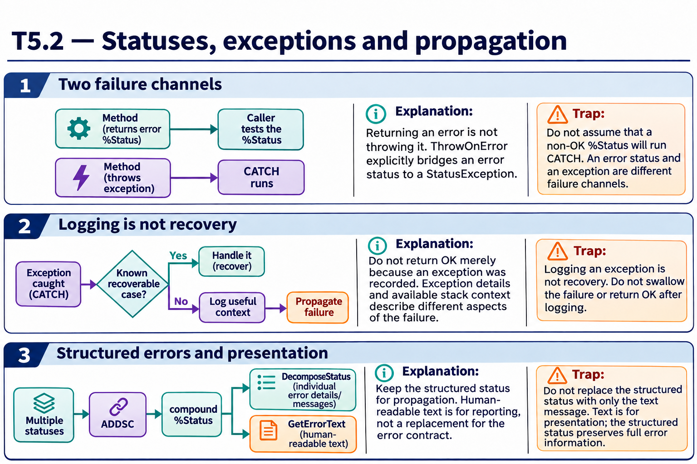

# T5.2 · 03 — Un errore composto richiede una rappresentazione strutturata

[Indice degli approfondimenti](README.md) · [Quiz originale](../quiz.md) · [Teoria](../study.md)

**Esercizi di partenza:** [Q3](../quiz.md#question-3-single) · [Q14](../quiz.md#question-14-single) · [Q15](../quiz.md#question-15-single). L’approfondimento rielabora il concetto e aggiunge una variante; non riproduce soltanto la risposta del quiz.

## Il caso concreto

La validazione raccoglie più problemi. %Status non va trattato come una frase singola da concatenare a mano.

## Ragionamento passo per passo

Usa le API di composizione e decomposizione degli status per conservare i singoli errori. Per mostrare all’utente usa la conversione in testo prevista; per prendere decisioni mantieni il risultato strutturato. L’oggetto restituito da %New e lo status di %Save appartengono ancora a canali differenti.

## Perché il distrattore è plausibile

Concatenare testi e poi provare a ricavarne affidabilmente codici e campi, oppure accedere a una proprietà di un oref vuoto.

## Lo spunto da portare oltre l’esercizio

Separare formato macchina, presentazione e validità del riferimento evita errori secondari che mascherano il primo.

*Leggi il pannello 3; gli altri due collegano il caso agli altri approfondimenti del capitolo.*

## Variante: prova prima di leggere la soluzione

Due vincoli falliscono. È sufficiente mostrare solo l’ultima stringa di errore ignorando il primo?

Soluzione ragionata

No, se il contratto richiede una validazione completa: conserva e presenta entrambi in modo strutturato.

## Riferimenti e precisazioni

- [%Status](https://docs.intersystems.com/irislatest/csp/docbook/DocBook.UI.Page.cls?KEY=GCOS_status)
- [$STACK](https://docs.intersystems.com/irislatest/csp/docbook/DocBook.UI.Page.cls?KEY=RCOS_fstack)
- [TRY/CATCH](https://docs.intersystems.com/irislatest/csp/docbook/DocBook.UI.Page.cls?KEY=RCOS_ctrycatch)

[Note specifiche del capitolo](README.md#precisazioni-rispetto-al-quiz) · [Metodo e limiti della revisione](../../../approfondimenti-esercizi.md#metodo-e-limiti)
