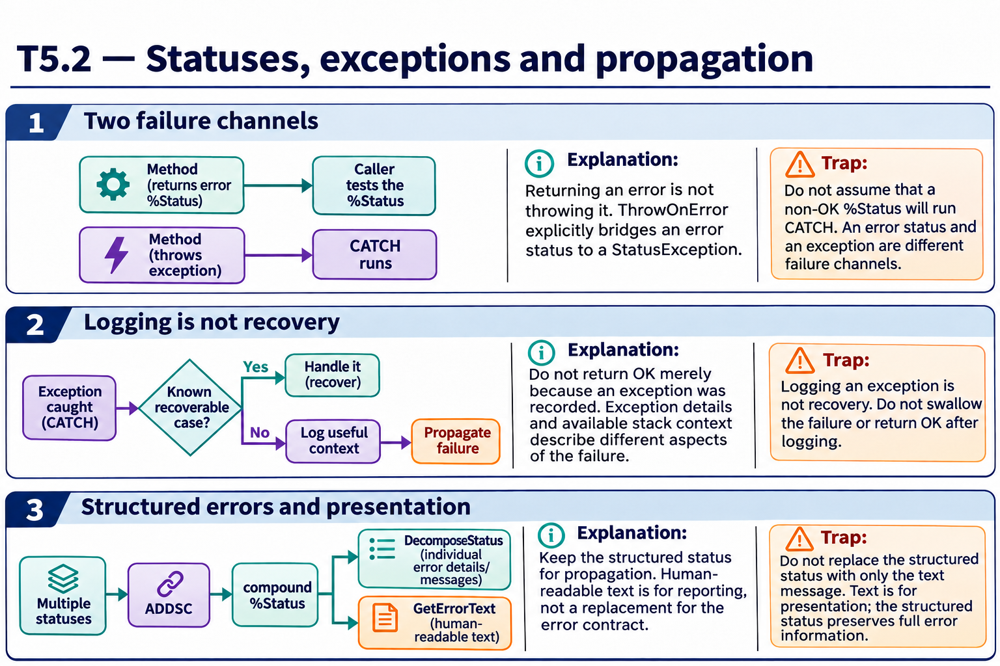
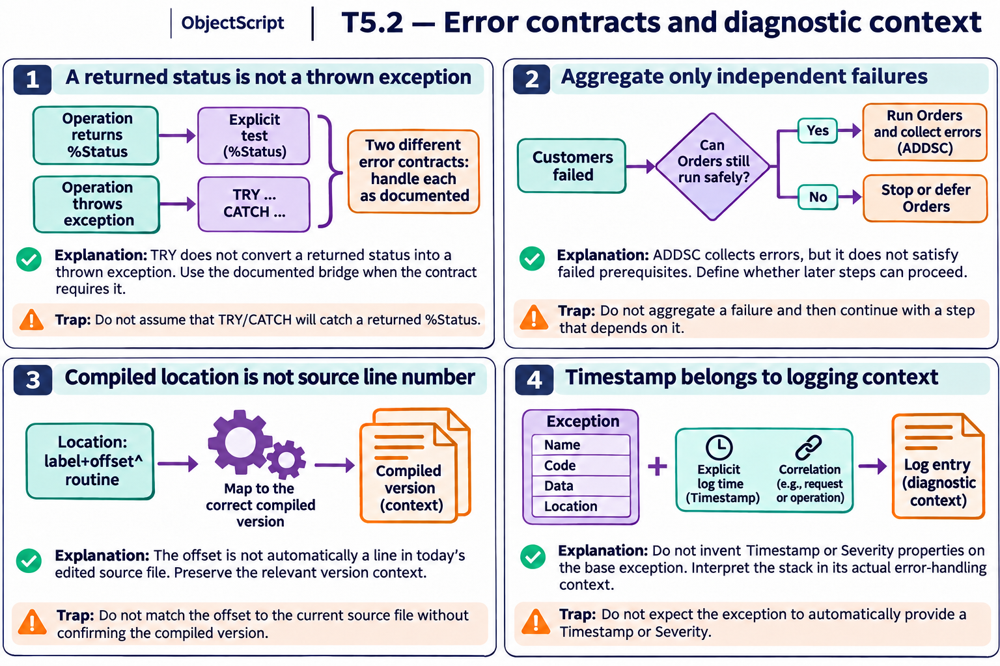

# T5.2 — Approfondimenti dagli esercizi

## Tutte le 18 domande approfondite

[Apri le schede domanda per domanda](<Domanda per domanda/README.md>) · [Tavole spiegate in inglese](tavole-esercizi.md)

Ogni domanda dispone ora di un commento specifico, un concetto ulteriore e una variante con soluzione. I tre casi seguenti sono percorsi tematici aggiuntivi. Le immagini sono in inglese.

[Teoria](../study.md) · [Quiz](../quiz.md) · [Tutti gli approfondimenti](../../../approfondimenti-esercizi.md)

Tre percorsi trasversali, da affiancare alle schede individuali, per capire il meccanismo dietro le risposte: scenario, ragionamento, distrattore, regola riutilizzabile e variante con soluzione. I riferimenti Q rimandano al quiz scaricato; la numerazione è locale al capitolo.

[Leggi esempi e spiegazioni dei pannelli](tavole-esercizi.md).

## Percorso consigliato

1. [Uno status di errore non salta da solo nel CATCH](<01 - Uno status di errore non salta da solo nel CATCH.md>) — Q2, Q4, Q6, Q7, Q9, Q11, Q16
2. [Conservare contesto senza inghiottire l’errore](<02 - Conservare contesto senza inghiottire l’errore.md>) — Q1, Q5, Q8, Q10, Q12, Q13, Q17, Q18
3. [Un errore composto richiede una rappresentazione strutturata](<03 - Un errore composto richiede una rappresentazione strutturata.md>) — Q3, Q14, Q15

[Indice di tutte le 18 domande del capitolo](mappa-domande.md). I percorsi sono tematici; ogni domanda ha inoltre una scheda individuale nella sottocartella dedicata.

## Precisazioni rispetto al quiz

Q17 è impreciso: $STACK restituisce la profondità corrente; $STACK(-1) riguarda il livello più alto con informazioni, anche di errore, e non è sempre un sinonimo. Registrare lo stack nel CATCH non va presentato come ricostruzione garantita di ogni frame già svolto.

Queste precisazioni si applicano agli approfondimenti nuovi. Il testo delle risposte scaricate rimane una testimonianza della fonte e non viene riscritto silenziosamente.

## Documentazione

- [%Status](https://docs.intersystems.com/irislatest/csp/docbook/DocBook.UI.Page.cls?KEY=GCOS_status)
- [$STACK](https://docs.intersystems.com/irislatest/csp/docbook/DocBook.UI.Page.cls?KEY=RCOS_fstack)
- [TRY/CATCH](https://docs.intersystems.com/irislatest/csp/docbook/DocBook.UI.Page.cls?KEY=RCOS_ctrycatch)

Gli snippet sono frammenti didattici: quando usano classi di esempio o macro, presuppongono le relative definizioni e include. Non costituiscono implementazioni complete né sono stati eseguiti in IRIS.
