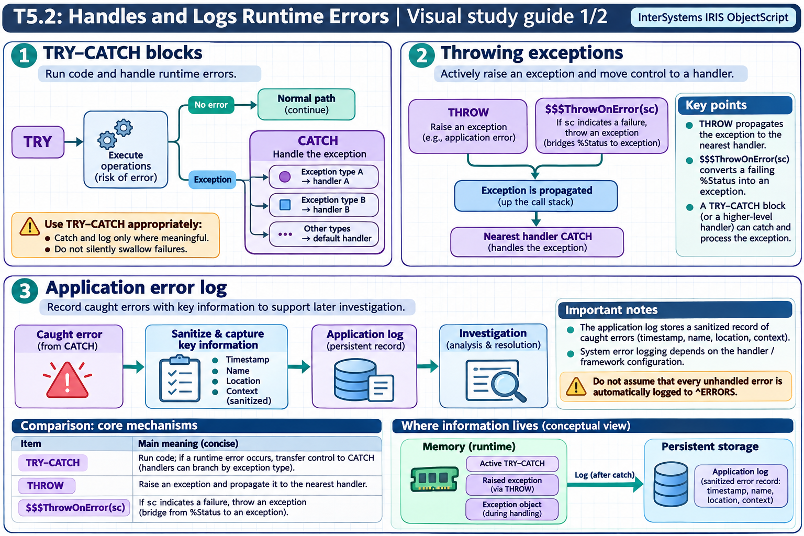
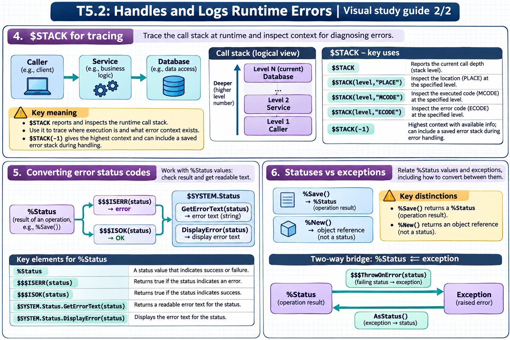

[All topics](../../index.md) · [Practice quiz](quiz.md)

# T5.2: Handles and Logs Runtime Errors

[Approfondimenti dagli esercizi](<Approfondimenti esercizi/README.md>)

Saved 2 November 2026 from [exam-prep.es](https://exam-prep.es/exams/objectscript/knowledge/T5.2.html). Reference links require internet access.

### Contents

1. [TRY-CATCH blocks](#1-try-catch-blocks)
2. [Throwing exceptions](#2-throwing-exceptions)
3. [Application error log](#3-application-error-log)
4. [$STACK for tracing](#4-stack-for-tracing)
5. [Converting error status codes](#5-converting-error-status-codes)
6. [Statuses vs exceptions](#6-statuses-vs-exceptions)

### Visual study guide — sections 1–3



[View all chapter diagrams](visuals.md) · [Technical review notes](../../visual-technical-notes.md)

## 1. TRY-CATCH blocks

### Key Points

- **TRY block**: Contains protected code that may generate errors
- **CATCH block**: Receives an exception object derived from %Exception.AbstractException
- **Exception properties**: ex.Name (error name), ex.Code (error code), ex.Data (additional data), ex.Location (where error occurred)
- **Multiple CATCH**: Only one CATCH block per TRY; use IF/ELSEIF inside CATCH to handle different error types
- **Nesting**: TRY-CATCH blocks can be nested for granular error handling
- **No stack level**: TRY blocks do not create a new stack level

### Detailed Notes

#### Overview

TRY-CATCH is the recommended error handling mechanism in modern ObjectScript. It provides structured, readable, and maintainable error handling using exception objects that carry detailed information about what went wrong and where.

Only a thrown exception enters `CATCH`; a method can also return an error `%Status` without throwing. Catch the exception object to inspect the failure, then decide whether to recover, convert it to a status, or rethrow it. Keep the protected operation inside `TRY`, and make sure required cleanup also happens when an exception interrupts the normal path.

#### Basic TRY-CATCH Syntax

```objectscript
ClassMethod BasicExample()
{
    TRY {
        // Protected code
        Set x = 1 / 0  // Will cause <DIVIDE> error
        Write "This line never executes", !
    }
    CATCH ex {
        Write "Error: ", ex.Name, !           // <DIVIDE>
        Write "Code: ", ex.Code, !            // Error code
        Write "Location: ", ex.Location, !    // Where it happened
        Write "Data: ", ex.Data, !            // Additional info
    }
    Write "Execution continues here", !
}
```

#### Exception Object Properties and Methods

The CATCH variable is an instance of `%Exception.AbstractException` (or a subclass). Key properties and methods:

```objectscript
ClassMethod ExamineException()
{
    TRY {
        Set ^ReadOnlyGlobal(1) = "test"  // Assuming <PROTECT> error
    }
    CATCH ex {
        // Properties
        Write "Name:     ", ex.Name, !        // Error name (e.g., <PROTECT>)
        Write "Code:     ", ex.Code, !        // Numeric error code
        Write "Location: ", ex.Location, !    // label+offset^routine
        Write "Data:     ", ex.Data, !        // Context-specific data

        // Methods
        Write "Display:  ", ex.DisplayString(), !  // Full formatted string
        Set sc = ex.AsStatus()                     // Convert to %Status
        Write "Status:   ", $SYSTEM.Status.GetErrorText(sc), !

        // As a SQL code
        Write "SQL Code: ", ex.AsSQLCODE(), !
        Write "SQL Msg:  ", ex.AsSQLMessage(), !
    }
}
```

#### Nested TRY-CATCH Blocks

```objectscript
ClassMethod NestedExample()
{
    TRY {
        Write "Outer TRY", !

        TRY {
            Write "Inner TRY", !
            // Generate an error
            Set x = $PIECE("", ",", -1)  // <FUNCTION> error
        }
        CATCH innerEx {
            Write "Inner CATCH: ", innerEx.Name, !
            // Can rethrow to outer CATCH
            If innerEx.Name = "<SERIOUS>" {
                THROW innerEx
            }
            // Otherwise handle it here
        }

        Write "Continues in outer TRY", !
    }
    CATCH outerEx {
        Write "Outer CATCH: ", outerEx.Name, !
    }
}
```

#### Handling Different Error Types Within CATCH

```objectscript
ClassMethod HandleByType()
{
    TRY {
        Do ..RiskyOperation()
    }
    CATCH ex {
        If ex.Name = "<DIVIDE>" {
            Write "Division by zero detected", !
        }
        ElseIf ex.Name = "<UNDEFINED>" {
            Write "Undefined variable: ", ex.Data, !
        }
        ElseIf ex.Name = "<SUBSCRIPT>" {
            Write "Invalid subscript access", !
        }
        Else {
            Write "Unexpected error: ", ex.DisplayString(), !
            // Rethrow unexpected errors
            THROW ex
        }
    }
}
```

### Documentation References

- [The TRY-CATCH Mechanism](https://docs.intersystems.com/irislatest/csp/docbook/DocBook.UI.Page.cls?KEY=GCOS_errors#GCOS_errors_trycatch)
- [TRY Command](https://docs.intersystems.com/irislatest/csp/docbook/DocBook.UI.Page.cls?KEY=RCOS_ctry)
- [CATCH Command](https://docs.intersystems.com/irislatest/csp/docbook/DocBook.UI.Page.cls?KEY=RCOS_ccatch)
- [%Exception.AbstractException](https://docs.intersystems.com/irislatest/csp/documatic/%25CSP.Documatic.cls?LIBRARY=%25SYS&CLASSNAME=%25Exception.AbstractException)

## 2. Throwing exceptions

### Key Points

- **THROW command**: Throws an exception object, transferring control to the nearest CATCH block
- **%Exception.General**: General-purpose exception class for user-defined errors
- **$$$ThrowStatus**: Macro that throws an exception created from a %Status value
- **$$$ThrowOnError**: Macro that throws only if the status is an error (does nothing if OK)
- **Custom exception classes**: Can extend %Exception.AbstractException for application-specific errors
- **Rethrow**: Catch an exception and THROW it again to propagate to an outer handler

### Detailed Notes

#### Overview

Throwing exceptions allows you to signal error conditions explicitly, rather than relying only on system-generated errors. This is essential for creating robust applications with clear error boundaries.

#### Throwing %Exception.General

```objectscript
ClassMethod ValidateAge(age As %Integer) As %Status
{
    TRY {
        If age < 0 {
            Throw ##class(%Exception.General).%New(
                "InvalidAge",    // Name
                5001,            // Code (application-defined)
                ,                // Location (auto-filled)
                "Age cannot be negative: " _ age)  // Data
        }
        If age > 150 {
            Throw ##class(%Exception.General).%New(
                "InvalidAge", 5001, , "Unrealistic age: " _ age)
        }
        Write "Age is valid: ", age, !
        Return $$$OK
    }
    CATCH ex {
        Write "Validation error: ", ex.Name, !
        Write "Details: ", ex.Data, !
        Return ex.AsStatus()
    }
}
```

#### Using $$$ThrowStatus Macro

The `$$$ThrowStatus` macro converts a `%Status` value into an exception and throws it. This is essential for bridging status-based code and exception-based code.

```objectscript
Include %occStatus

ClassMethod SaveRecord() As %Status
{
    TRY {
        Set obj = ##class(MyApp.Person).%New()
        Set obj.Name = "John Doe"
        Set sc = obj.%Save()

        // If sc is an error, throw it as an exception
        $$$ThrowOnError(sc)

        Write "Saved successfully with ID: ", obj.%Id(), !
        Return $$$OK
    }
    CATCH ex {
        Write "Save failed: ", ex.DisplayString(), !
        Return ex.AsStatus()
    }
}
```

#### $$$ThrowOnError vs $$$ThrowStatus

```objectscript
Include %occStatus

ClassMethod CompareThrowMacros()
{
    TRY {
        Set sc = $$$OK

        // $$$ThrowOnError: Only throws if sc is an error
        // Does NOTHING if sc is $$$OK -- safe to use always
        $$$ThrowOnError(sc)   // No effect, sc is OK

        Set sc = $$$ERROR($$$GeneralError, "Something went wrong")

        // $$$ThrowStatus: ALWAYS throws, even if sc is OK
        // Use this only when you KNOW sc is an error
        // $$$ThrowStatus(sc)  // Would always throw

        // $$$ThrowOnError: Throws because sc is now an error
        $$$ThrowOnError(sc)   // This throws!

        Write "Never reached", !
    }
    CATCH ex {
        Write "Caught: ", ex.DisplayString(), !
    }
}
```

#### Rethrowing Exceptions

```objectscript
ClassMethod OuterMethod()
{
    TRY {
        Do ..InnerMethod()
    }
    CATCH ex {
        Write "Final handler: ", ex.DisplayString(), !
    }
}

ClassMethod InnerMethod() [ Private ]
{
    TRY {
        // Some risky operation
        Set value = $LISTGET($LISTBUILD(), 5)
    }
    CATCH ex {
        // Log the error
        Set ^ErrorLog($INCREMENT(^ErrorLog)) = ex.DisplayString()
        // Rethrow to let caller handle it
        THROW ex
    }
}
```

### Documentation References

- [THROW Command](https://docs.intersystems.com/irislatest/csp/docbook/DocBook.UI.Page.cls?KEY=RCOS_cthrow)
- [%Exception.General](https://docs.intersystems.com/irislatest/csp/documatic/%25CSP.Documatic.cls?LIBRARY=%25SYS&CLASSNAME=%25Exception.General)
- [%Exception.StatusException](https://docs.intersystems.com/irislatest/csp/documatic/%25CSP.Documatic.cls?LIBRARY=%25SYS&CLASSNAME=%25Exception.StatusException)
- [Error Handling Macros](https://docs.intersystems.com/irislatest/csp/docbook/DocBook.UI.Page.cls?KEY=GCOS_errors)

## 3. Application error log

### Key Points

- **^ERRORS global**: System global that stores application errors automatically when unhandled errors occur
- **$SYSTEM.OBJ.DisplayError()**: Displays human-readable error text from a %Status value
- **Management Portal**: Application Error Log viewer at System Operation &gt; System Logs &gt; Application Error Log
- **Error structure**: ^ERRORS stores error name, location, stack trace, variables, and timestamp
- **^%ERN**: Counter global tracking the number of errors per namespace
- **Custom logging**: Best practice is to supplement system logging with application-specific error logs

### Detailed Notes

#### Overview

InterSystems IRIS automatically logs unhandled errors in the `^ERRORS` global. Additionally, developers should implement structured error logging within their applications for comprehensive diagnostics.

#### The ^ERRORS Global

When an unhandled error occurs (no TRY-CATCH or $ZTRAP in effect), IRIS logs the error in the `^ERRORS` global in the current namespace. The structure contains:

```objectscript
// Viewing the error log from Terminal
ZWrite ^ERRORS

// Structure of ^ERRORS:
// ^ERRORS(date, index) = errorName
// ^ERRORS(date, index, "m") = stack trace details
// where date is in $HOROLOG format and index is sequential
```

#### Management Portal Application Error Log

Navigate to **System Operation &gt; System Logs &gt; Application Error Log** to view a formatted table of application errors. This page shows:

- Date and time of each error
- Error name (e.g., `<UNDEFINED>`, `<SUBSCRIPT>`)
- Location where the error occurred
- Namespace where the error happened
- Process ID and username

#### Using $SYSTEM.Status Methods for Error Display

```objectscript
Include %occStatus

ClassMethod DemonstrateErrorDisplay()
{
    // Create an error status
    Set sc = $$$ERROR($$$GeneralError, "Database connection failed")

    // DisplayError - writes to current device
    Do $SYSTEM.Status.DisplayError(sc)
    // Output: ERROR #5001: Database connection failed

    // GetErrorText - returns error as a string
    Set errorText = $SYSTEM.Status.GetErrorText(sc)
    Write "Error text: ", errorText, !

    // For multi-status errors, get individual components
    Set sc2 = $$$ERROR($$$GeneralError, "Additional problem")
    Set combinedSc = $SYSTEM.Status.AppendStatus(sc, sc2)

    // GetOneStatusText gets a specific error from a compound status
    Set firstError = $SYSTEM.Status.GetOneStatusText(combinedSc, 1)
    Set secondError = $SYSTEM.Status.GetOneStatusText(combinedSc, 2)
    Write "First:  ", firstError, !
    Write "Second: ", secondError, !
}
```

#### Logging Exceptions to the Application Error Log

The simplest way to log a caught exception to `^ERRORS` (viewable in the Management Portal and via `Do ^%ER`) is to call the `.Log()` method on the exception object:

```objectscript
TRY {
    // Business logic
    Set result = 100 / 0
}
CATCH ex {
    // Log to ^ERRORS (calls LOG^%ETN internally)
    Do ex.Log()
    // Continue with error handling...
    Return ex.AsStatus()
}
```

The `%Exception.AbstractException.Log()` method calls `LOG^%ETN` to record the exception in the system error log. You can then view logged errors:

- **Terminal**: `Do ^%ER` utility
- **Management Portal**: System Operation &gt; System Logs &gt; Application Error Log

This is the recommended approach for logging caught exceptions, since unhandled exceptions are logged automatically but caught exceptions are not unless you explicitly call `.Log()`.

#### Building a Custom Application Error Log

```objectscript
ClassMethod LogError(
    className As %String,
    methodName As %String,
    ex As %Exception.AbstractException)
{
    Set timestamp = $ZDATETIME($HOROLOG, 3)
    Set key = $INCREMENT(^MyApp.ErrorLog)

    Set ^MyApp.ErrorLog(key, "timestamp") = timestamp
    Set ^MyApp.ErrorLog(key, "class") = className
    Set ^MyApp.ErrorLog(key, "method") = methodName
    Set ^MyApp.ErrorLog(key, "error") = ex.DisplayString()
    Set ^MyApp.ErrorLog(key, "name") = ex.Name
    Set ^MyApp.ErrorLog(key, "code") = ex.Code
    Set ^MyApp.ErrorLog(key, "location") = ex.Location
    Set ^MyApp.ErrorLog(key, "data") = ex.Data

    // Also log the stack trace
    For level = 0:1:$STACK(-1) {
        Set ^MyApp.ErrorLog(key, "stack", level) =
            $STACK(level, "PLACE") _ " : " _ $STACK(level, "MCODE")
    }
}

ClassMethod ProcessData()
{
    TRY {
        // Business logic here
        Set result = 100 / 0
    }
    CATCH ex {
        Do ..LogError("MyApp.Processor", "ProcessData", ex)
        // Optionally rethrow or return error status
        Return ex.AsStatus()
    }
}
```

### Documentation References

- [Application Error Log](https://docs.intersystems.com/irislatest/csp/docbook/DocBook.UI.Page.cls?KEY=GCM_monitor)
- [%SYSTEM.Status Class](https://docs.intersystems.com/irislatest/csp/documatic/%25CSP.Documatic.cls?LIBRARY=%25SYS&CLASSNAME=%25SYSTEM.Status)
- [$SYSTEM.OBJ.DisplayError](https://docs.intersystems.com/irislatest/csp/docbook/DocBook.UI.Page.cls?KEY=RERR_gen)

### Visual study guide — sections 4–6



[View all chapter diagrams](visuals.md) · [Technical review notes](../../visual-technical-notes.md)

## 4. $STACK for tracing

### Key Points

- **$STACK(-1)**: Returns the current stack depth (number of levels on the execution stack)
- **$STACK(level, "PLACE")**: Returns the location (label+offset^routine) at the specified stack level
- **$STACK(level, "MCODE")**: Returns the actual source code at the specified stack level
- **$STACK(level, "ECODE")**: Returns the error code at a given level (if an error occurred there)
- **Loop pattern**: Loop from 0 to $STACK(-1) to dump the full call stack
- **Diagnostic use**: Essential for understanding call chains during error handling

### Detailed Notes

#### Overview

The `$STACK` special variable provides programmatic access to the execution call stack. During error handling, `$STACK` lets you capture a complete trace of the call chain that led to the error, which is invaluable for debugging.

Read `$STACK` at the point where the failure is handled: it reports the current depth and the call information available at that moment. If a `CATCH` block needs those details, capture them before returning or rethrowing. The stack can show which calls led to the failing method, but it does not automatically write or preserve that trace in a log.

#### Basic $STACK Usage

```objectscript
ClassMethod ShowStack()
{
    Write "Current stack depth: ", $STACK(-1), !
    Write !
    For level = 0:1:$STACK(-1) {
        Write "Level ", level, ": "
        Write $STACK(level, "PLACE")
        Write !
    }
}
```

#### Full Stack Dump During Error Handling

```objectscript
ClassMethod MethodA()
{
    TRY {
        Do ..MethodB()
    }
    CATCH ex {
        Write "Error: ", ex.DisplayString(), !
        Write "--- Stack Trace ---", !
        Do ..DumpStack()
    }
}

ClassMethod MethodB() [ Private ]
{
    Do ..MethodC()
}

ClassMethod MethodC() [ Private ]
{
    // Cause an error
    Set x = undefinedVariable  // <UNDEFINED> error
}

ClassMethod DumpStack()
{
    Set depth = $STACK(-1)
    Write "Stack depth: ", depth, !
    For level = 0:1:depth {
        Write "  Level ", level, ":", !
        Write "    PLACE: ", $STACK(level, "PLACE"), !
        Write "    MCODE: ", $STACK(level, "MCODE"), !
        Set ecode = $STACK(level, "ECODE")
        If ecode '= "" {
            Write "    ECODE: ", ecode, !
        }
    }
}
```

Output would look like:

```text
Error: <UNDEFINED>zMethodC+1^MyApp.Debug.1 *undefinedVariable
--- Stack Trace ---
Stack depth: 3
  Level 0:
    PLACE: +1^MyApp.Debug.1
    MCODE: Do ..MethodB()
  Level 1:
    PLACE: zMethodB+1^MyApp.Debug.1
    MCODE: Do ..MethodC()
  Level 2:
    PLACE: zMethodC+1^MyApp.Debug.1
    MCODE: Set x = undefinedVariable
    ECODE: <UNDEFINED>
```

#### $STACK Parameters Reference

| Syntax | Returns |
| --- | --- |
| `$STACK(-1)` | Current stack depth (integer) |
| `$STACK(n, "PLACE")` | Location at level n (label+offset^routine) |
| `$STACK(n, "MCODE")` | Source code at level n |
| `$STACK(n, "ECODE")` | Error code at level n (empty if no error) |

#### Integrating $STACK with Error Logging

```objectscript
ClassMethod CaptureStackTrace() As %String
{
    Set trace = ""
    Set depth = $STACK(-1)
    For level = 0:1:depth {
        Set line = "Level " _ level _ ": "
        Set line = line _ $STACK(level, "PLACE")
        Set mcode = $STACK(level, "MCODE")
        If mcode '= "" {
            Set line = line _ " [" _ mcode _ "]"
        }
        Set trace = trace _ line _ $CHAR(10)
    }
    Return trace
}

ClassMethod HandleError()
{
    TRY {
        Do ..SomeOperation()
    }
    CATCH ex {
        Set stackTrace = ..CaptureStackTrace()
        // Store in error log global
        Set key = $INCREMENT(^ErrorLog)
        Set ^ErrorLog(key) = ex.DisplayString()
        Set ^ErrorLog(key, "stack") = stackTrace
        Set ^ErrorLog(key, "time") = $ZDATETIME($HOROLOG, 3)
    }
}
```

### Documentation References

- [$STACK Special Variable](https://docs.intersystems.com/irislatest/csp/docbook/DocBook.UI.Page.cls?KEY=RCOS_vstack)
- [Error Processing Context](https://docs.intersystems.com/irislatest/csp/docbook/DocBook.UI.Page.cls?KEY=GCOS_errors#GCOS_errors_context)

## 5. Converting error status codes

### Key Points

- **$$$ISERR(sc)**: Macro that returns true (1) if the status represents an error
- **$$$ISOK(sc)**: Macro that returns true (1) if the status represents success
- **$SYSTEM.Status.GetErrorText(sc)**: Returns a human-readable error string
- **$SYSTEM.Status.DisplayError(sc)**: Writes the error text to the current device
- **$SYSTEM.Status.GetOneStatusText(sc, n)**: Returns the nth error from a compound status
- **$$$ERROR()**: Macro to create a new error %Status value with a specific error code and message

### Detailed Notes

#### Overview

`%Status` is a fundamental data type in InterSystems IRIS used throughout the class library to indicate success or failure of operations. Methods like `%Save()`, `%New()`, `%Open()`, and many others return `%Status` values. Understanding how to test, display, and create status values is essential.

A `%Status` is a structured success or error value, not a message string. For example, save the result of `%Save()` in `sc`, test it with `$SYSTEM.Status.IsError(sc)`, and display `$SYSTEM.Status.GetErrorText(sc)` on failure. Returning the same status to the caller preserves the failure; printing it and continuing as if the save succeeded does not.

#### Testing Status Values

```objectscript
Include %occStatus

ClassMethod TestStatus()
{
    Set obj = ##class(Sample.Person).%New()
    Set obj.Name = "Test Person"
    Set sc = obj.%Save()

    // Test if the operation succeeded
    If $$$ISOK(sc) {
        Write "Save succeeded, ID: ", obj.%Id(), !
    }

    // Test if the operation failed
    If $$$ISERR(sc) {
        Write "Save failed!", !
    }

    // IMPORTANT: Never compare %Status directly to 1 or 0
    // WRONG: If sc = 1 { ... }
    // RIGHT: If $$$ISOK(sc) { ... }
}
```

#### Displaying and Extracting Error Text

```objectscript
Include %occStatus

ClassMethod DisplayStatusExamples()
{
    // Create an error status for demonstration
    Set sc = $$$ERROR($$$GeneralError, "Connection timeout after 30 seconds")

    // Method 1: Display to current device
    Do $SYSTEM.Status.DisplayError(sc)
    // Output: ERROR #5001: Connection timeout after 30 seconds

    // Method 2: Get as a string (for logging, display elsewhere)
    Set text = $SYSTEM.Status.GetErrorText(sc)
    Write "Error: ", text, !

    // Method 3: Compound status with multiple errors
    Set sc1 = $$$ERROR($$$GeneralError, "First error")
    Set sc2 = $$$ERROR($$$GeneralError, "Second error")
    Set combined = $SYSTEM.Status.AppendStatus(sc1, sc2)

    // Get individual error messages
    Set first = $SYSTEM.Status.GetOneStatusText(combined, 1)
    Set second = $SYSTEM.Status.GetOneStatusText(combined, 2)
    Write "Error 1: ", first, !
    Write "Error 2: ", second, !

    // Get count of errors
    Set count = $SYSTEM.Status.GetErrorCodes(combined)
    Write "Total errors: ", count, !
}
```

#### Creating Error Status Values

```objectscript
Include (%occStatus, %occErrors)

ClassMethod CreateErrors()
{
    // General error with custom message
    Set sc = $$$ERROR($$$GeneralError, "Custom error message")

    // Error with specific error code
    Set sc = $$$ERROR($$$InvalidArgument, "paramName")

    // Compound status: append multiple errors
    Set sc = $$$OK
    If 'condition1 {
        Set sc = $SYSTEM.Status.AppendStatus(sc,
            $$$ERROR($$$GeneralError, "Condition 1 failed"))
    }
    If 'condition2 {
        Set sc = $SYSTEM.Status.AppendStatus(sc,
            $$$ERROR($$$GeneralError, "Condition 2 failed"))
    }

    Return sc  // Contains all accumulated errors
}
```

#### Common Pattern: Checking Return Status

```objectscript
Include %occStatus

ClassMethod RobustSave() As %Status
{
    Set sc = $$$OK

    Set obj = ##class(MyApp.Data).%New()
    Set obj.Field1 = "value1"

    Set sc = obj.%Save()
    If $$$ISERR(sc) {
        // Log and return
        Do $SYSTEM.Status.DisplayError(sc)
        Return sc
    }

    // Continue with more operations
    Set sc = ..AdditionalProcessing(obj.%Id())
    If $$$ISERR(sc) Return sc

    Return $$$OK
}
```

### Documentation References

- [%Status Values](https://docs.intersystems.com/irislatest/csp/docbook/DocBook.UI.Page.cls?KEY=GCOS_errors#GCOS_errors_status)
- [%SYSTEM.Status Class](https://docs.intersystems.com/irislatest/csp/documatic/%25CSP.Documatic.cls?LIBRARY=%25SYS&CLASSNAME=%25SYSTEM.Status)
- [Status Macros](https://docs.intersystems.com/irislatest/csp/docbook/DocBook.UI.Page.cls?KEY=GCOS_errors#GCOS_errors_macros)

## 6. Statuses vs exceptions

### Key Points

- **%Status pattern**: Methods return %Status, caller checks with $$$ISERR/$$$ISOK -- used by %Save, %New, %Open
- **Exception pattern**: Errors thrown as exceptions, caught by TRY-CATCH -- used for system errors and explicit THROW
- **$$$ThrowOnError(sc)**: Converts a %Status error into an exception (bridge from status to exception world)
- **ex.AsStatus()**: Converts an exception back to a %Status value (bridge from exception to status world)
- **%Exception.StatusException**: Exception subclass created from a %Status value
- **Mixing patterns**: Common to use exceptions internally but return %Status to callers

### Detailed Notes

#### Overview

InterSystems IRIS uses two distinct error signaling patterns: `%Status` return values and exceptions. The `%Status` pattern is pervasive in the class library (e.g., `%Save()`, `%Open()`), while exceptions are used for runtime errors and modern structured error handling. Real-world code must bridge both patterns fluently.

Returning an error `%Status` does not transfer control to `CATCH`; the caller must check it. For example, after `%Save()`, use `$$$ThrowOnError(sc)` if the method's contract is exception-based, or return `sc` if callers are expected to check statuses. Choose and document the contract at each method boundary so errors are not ignored or handled twice.

#### The %Status Pattern

```objectscript
Include %occStatus

/// Pure %Status style - check every return value
ClassMethod StatusStyle() As %Status
{
    Set sc = $$$OK

    Set obj = ##class(MyApp.Person).%New()
    Set obj.Name = "Test"

    // %Save returns %Status
    Set sc = obj.%Save()
    If $$$ISERR(sc) {
        Do $SYSTEM.Status.DisplayError(sc)
        Return sc
    }

    // %OpenId returns object or "" (with status in second arg)
    Set obj2 = ##class(MyApp.Person).%OpenId(999, , .sc)
    If $$$ISERR(sc) {
        Return sc
    }

    Return $$$OK
}
```

#### The Exception Pattern

```objectscript
/// Pure exception style - everything in TRY-CATCH
ClassMethod ExceptionStyle()
{
    TRY {
        Set x = 100 / 0           // <DIVIDE> - system exception
        Set ^data(1) = "value"    // <PROTECT> - system exception
    }
    CATCH ex {
        Write "Caught: ", ex.DisplayString(), !
    }
}
```

#### Converting %Status to Exception with $$$ThrowOnError

```objectscript
Include %occStatus

/// Recommended hybrid: Use exceptions internally, return %Status
ClassMethod RecommendedPattern() As %Status
{
    TRY {
        Set obj = ##class(MyApp.Person).%New()
        Set obj.Name = "Test"

        // %Save returns %Status -- convert to exception if error
        Set sc = obj.%Save()
        $$$ThrowOnError(sc)

        // %OpenId with status -- convert to exception if error
        Set obj2 = ##class(MyApp.Person).%OpenId(42, , .sc)
        $$$ThrowOnError(sc)

        // Now both system errors AND status errors are
        // caught by the same CATCH block
        Set result = obj2.Name _ " processed"

        Return $$$OK
    }
    CATCH ex {
        // Single error handling point
        // Convert exception back to %Status for the caller
        Return ex.AsStatus()
    }
}
```

#### Converting Exception to %Status

```objectscript
Include %occStatus

ClassMethod ExceptionToStatus() As %Status
{
    TRY {
        // Some operation that may throw
        Do ..RiskyOperation()
        Return $$$OK
    }
    CATCH ex {
        // ex.AsStatus() converts any exception to %Status
        Return ex.AsStatus()
    }
}
```

#### Creating Exception from %Status (Explicitly)

```objectscript
Include %occStatus

ClassMethod CreateStatusException()
{
    Set sc = $$$ERROR($$$GeneralError, "Something failed")

    // Create an exception from a status (without throwing)
    Set ex = ##class(%Exception.StatusException).CreateFromStatus(sc)

    // Now you have an exception object you can inspect
    Write "Name: ", ex.Name, !
    Write "Code: ", ex.Code, !
    Write "Display: ", ex.DisplayString(), !

    // Or throw it
    // THROW ex
}
```

#### Side-by-Side Comparison

```objectscript
Include %occStatus

/// Side-by-side: same logic, different patterns
ClassMethod ComparePatterns()
{
    // ===== STATUS PATTERN =====
    Set sc = ..DoWork1()
    If $$$ISERR(sc) {
        Set sc2 = ..DoCleanup()
        If $$$ISERR(sc2) {
            // Compound error - append
            Set sc = $SYSTEM.Status.AppendStatus(sc, sc2)
        }
        Do $SYSTEM.Status.DisplayError(sc)
        Quit
    }

    // ===== EXCEPTION PATTERN =====
    TRY {
        Do ..DoWork2()
    }
    CATCH ex {
        TRY {
            Do ..DoCleanup()
        }
        CATCH cleanupEx {
            // Log cleanup failure too
        }
        Write ex.DisplayString(), !
    }
}
```

#### The Standard Method Template

```objectscript
Include %occStatus

/// This is the standard recommended pattern for methods
/// that need to return %Status
ClassMethod StandardTemplate(input As %String) As %Status
{
    TRY {
        // Validate input
        If input = "" {
            $$$ThrowStatus($$$ERROR($$$GeneralError, "Input required"))
        }

        // Call methods that return %Status
        Set sc = ..Step1(input)
        $$$ThrowOnError(sc)

        Set sc = ..Step2(input)
        $$$ThrowOnError(sc)

        // Any system error (<UNDEFINED>, <SUBSCRIPT>, etc.)
        // is also caught automatically

        Return $$$OK
    }
    CATCH ex {
        Return ex.AsStatus()
    }
}
```

### Documentation References

- [Error Handling Overview](https://docs.intersystems.com/irislatest/csp/docbook/DocBook.UI.Page.cls?KEY=GCOS_errors)
- [%Exception.StatusException](https://docs.intersystems.com/irislatest/csp/documatic/%25CSP.Documatic.cls?LIBRARY=%25SYS&CLASSNAME=%25Exception.StatusException)
- [%Exception.AbstractException](https://docs.intersystems.com/irislatest/csp/documatic/%25CSP.Documatic.cls?LIBRARY=%25SYS&CLASSNAME=%25Exception.AbstractException)
- [Status Macros and Methods](https://docs.intersystems.com/irislatest/csp/docbook/DocBook.UI.Page.cls?KEY=GCOS_errors#GCOS_errors_status)

## Exam Preparation Summary

### Critical Concepts to Master:

1. **TRY-CATCH syntax**: Know that CATCH receives a single exception object of type %Exception.AbstractException
2. **Exception properties**: Memorize ex.Name, ex.Code, ex.Data, ex.Location, ex.DisplayString(), ex.AsStatus()
3. **$$$ThrowOnError vs $$$ThrowStatus**: ThrowOnError only throws on error; ThrowStatus always throws
4. **^ERRORS global**: Know it stores unhandled errors automatically and is viewable in Management Portal
5. **$STACK(-1)**: Returns stack depth; loop from 0 to $STACK(-1) with "PLACE" and "MCODE" for full trace
6. **$$$ISERR and $$$ISOK**: Never compare %Status directly to 1 or 0; always use these macros
7. **Status-exception bridge**: $$$ThrowOnError converts status to exception; ex.AsStatus() converts exception to status
8. **Standard template**: TRY block with $$$ThrowOnError calls, single CATCH returning ex.AsStatus()

### Common Exam Scenarios:

- Given code with a missing error check, identify what happens when an operation fails
- Choosing between $$$ThrowOnError and $$$ThrowStatus for a specific situation
- Reading a TRY-CATCH block and determining what ex.Name or ex.Data contains for a given error
- Identifying the correct way to convert between %Status and exceptions
- Determining what $STACK(n, "PLACE") returns at various stack levels
- Recognizing that $SYSTEM.Status.GetErrorText() returns a string while DisplayError() writes to device

### Hands-On Practice Recommendations:

- Write a method using the standard TRY-CATCH template with $$$ThrowOnError
- Deliberately cause , , and  errors and examine the exception object
- Create a custom error logging method that captures $STACK trace information
- Practice converting between %Status and exceptions in both directions
- Create compound %Status values with AppendStatus and extract individual errors
- Navigate to Management Portal Application Error Log and review entries
- Use $SYSTEM.Status.GetErrorText() and DisplayError() on various error statuses
- Implement nested TRY-CATCH blocks and observe which CATCH handles each error
