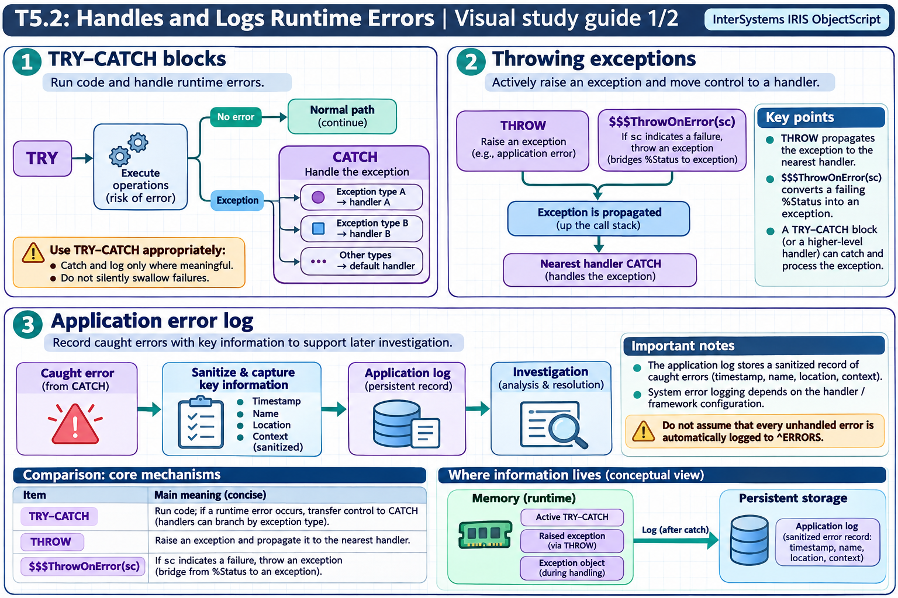
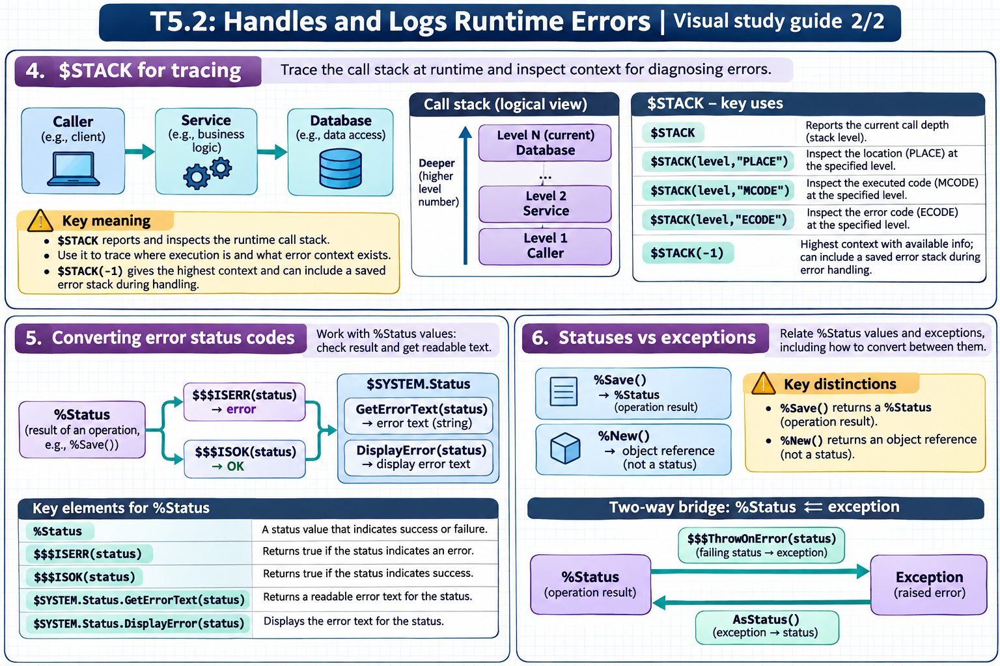

# T5.2: Handles and Logs Runtime Errors — visual study guides

[Approfondimenti dagli esercizi](<Approfondimenti esercizi/README.md>)

[Chapter contents](index.md) · [Full guide](study.md) · [Practice questions](quiz.md)

Generated learning summaries. Read the full notes for detailed explanations and exact code. [Technical review notes](../../visual-technical-notes.md).

## Visual guide — sections 1–3

Covers:

- 1. TRY-CATCH blocks
- 2. Throwing exceptions
- 3. Application error log

## Visual guide — sections 4–6

Covers:

- 4. $STACK for tracing
- 5. Converting error status codes
- 6. Statuses vs exceptions
