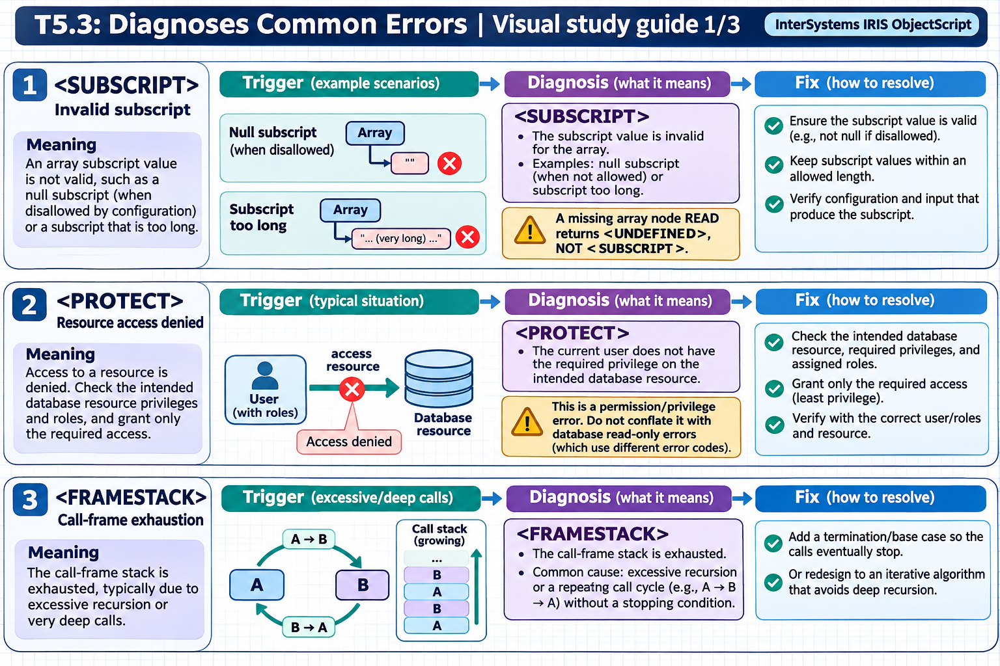

[Topic contents](../index.md) · [Full topic guide](../study.md) · [All topics](../../../index.md)

# T5.3: Diagnoses Common Errors

Saved 2 November 2026 from [exam-prep.es](https://exam-prep.es/exams/objectscript/knowledge/T5.3.html). Reference links require internet access.

## 1. &lt;SUBSCRIPT&gt; errors



*This diagram covers sections 1–3; use the matching numbered panel for this page.* [Chapter diagrams](../visuals.md) · [Technical review notes](../../../visual-technical-notes.md)

### Key Points

- **Accessing undefined subscript**: Referencing a global or local array node that does not exist
- **Out-of-range $LIST access**: Using $LIST or $LISTGET with a position beyond the list length
- **Empty string as subscript**: Global subscripts cannot be the empty string ""
- **Wrong number of arguments**: Passing fewer arguments than expected can cause subscript errors in called code
- **$DATA and $GET**: Use these to check existence before accessing subscripts
- **$LISTLENGTH**: Check list length before accessing specific positions

### Detailed Notes

#### Overview

`<SUBSCRIPT>` errors occur when code attempts to use an invalid subscript to reference a global or local array node, or when `$LIST` operations reference positions that do not exist in a list structure. These are among the most common runtime errors in ObjectScript.

#### Accessing Undefined Subscript Nodes

```objectscript
// ERROR: Accessing a subscript that doesn't exist
Kill ^Data
Set ^Data(1) = "First"
Set ^Data(3) = "Third"

// This causes <SUBSCRIPT> if ^Data(2) doesn't exist
// and you use it in certain contexts
Write ^Data(2)    // <SUBSCRIPT> error - node 2 doesn't exist

// FIX: Use $GET with a default value
Write $GET(^Data(2), "N/A"), !   // Returns "N/A" safely

// FIX: Check with $DATA first
If $DATA(^Data(2)) {
    Write ^Data(2), !
}
Else {
    Write "No data for subscript 2", !
}
```

#### Empty String as Subscript

```objectscript
// ERROR: Empty string is not a valid global subscript
Set key = ""
Set ^Data(key) = "value"    // <SUBSCRIPT> error

// FIX: Validate before use
ClassMethod StoreValue(key As %String, value As %String) As %Status
{
    If key = "" {
        Return $$$ERROR($$$GeneralError, "Key cannot be empty")
    }
    Set ^Data(key) = value
    Return $$$OK
}
```

#### Out-of-Range $LIST Access

```objectscript
// ERROR: $LIST with out-of-range position
Set myList = $LISTBUILD("Apple", "Banana", "Cherry")
// myList has 3 elements

// Accessing position 5 causes <SUBSCRIPT> error with $LIST
Write $LIST(myList, 5)    // <SUBSCRIPT> error

// FIX: Use $LISTGET (returns "" for missing positions)
Write $LISTGET(myList, 5), !          // Returns ""
Write $LISTGET(myList, 5, "N/A"), !   // Returns "N/A"

// FIX: Check length first
If $LISTLENGTH(myList) >= 5 {
    Write $LIST(myList, 5), !
}
Else {
    Write "List has only ", $LISTLENGTH(myList), " elements", !
}
```

#### $LIST vs $LISTGET Comparison

```objectscript
Set list = $LISTBUILD("A", "B", "C")

// $LIST - throws <SUBSCRIPT> if position invalid
// Use when you KNOW the position exists
Set first = $LIST(list, 1)      // "A" - safe
// Set fifth = $LIST(list, 5)   // <SUBSCRIPT> error!

// $LISTGET - returns default if position invalid
// Use when position may not exist
Set first = $LISTGET(list, 1)        // "A"
Set fifth = $LISTGET(list, 5)        // "" (empty string)
Set fifth = $LISTGET(list, 5, "?")   // "?" (custom default)
```

#### Wrong Number of Arguments

```objectscript
// ERROR: Method expects data in a subscripted array
ClassMethod ProcessItems(ByRef items)
{
    // Expects items(1), items(2), etc.
    For i = 1:1:items {
        Write items(i), !  // <SUBSCRIPT> if items(i) doesn't exist
    }
}

// Caller passes wrong structure
ClassMethod CallerBug()
{
    Set data = 3           // Set count
    Set data(1) = "Apple"
    Set data(2) = "Banana"
    // Forgot to set data(3)!
    Do ..ProcessItems(.data)  // <SUBSCRIPT> at items(3)
}

// FIX: Defensive coding with $GET
ClassMethod ProcessItemsSafe(ByRef items)
{
    For i = 1:1:$GET(items, 0) {
        Set value = $GET(items(i), "")
        If value '= "" {
            Write value, !
        }
    }
}
```

### Documentation References

- [&lt;SUBSCRIPT&gt; Error](https://docs.intersystems.com/irislatest/csp/docbook/DocBook.UI.Page.cls?KEY=RERR_gen#RERR_SUBSCRIPT)
- [$GET Function](https://docs.intersystems.com/irislatest/csp/docbook/DocBook.UI.Page.cls?KEY=RCOS_fget)
- [$DATA Function](https://docs.intersystems.com/irislatest/csp/docbook/DocBook.UI.Page.cls?KEY=RCOS_fdata)
- [$LIST Function](https://docs.intersystems.com/irislatest/csp/docbook/DocBook.UI.Page.cls?KEY=RCOS_flist)
- [$LISTGET Function](https://docs.intersystems.com/irislatest/csp/docbook/DocBook.UI.Page.cls?KEY=RCOS_flistget)
