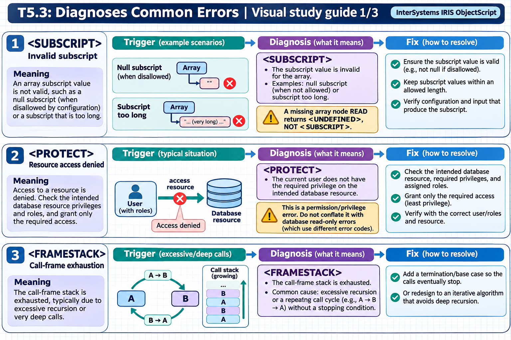

[Topic contents](../index.md) · [Full topic guide](../study.md) · [All topics](../../../index.md)

# T5.3: Diagnoses Common Errors

Saved 2 November 2026 from [exam-prep.es](https://exam-prep.es/exams/objectscript/knowledge/T5.3.html). Reference links require internet access.

## 2. &lt;PROTECT&gt; errors



*This diagram covers sections 1–3; use the matching numbered panel for this page.* [Chapter diagrams](../visuals.md) · [Technical review notes](../../../visual-technical-notes.md)

### Key Points

- **Database read-only**: Writing to a global in a read-only or mounted read-only database
- **Insufficient permissions**: Process lacks the required resource privileges to access a database
- **Namespace access denied**: Process not permitted to switch to or operate in a namespace
- **Role missing database resource**: User's roles do not include Read-Write access to the database resource
- **System globals**: Certain system globals are protected and cannot be modified by application code
- **Resolution**: Check database properties, user roles, and resource allocations in Management Portal

### Detailed Notes

#### Overview

`<PROTECT>` errors occur when a process attempts an operation that violates security constraints or database access permissions. These errors are security-related and require understanding of the InterSystems IRIS security model: resources, roles, and database permissions.

#### Writing to a Read-Only Database

```objectscript
// ERROR: Database is mounted read-only
// (e.g., IRISSYS or a database mounted for backup)
Set ^SomeGlobal = "value"   // <PROTECT> if database is read-only

// Checking if you can write to the current namespace:
ClassMethod CanWrite() As %Boolean
{
    TRY {
        Set testKey = "##TEST##" _ $JOB
        Set ^CacheTemp(testKey) = 1
        Kill ^CacheTemp(testKey)
        Return 1
    }
    CATCH ex {
        If ex.Name = "<PROTECT>" {
            Return 0
        }
        THROW ex
    }
}
```

#### Handling in Application Code

```objectscript
ClassMethod SaveData(key As %String, value As %String) As %Status
{
    TRY {
        Set ^AppData(key) = value
        Return $$$OK
    }
    CATCH ex {
        If ex.Name = "<PROTECT>" {
            // Provide a clear message to the user
            Return $$$ERROR($$$GeneralError,
                "Cannot write to database. Check that the database " _
                "is not read-only and that your account has " _
                "Read-Write access to the database resource.")
        }
        Return ex.AsStatus()
    }
}
```

#### Common Causes and Resolutions

```text
Cause: Database is read-only
  Check: Management Portal > System Administration > Configuration >
         System Configuration > Local Databases
  Fix:   Change database from Read-Only to Read-Write

Cause: User lacks database resource permission
  Check: Management Portal > System Administration > Security >
         Users > [user] > Roles tab
  Fix:   Add a role that has Read-Write on the database resource

Cause: Application runs as UnknownUser with minimal privileges
  Check: Management Portal > System Administration > Security >
         Users > UnknownUser
  Fix:   Assign appropriate roles or configure application to
         authenticate properly

Cause: Namespace default database differs from expectation
  Check: Management Portal > System Administration > Configuration >
         System Configuration > Namespaces
  Fix:   Verify the global database mapping for the namespace
```

#### Programmatic Security Check

```objectscript
ClassMethod CheckDatabaseAccess(namespace As %String) As %String
{
    // Get the default database for a namespace
    Set db = ##class(%SYS.Namespace).GetGlobalDest(namespace)
    Write "Global database: ", db, !

    // Check current user's roles
    Write "Current user: ", $USERNAME, !
    Write "Current roles: ", $ROLES, !

    Return db
}
```

### Documentation References

- [&lt;PROTECT&gt; Error](https://docs.intersystems.com/irislatest/csp/docbook/DocBook.UI.Page.cls?KEY=RERR_gen#RERR_PROTECT)
- [Database Security](https://docs.intersystems.com/irislatest/csp/docbook/DocBook.UI.Page.cls?KEY=GCAS_dbsecurity)
- [Resources, Roles, and Privileges](https://docs.intersystems.com/irislatest/csp/docbook/DocBook.UI.Page.cls?KEY=GCAS_roles)
- [Managing Databases](https://docs.intersystems.com/irislatest/csp/docbook/DocBook.UI.Page.cls?KEY=GCAS_dbsrv)
