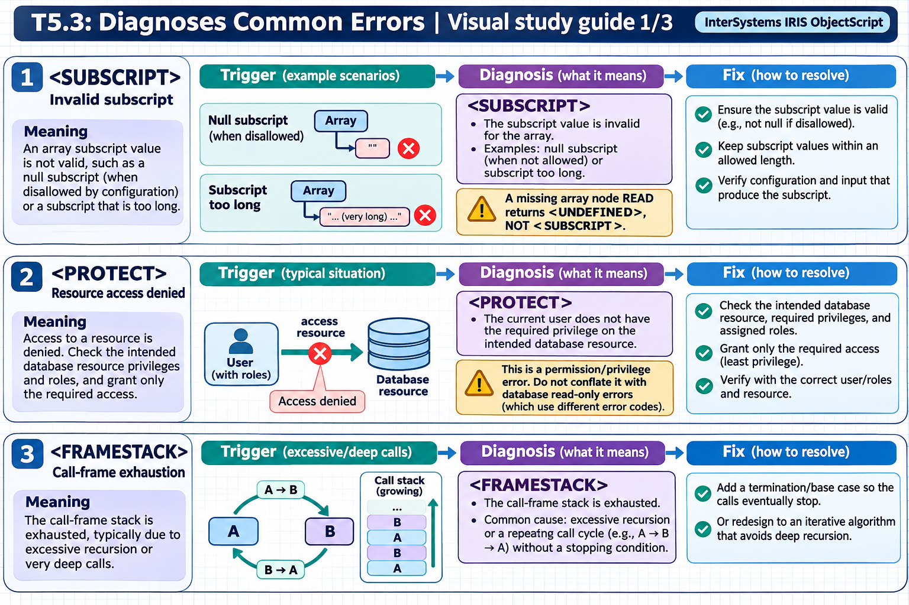

[Topic contents](../index.md) · [Full topic guide](../study.md) · [All topics](../../../index.md)

# T5.3: Diagnoses Common Errors

Saved 2 November 2026 from [exam-prep.es](https://exam-prep.es/exams/objectscript/knowledge/T5.3.html). Reference links require internet access.

## 3. &lt;FRAMESTACK&gt; errors



*This diagram covers sections 1–3; use the matching numbered panel for this page.* [Chapter diagrams](../visuals.md) · [Technical review notes](../../../visual-technical-notes.md)

### Key Points

- **Infinite recursion**: Most common cause; a method calls itself without a proper base case
- **Excessive call depth**: Even non-recursive code can exhaust the frame stack with deeply nested call chains
- **Indirect recursion**: Method A calls Method B, which calls Method A, creating an infinite loop
- **Frame stack**: Fixed-size stack that stores return addresses and context for each method call
- **Base case**: Every recursive method must have a condition that stops the recursion
- **Iterative alternatives**: Convert deep recursion to iterative loops when possible

### Detailed Notes

#### Overview

`<FRAMESTACK>` errors occur when the execution call stack overflows. Each method call, DO command, or XECUTE pushes a frame onto the stack. When the stack is exhausted (typically after thousands of nested calls), IRIS raises a `<FRAMESTACK>` error. The most common cause is infinite recursion.

#### Infinite Recursion - Direct

```objectscript
// ERROR: No base case - infinite recursion
ClassMethod BadFactorial(n As %Integer) As %Integer
{
    // Missing: If n <= 1 Return 1
    Return n * ..BadFactorial(n - 1)   // Never stops!
    // Calls: BadFactorial(5) -> BadFactorial(4) -> ... -> BadFactorial(-9999) -> <FRAMESTACK>
}

// FIX: Add a proper base case
ClassMethod Factorial(n As %Integer) As %Integer
{
    If n <= 1 {
        Return 1    // BASE CASE - stops recursion
    }
    Return n * ..Factorial(n - 1)
}
```

#### Infinite Recursion - Indirect

```objectscript
// ERROR: Indirect recursion - A calls B, B calls A
ClassMethod ProcessA(data As %String)
{
    // Some processing...
    Set data = data _ "A"
    Do ..ProcessB(data)     // Calls B
}

ClassMethod ProcessB(data As %String)
{
    // Some processing...
    Set data = data _ "B"
    Do ..ProcessA(data)     // Calls A -> infinite loop!
}

// FIX: Add termination condition
ClassMethod ProcessA(data As %String, depth As %Integer = 0)
{
    If depth > 100 {
        Write "Maximum processing depth reached", !
        Return
    }
    Set data = data _ "A"
    Do ..ProcessB(data, depth + 1)
}

ClassMethod ProcessB(data As %String, depth As %Integer = 0)
{
    If depth > 100 {
        Write "Maximum processing depth reached", !
        Return
    }
    Set data = data _ "B"
    Do ..ProcessA(data, depth + 1)
}
```

#### Converting Recursion to Iteration

```objectscript
// RECURSIVE version - may cause <FRAMESTACK> for deep trees
ClassMethod TraverseTree(node As %String)
{
    Quit:node=""
    Write node, !
    Set child = $ORDER(^Tree(node, ""))
    While child '= "" {
        Do ..TraverseTree(child)    // Recursive call
        Set child = $ORDER(^Tree(node, child))
    }
}

// ITERATIVE version - uses an explicit stack (no <FRAMESTACK> risk)
ClassMethod TraverseTreeIterative(startNode As %String)
{
    // Use a local array as an explicit stack
    Set stackTop = 1
    Set stack(stackTop) = startNode

    While stackTop > 0 {
        // Pop from stack
        Set node = stack(stackTop)
        Set stackTop = stackTop - 1

        If node = "" Continue

        Write node, !

        // Push children onto stack
        Set child = $ORDER(^Tree(node, ""))
        While child '= "" {
            Set stackTop = stackTop + 1
            Set stack(stackTop) = child
            Set child = $ORDER(^Tree(node, child))
        }
    }
}
```

#### Catching Errors

```objectscript
ClassMethod SafeRecursion(data As %String) As %Status
{
    TRY {
        Do ..DeepRecursiveProcess(data, 0)
        Return $$$OK
    }
    CATCH ex {
        If ex.Name = "<FRAMESTACK>" {
            Return $$$ERROR($$$GeneralError,
                "Operation exceeded maximum recursion depth. " _
                "Data may be too deeply nested.")
        }
        Return ex.AsStatus()
    }
}

ClassMethod DeepRecursiveProcess(data As %String, depth As %Integer)
{
    // Guard clause: prevent <FRAMESTACK> with explicit limit
    If depth > 500 {
        Throw ##class(%Exception.General).%New(
            "MaxDepth", 5001, , "Recursion depth exceeded 500")
    }
    // ... recursive processing ...
}
```

### Documentation References

- [&lt;FRAMESTACK&gt; Error](https://docs.intersystems.com/irislatest/csp/docbook/DocBook.UI.Page.cls?KEY=RERR_gen#RERR_FRAMESTACK)
- [Process Memory](https://docs.intersystems.com/irislatest/csp/docbook/DocBook.UI.Page.cls?KEY=GSTU_process)
- [Maximum Per-Process Memory](https://docs.intersystems.com/irislatest/csp/docbook/DocBook.UI.Page.cls?KEY=GSTU_process)
