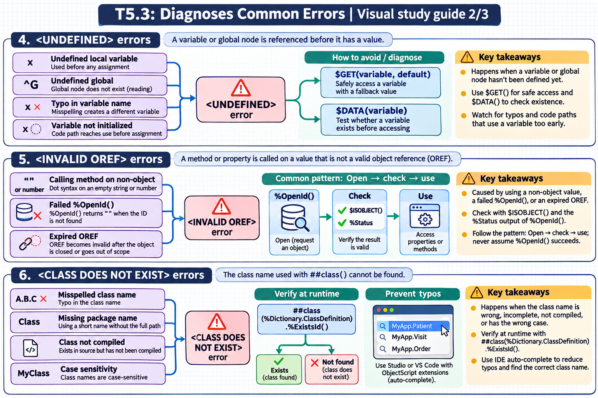

[Topic contents](../index.md) · [Full topic guide](../study.md) · [All topics](../../../index.md)

# T5.3: Diagnoses Common Errors

Saved 2 November 2026 from [exam-prep.es](https://exam-prep.es/exams/objectscript/knowledge/T5.3.html). Reference links require internet access.

## 4. &lt;UNDEFINED&gt; errors



*This diagram covers sections 4–6; use the matching numbered panel for this page.* [Chapter diagrams](../visuals.md) · [Technical review notes](../../../visual-technical-notes.md)

### Key Points

- **Undefined local variable**: Using a variable that was never assigned a value
- **Undefined global**: Referencing a global node that does not exist (reading, not setting)
- **Typo in variable name**: Misspelling a variable name creates a different (undefined) variable
- **Variable not initialized**: Code path reaches a variable use before its assignment
- **$GET to prevent**: Use $GET(variable, default) to safely access potentially undefined variables
- **$DATA to check**: Use $DATA(variable) to test existence before accessing

### Detailed Notes

#### Overview

`<UNDEFINED>` is the most common runtime error in ObjectScript. It occurs when code attempts to read the value of a variable (local or global) that has no value assigned. The error message includes the variable name, making it relatively easy to diagnose. Prevention relies on defensive coding practices.

#### Undefined Local Variable

```objectscript
// ERROR: Variable never assigned
ClassMethod UndefinedExample()
{
    // Write result  // <UNDEFINED> - 'result' was never set

    // Common pattern: conditional assignment
    Set inputValue = ""
    If inputValue '= "" {
        Set processed = $ZCONVERT(inputValue, "U")
    }
    // ERROR: If inputValue was "", 'processed' was never set
    Write processed   // <UNDEFINED> *processed

    // FIX: Initialize before conditional
    Set processed = ""
    If inputValue '= "" {
        Set processed = $ZCONVERT(inputValue, "U")
    }
    Write processed, !   // Safe - always has a value
}
```

#### Typos in Variable Names

```objectscript
// ERROR: Typo creates a different variable
ClassMethod TypoExample()
{
    Set customerName = "John Doe"

    // ... many lines later ...

    // Typo: 'custormerName' instead of 'customerName'
    Write custormerName   // <UNDEFINED> *custormerName

    // ObjectScript is case-sensitive for variable names!
    Set myValue = 42
    Write MyValue         // <UNDEFINED> *MyValue  (capital M!)
    Write myvalue         // <UNDEFINED> *myvalue  (lowercase v!)
    Write myValue, !      // Correct: 42
}
```

#### Variable Not Initialized on All Code Paths

```objectscript
// ERROR: Variable only set on some branches
ClassMethod ConditionalBug(type As %String) As %String
{
    If type = "A" {
        Set result = "Type A processing"
    }
    ElseIf type = "B" {
        Set result = "Type B processing"
    }
    // What if type = "C"? 'result' is never set!
    Return result    // <UNDEFINED> *result when type = "C"

    // FIX: Initialize with default before conditionals
}

ClassMethod ConditionalFixed(type As %String) As %String
{
    Set result = "Unknown type: " _ type    // Default value

    If type = "A" {
        Set result = "Type A processing"
    }
    ElseIf type = "B" {
        Set result = "Type B processing"
    }
    Return result    // Always has a value
}
```

#### Using $GET to Prevent

```objectscript
ClassMethod SafeAccessExamples()
{
    // $GET with local variables
    Set name = $GET(undefinedVar)           // Returns ""
    Set name = $GET(undefinedVar, "N/A")   // Returns "N/A"

    // $GET with global variables
    Set config = $GET(^Config("timeout"), 30)  // Default 30 if not set

    // $GET with object properties (when object might be "")
    Set obj = ##class(MyApp.Person).%OpenId(999)
    // If ID 999 doesn't exist, obj = ""
    // obj.Name would cause an error, but:
    If obj '= "" {
        Set name = obj.Name
    }
    Else {
        Set name = "Not found"
    }

    // $GET with multidimensional array
    Set data(1) = "first"
    Set data(3) = "third"
    // data(2) is not set
    For i = 1:1:3 {
        Write i, ": ", $GET(data(i), "(empty)"), !
    }
    // Output:
    // 1: first
    // 2: (empty)
    // 3: third
}
```

#### Using $DATA to Check Existence

```objectscript
ClassMethod DataCheckExamples()
{
    Set ^Config("host") = "localhost"
    Set ^Config("port") = 8080
    // ^Config("password") is not set

    // $DATA returns:
    // 0 - node does not exist
    // 1 - node has data, no children
    // 10 - node has children, no data
    // 11 - node has both data and children

    If $DATA(^Config("password")) {
        Set pw = ^Config("password")
    }
    Else {
        Write "Password not configured!", !
    }

    // Compact form using $DATA's truthiness
    Set host = $SELECT($DATA(^Config("host")):^Config("host"), 1:"127.0.0.1")
}
```

#### Undefined Global Reference

```objectscript
// ERROR: Reading a global that doesn't exist
Kill ^TempData
Write ^TempData(1)    // <UNDEFINED> *^TempData(1)

// FIX: Use $GET
Write $GET(^TempData(1), "not set"), !

// FIX: Use $DATA
If $DATA(^TempData(1)) {
    Write ^TempData(1), !
}

// NOTE: Setting a global never causes <UNDEFINED>
Set ^TempData(1) = "value"   // Always works (assuming no <PROTECT>)
```

#### Comprehensive Defensive Pattern

```objectscript
Include %occStatus

ClassMethod ProcessRecord(id As %Integer) As %Status
{
    TRY {
        // Defensive: validate inputs
        If '$DATA(id) || (id = "") {
            Return $$$ERROR($$$GeneralError, "ID is required")
        }

        // Defensive: check object exists before using
        Set obj = ##class(MyApp.Record).%OpenId(id, , .sc)
        $$$ThrowOnError(sc)
        If obj = "" {
            Return $$$ERROR($$$GeneralError, "Record not found: " _ id)
        }

        // Defensive: use $GET for optional properties
        Set category = $GET(obj.Category, "General")
        Set priority = $GET(obj.Priority, 3)

        // Defensive: use $GET for global lookups
        Set config = $GET(^AppConfig("maxRetries"), 5)

        Return $$$OK
    }
    CATCH ex {
        If ex.Name = "<UNDEFINED>" {
            Return $$$ERROR($$$GeneralError,
                "Undefined variable: " _ ex.Data _ " at " _ ex.Location)
        }
        Return ex.AsStatus()
    }
}
```

### Documentation References

- [&lt;UNDEFINED&gt; Error](https://docs.intersystems.com/irislatest/csp/docbook/DocBook.UI.Page.cls?KEY=RERR_gen#RERR_UNDEFINED)
- [$GET Function](https://docs.intersystems.com/irislatest/csp/docbook/DocBook.UI.Page.cls?KEY=RCOS_fget)
- [$DATA Function](https://docs.intersystems.com/irislatest/csp/docbook/DocBook.UI.Page.cls?KEY=RCOS_fdata)
- [Local Variables](https://docs.intersystems.com/irislatest/csp/docbook/DocBook.UI.Page.cls?KEY=GCOS_variables)
