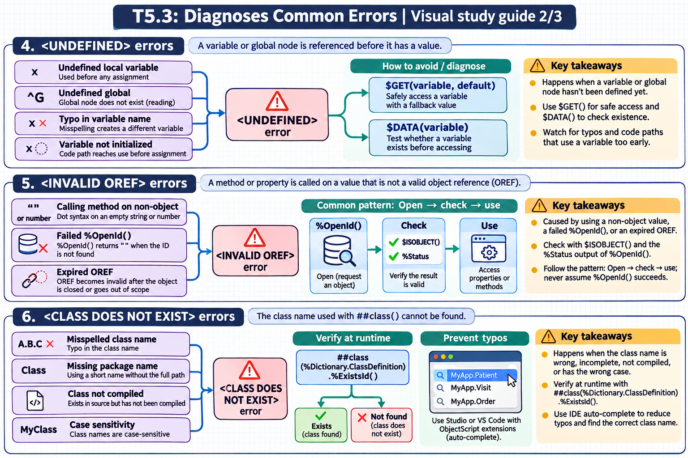

[Topic contents](../index.md) · [Full topic guide](../study.md) · [All topics](../../../index.md)

# T5.3: Diagnoses Common Errors

Saved 2 November 2026 from [exam-prep.es](https://exam-prep.es/exams/objectscript/knowledge/T5.3.html). Reference links require internet access.

## 5. &lt;INVALID OREF&gt; errors



*This diagram covers sections 4–6; use the matching numbered panel for this page.* [Chapter diagrams](../visuals.md) · [Technical review notes](../../../visual-technical-notes.md)

### Key Points

- **Calling method on non-object**: Using dot syntax on a value that is not a valid object reference (empty string, number)
- **Failed %OpenId**: `%OpenId()` returns `""` when the ID doesn't exist; calling a method on that result triggers the error
- **Expired OREF**: Object reference becomes invalid after the object is closed or goes out of scope
- **$ISOBJECT check**: Always verify an OREF is valid with `$ISOBJECT()` before accessing properties or methods
- **%Status checking**: Use the status output parameter of `%OpenId()` to detect and handle open failures
- **Common pattern**: Open → check → use; never assume `%OpenId()` succeeds

### Detailed Notes

#### Overview

`<INVALID OREF>` errors occur when code attempts to call a method or access a property on a value that is not a valid object reference. The most common cause is using the result of `%OpenId()` without checking whether it returned a valid object. If the requested ID does not exist, `%OpenId()` returns `""`, and any subsequent dot-syntax access on that value triggers `<INVALID OREF>`.

#### Failed %OpenId Leading to INVALID OREF

```objectscript
// ERROR: %OpenId returns "" when ID doesn't exist
ClassMethod DisplayPerson(id As %Integer)
{
    Set person = ##class(MyApp.Person).%OpenId(id)
    // If id 999 doesn't exist, person = ""
    Write person.Name, !    // <INVALID OREF> error!
}

// FIX: Check with $ISOBJECT before use
ClassMethod DisplayPersonSafe(id As %Integer) As %Status
{
    Set person = ##class(MyApp.Person).%OpenId(id)
    If '$ISOBJECT(person) {
        Write "Person not found: ", id, !
        Return $$$ERROR($$$GeneralError, "Person not found: " _ id)
    }
    Write person.Name, !
    Return $$$OK
}
```

#### Expired or Killed Object Reference

```objectscript
// ERROR: OREF becomes invalid after object is killed
ClassMethod OrefScopeIssue()
{
    Set obj = ##class(%ArrayOfDataTypes).%New()
    Do obj.SetAt("value1", "key1")

    // Kill the object
    Set obj = ""

    // Now obj is "" (empty string), not an OREF
    Do obj.SetAt("value2", "key2")    // <INVALID OREF> error!

    // FIX: Check before use
    If $ISOBJECT(obj) {
        Do obj.SetAt("value2", "key2")
    }
}
```

#### Using %Status Output Parameter

```objectscript
// BEST PRACTICE: Use the status parameter of %OpenId
ClassMethod ProcessRecord(id As %Integer) As %Status
{
    Set record = ##class(MyApp.Record).%OpenId(id, , .sc)
    If $$$ISERR(sc) {
        // Open failed - sc contains the reason
        Return sc
    }
    If '$ISOBJECT(record) {
        Return $$$ERROR($$$GeneralError, "Record not found: " _ id)
    }

    // Safe to use record
    Set record.Status = "Processed"
    Return record.%Save()
}
```

### Documentation References

- [&lt;INVALID OREF&gt; Error](https://docs.intersystems.com/irislatest/csp/docbook/DocBook.UI.Page.cls?KEY=RERR_gen#RERR_INVALID_OREF)
- [$ISOBJECT Function](https://docs.intersystems.com/irislatest/csp/docbook/DocBook.UI.Page.cls?KEY=RCOS_fisobject)
- [%OpenId Method](https://docs.intersystems.com/irislatest/csp/docbook/DocBook.UI.Page.cls?KEY=RCOS_openid)
