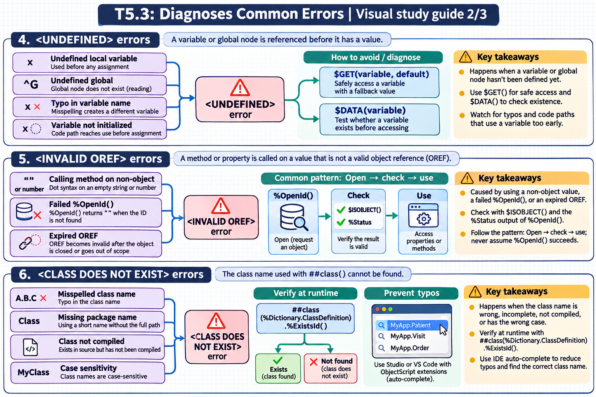

[Topic contents](../index.md) · [Full topic guide](../study.md) · [All topics](../../../index.md)

# T5.3: Diagnoses Common Errors

Saved 2 November 2026 from [exam-prep.es](https://exam-prep.es/exams/objectscript/knowledge/T5.3.html). Reference links require internet access.

## 6. &lt;CLASS DOES NOT EXIST&gt; errors



*This diagram covers sections 4–6; use the matching numbered panel for this page.* [Chapter diagrams](../visuals.md) · [Technical review notes](../../../visual-technical-notes.md)

### Key Points

- **Misspelled class name**: Typo in the class name used with `##class()` causes immediate failure
- **Missing package name**: Using a short class name without the full package path
- **Class not compiled**: The class exists in source but has not been compiled yet
- **Case sensitivity**: Class names in ObjectScript are case-sensitive
- **Verify with %Dictionary**: Use `##class(%Dictionary.ClassDefinition).%ExistsId()` to check at runtime
- **IDE auto-complete**: Use Studio or VS Code with ObjectScript extensions to prevent typos

### Detailed Notes

#### Overview

`<CLASS DOES NOT EXIST>` errors occur when code references a class that cannot be found in the class dictionary. This typically happens due to typos in `##class()` calls, missing package prefixes, or referencing a class that has not been compiled. The error includes the class name that was not found, making diagnosis straightforward.

#### Typo in Class Name

```objectscript
// ERROR: Misspelled class name
ClassMethod CreatePerson() As %Status
{
    // Typo: "Perso" instead of "Person"
    Set person = ##class(MyApp.Perso).%New()    // <CLASS DOES NOT EXIST>

    // FIX: Correct the class name
    Set person = ##class(MyApp.Person).%New()
}
```

#### Missing Package Prefix

```objectscript
// ERROR: Missing the full package path
ClassMethod OpenRecord() As %Status
{
    // Missing "MyApp." package prefix
    Set obj = ##class(Person).%New()    // <CLASS DOES NOT EXIST>

    // FIX: Include the full package name
    Set obj = ##class(MyApp.Person).%New()
}
```

#### Wrong Class Path in System Calls

```objectscript
// ERROR: Wrong class hierarchy for system utilities
// Common mistake with SQL statistics gathering
Do $SYSTEM.SQL.Stats.GatherTableStats("MyApp.Person")
// <CLASS DOES NOT EXIST> if the correct path differs

// FIX: Use the correct class path
Do $SYSTEM.SQL.Stats.Table.GatherTableStats("MyApp.Person")
```

#### Runtime Class Existence Check

```objectscript
// Checking if a class exists before using it
ClassMethod SafeCreateObject(className As %String) As %RegisteredObject
{
    // Check if the class exists in the dictionary
    If '##class(%Dictionary.ClassDefinition).%ExistsId(className) {
        Write "Class does not exist: ", className, !
        Return ""
    }

    // Safe to create an instance
    Set obj = $CLASSMETHOD(className, "%New")
    Return obj
}
```

### Documentation References

- [&lt;CLASS DOES NOT EXIST&gt; Error](https://docs.intersystems.com/irislatest/csp/docbook/DocBook.UI.Page.cls?KEY=RERR_gen#RERR_CLASS_DOES_NOT_EXIST)
- [##class Syntax](https://docs.intersystems.com/irislatest/csp/docbook/DocBook.UI.Page.cls?KEY=GCOS_commands#GCOS_commands_class)
- [%Dictionary.ClassDefinition](https://docs.intersystems.com/irislatest/csp/docbook/DocBook.UI.Page.cls?KEY=RCOS_cdictclassdef)
