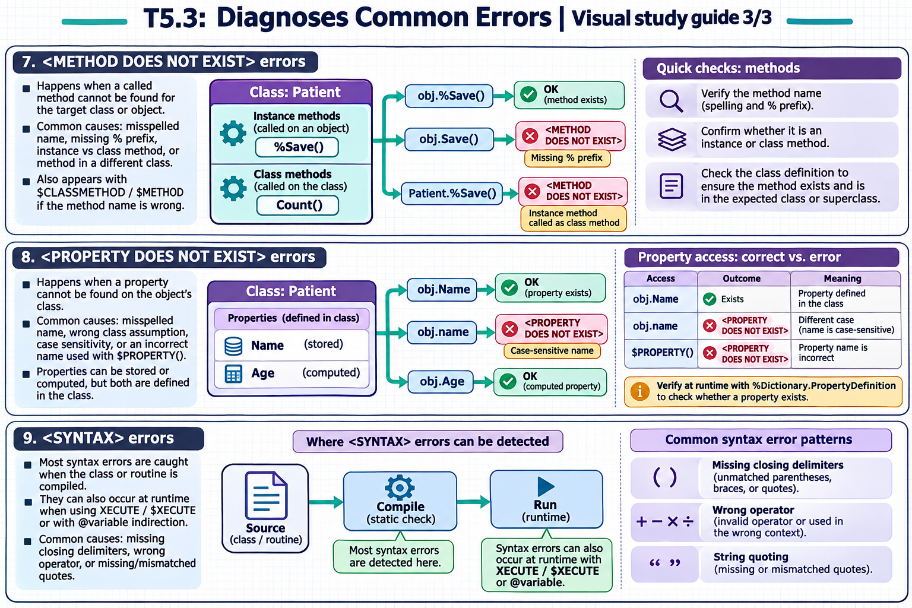

[Topic contents](../index.md) · [Full topic guide](../study.md) · [All topics](../../../index.md)

# T5.3: Diagnoses Common Errors

Saved 2 November 2026 from [exam-prep.es](https://exam-prep.es/exams/objectscript/knowledge/T5.3.html). Reference links require internet access.

## 7. &lt;METHOD DOES NOT EXIST&gt; errors



*This diagram covers sections 7–9; use the matching numbered panel for this page.* [Chapter diagrams](../visuals.md) · [Technical review notes](../../../visual-technical-notes.md)

### Key Points

- **Misspelled method name**: Typo in the method name when calling it on an object or class
- **Missing % prefix**: Many system methods start with `%` (e.g., `%Save()` not `Save()`)
- **Instance vs class method**: Calling an instance method as a class method or vice versa
- **Method not in class**: Method exists in a different class or superclass than expected
- **$CLASSMETHOD/$METHOD**: These system functions can trigger this error with wrong method names
- **Check class definition**: Verify method exists and its type (instance vs class) before calling

### Detailed Notes

#### Overview

`<METHOD DOES NOT EXIST>` errors occur when code attempts to call a method that is not defined in the target class (or any of its superclasses). The most common causes are typos in method names, forgetting the `%` prefix on system methods, and confusing instance methods with class methods. The error message includes both the method name and the class name.

#### Missing % Prefix on System Methods

```objectscript
// ERROR: Forgetting the % prefix on system methods
ClassMethod SavePerson() As %Status
{
    Set person = ##class(MyApp.Person).%New()
    Set person.Name = "John"

    // Wrong: Save() does not exist - the method is %Save()
    Set sc = person.Save()    // <METHOD DOES NOT EXIST>

    // FIX: Use the correct method name with % prefix
    Set sc = person.%Save()
    Return sc
}
```

#### Instance Method Called as Class Method

```objectscript
// ERROR: Calling an instance method as a class method
ClassMethod ProcessExample()
{
    // %Save is an instance method, not a class method
    Set sc = ##class(MyApp.Person).%Save()    // <METHOD DOES NOT EXIST>

    // FIX: Create or open an instance first, then call the method
    Set person = ##class(MyApp.Person).%New()
    Set person.Name = "Jane"
    Set sc = person.%Save()    // Correct: called on instance
}
```

#### Typo in Method Name

```objectscript
// ERROR: Misspelled method name
ClassMethod QueryExample()
{
    Set stmt = ##class(%SQL.Statement).%New()

    // Wrong: "Preapre" instead of "Prepare"
    Set sc = stmt.Preapre("SELECT Name FROM MyApp.Person")    // <METHOD DOES NOT EXIST>

    // FIX: Correct spelling
    Set sc = stmt.%Prepare("SELECT Name FROM MyApp.Person")
}
```

#### Using $CLASSMETHOD Safely

```objectscript
// Dynamic method dispatch - verify method exists first
ClassMethod DynamicCall(className As %String, methodName As %String) As %String
{
    // Check if the method exists in the class
    Set methodDef = className _ "||" _ methodName
    If '##class(%Dictionary.MethodDefinition).%ExistsId(methodDef) {
        Write "Method does not exist: ", className, ".", methodName, !
        Return ""
    }

    // Safe to call
    Return $CLASSMETHOD(className, methodName)
}
```

### Documentation References

- [&lt;METHOD DOES NOT EXIST&gt; Error](https://docs.intersystems.com/irislatest/csp/docbook/DocBook.UI.Page.cls?KEY=RERR_gen#RERR_METHOD_DOES_NOT_EXIST)
- [$CLASSMETHOD Function](https://docs.intersystems.com/irislatest/csp/docbook/DocBook.UI.Page.cls?KEY=RCOS_fclassmethod)
- [$METHOD Function](https://docs.intersystems.com/irislatest/csp/docbook/DocBook.UI.Page.cls?KEY=RCOS_fmethod)
