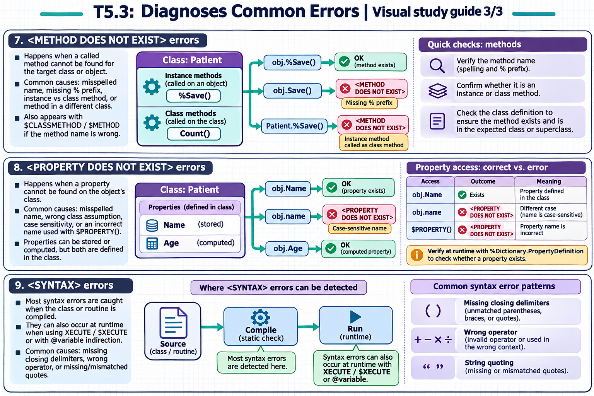

[Topic contents](../index.md) · [Full topic guide](../study.md) · [All topics](../../../index.md)

# T5.3: Diagnoses Common Errors

Saved 2 November 2026 from [exam-prep.es](https://exam-prep.es/exams/objectscript/knowledge/T5.3.html). Reference links require internet access.

## 8. &lt;PROPERTY DOES NOT EXIST&gt; errors



*This diagram covers sections 7–9; use the matching numbered panel for this page.* [Chapter diagrams](../visuals.md) · [Technical review notes](../../../visual-technical-notes.md)

### Key Points

- **Misspelled property name**: Typo in the property name when accessing via dot syntax
- **Wrong class assumption**: Object is of a different class than expected, lacking the property
- **Case sensitivity**: Property names are case-sensitive in ObjectScript
- **Dynamic property access**: Using `$PROPERTY()` with an incorrect property name
- **Check class definition**: Use `%Dictionary.PropertyDefinition` to verify property existence at runtime
- **Computed properties**: Some properties may be calculated and not stored — but they still exist in the class definition

### Detailed Notes

#### Overview

`<PROPERTY DOES NOT EXIST>` errors occur when code attempts to access a property that is not defined in the object's class. This is similar to `<METHOD DOES NOT EXIST>` but for properties. The error message includes the property name and the class name. Common causes include typos, case-sensitivity issues, and accessing a property on the wrong class.

#### Typo in Property Name

```objectscript
// ERROR: Misspelled property name
ClassMethod DisplayPerson(id As %Integer)
{
    Set person = ##class(MyApp.Person).%OpenId(id)
    If '$ISOBJECT(person) Return

    // Wrong: "Naem" instead of "Name"
    Write person.Naem, !    // <PROPERTY DOES NOT EXIST>

    // FIX: Correct the property name
    Write person.Name, !
}
```

#### Wrong Class Assumption

```objectscript
// ERROR: Assuming the wrong class
ClassMethod ProcessItem(item As %RegisteredObject)
{
    // Caller passes a %ArrayOfDataTypes but code assumes MyApp.Person
    Write item.Name, !    // <PROPERTY DOES NOT EXIST> if item is not a Person

    // FIX: Check the class before accessing specific properties
    If item.%IsA("MyApp.Person") {
        Write item.Name, !
    }
    Else {
        Write "Unexpected object type: ", item.%ClassName(1), !
    }
}
```

#### Dynamic Property Access with $PROPERTY

```objectscript
// ERROR: Wrong property name in dynamic access
ClassMethod GetPropertyValue(obj As %RegisteredObject, propName As %String) As %String
{
    // If propName is wrong, this triggers <PROPERTY DOES NOT EXIST>
    Return $PROPERTY(obj, propName)
}

// FIX: Validate property existence first
ClassMethod GetPropertyValueSafe(obj As %RegisteredObject, propName As %String) As %String
{
    Set className = obj.%ClassName(1)
    Set propDef = className _ "||" _ propName
    If '##class(%Dictionary.PropertyDefinition).%ExistsId(propDef) {
        Write "Property does not exist: ", className, ".", propName, !
        Return ""
    }
    Return $PROPERTY(obj, propName)
}
```

### Documentation References

- [&lt;PROPERTY DOES NOT EXIST&gt; Error](https://docs.intersystems.com/irislatest/csp/docbook/DocBook.UI.Page.cls?KEY=RERR_gen#RERR_PROPERTY_DOES_NOT_EXIST)
- [$PROPERTY Function](https://docs.intersystems.com/irislatest/csp/docbook/DocBook.UI.Page.cls?KEY=RCOS_fproperty)
- [%Dictionary.PropertyDefinition](https://docs.intersystems.com/irislatest/csp/docbook/DocBook.UI.Page.cls?KEY=RCOS_cdictpropdef)
