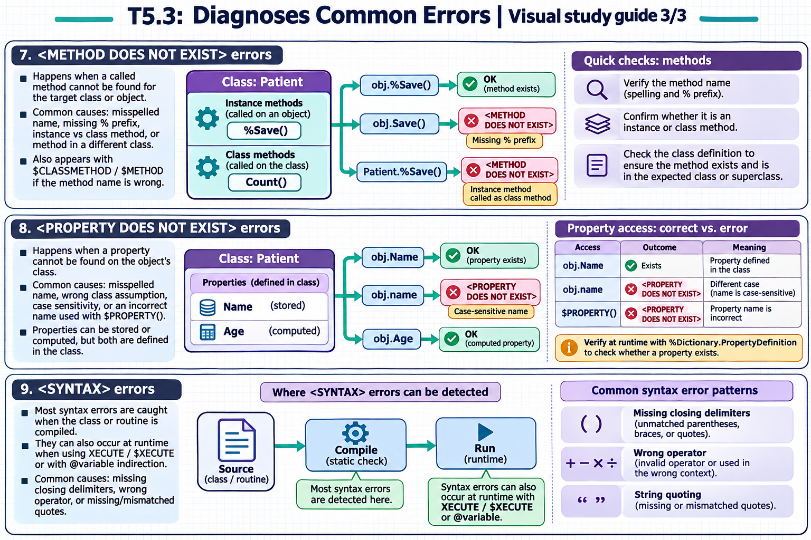

[Topic contents](../index.md) · [Full topic guide](../study.md) · [All topics](../../../index.md)

# T5.3: Diagnoses Common Errors

Saved 2 November 2026 from [exam-prep.es](https://exam-prep.es/exams/objectscript/knowledge/T5.3.html). Reference links require internet access.

## 9. &lt;SYNTAX&gt; errors



*This diagram covers sections 7–9; use the matching numbered panel for this page.* [Chapter diagrams](../visuals.md) · [Technical review notes](../../../visual-technical-notes.md)

### Key Points

- **Compile-time detection**: Most syntax errors are caught when the class or routine is compiled
- **Runtime with XECUTE**: Syntax errors in dynamically executed code (`XECUTE`, `$XECUTE`) occur at runtime
- **Missing closing delimiters**: Unmatched parentheses, braces, or quotes are common causes
- **Wrong operator**: Using an invalid operator or operator in the wrong context
- **String quoting**: Missing or mismatched quotes in string literals
- **Indirection**: Syntax errors in `@variable` indirection expressions are detected at runtime

### Detailed Notes

#### Overview

`<SYNTAX>` errors indicate that the ObjectScript parser cannot interpret the code due to a structural problem. Most syntax errors are caught at compile time, preventing the code from running at all. However, syntax errors can also occur at runtime when using dynamic code execution (`XECUTE` command, `$XECUTE` function) or indirection (`@`), since these construct and parse code strings at runtime.

#### Missing Closing Parenthesis

```objectscript
// ERROR: Missing closing parenthesis (caught at compile time)
ClassMethod CompileError()
{
    Set x = $LENGTH("hello"    // <SYNTAX> - missing closing )

    // FIX: Match all parentheses
    Set x = $LENGTH("hello")
}
```

#### Unbalanced Braces

```objectscript
// ERROR: Missing closing brace (caught at compile time)
ClassMethod BraceError()
{
    If x = 1 {
        Write "one", !
    // Missing closing }     // <SYNTAX>

    // FIX: Ensure every { has a matching }
    If x = 1 {
        Write "one", !
    }
}
```

#### Runtime Syntax Error with XECUTE

```objectscript
// ERROR: Syntax error in dynamic code (caught at RUNTIME)
ClassMethod DynamicCodeError()
{
    Set code = "Set x = $LENGTH(""hello"""    // Missing closing )

    // This compiles fine - the string is valid
    // But executing it causes <SYNTAX> at runtime
    XECUTE code    // <SYNTAX> error at runtime!

    // FIX: Validate dynamic code carefully
    Set code = "Set x = $LENGTH(""hello"")"
    XECUTE code    // Works correctly
}
```

#### Syntax Error with Indirection

```objectscript
// ERROR: Invalid expression in indirection
ClassMethod IndirectionError()
{
    Set expr = "1 + + 2"    // Invalid expression
    Set result = @expr       // <SYNTAX> at runtime

    // FIX: Validate the expression
    Set expr = "1 + 2"
    Set result = @expr       // Works: result = 3
}
```

#### Common Syntax Mistakes

```objectscript
// Common syntax errors and their fixes:

// 1. Missing dot before method call in same class
//    Do MyMethod()     // <SYNTAX> in instance context
//    Do ..MyMethod()   // Correct for instance methods

// 2. Wrong string quoting (doubling quotes inside strings)
//    Set x = "He said "hello""    // <SYNTAX>
//    Set x = "He said ""hello"""  // Correct

// 3. Missing comma in function arguments
//    Set x = $EXTRACT(str 1 3)    // <SYNTAX>
//    Set x = $EXTRACT(str, 1, 3)  // Correct

// 4. Using = instead of == in expressions (not an error but a logic bug)
//    Note: ObjectScript uses = for both assignment and comparison
//    depending on context, so this is valid syntax
```

### Documentation References

- [&lt;SYNTAX&gt; Error](https://docs.intersystems.com/irislatest/csp/docbook/DocBook.UI.Page.cls?KEY=RERR_gen#RERR_SYNTAX)
- [XECUTE Command](https://docs.intersystems.com/irislatest/csp/docbook/DocBook.UI.Page.cls?KEY=RCOS_cxecute)
- [Indirection](https://docs.intersystems.com/irislatest/csp/docbook/DocBook.UI.Page.cls?KEY=GCOS_commands)
