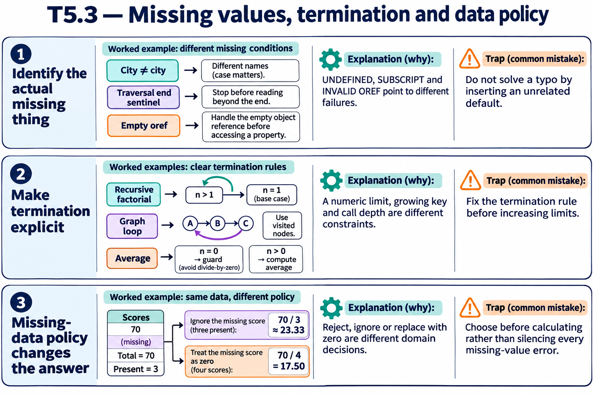

# T5.3 · 01 — La prima causa si cerca nel nome e nel valore effettivi

[Indice degli approfondimenti](README.md) · [Quiz originale](../quiz.md) · [Teoria](../study.md)

**Esercizi di partenza:** [Q2](../quiz.md#question-2-single) · [Q3](../quiz.md#question-3-single) · [Q5](../quiz.md#question-5-single) · [Q6](../quiz.md#question-6-single) · [Q8](../quiz.md#question-8-single) · [Q13](../quiz.md#question-13-single) · [Q14](../quiz.md#question-14-single) · [Q18](../quiz.md#question-18-single). L’approfondimento rielabora il concetto e aggiunge una variante; non riproduce soltanto la risposta del quiz.

## Il caso concreto

ordKey e key sono variabili diverse; City e city pure. Un ciclo che legge dopo la sentinella può inoltre tentare un nodo privo di valore.

```objectscript
set key=""
for {
  set key=$ORDER(data(key))
  quit:key=""
  write data(key),!
}
```

## Ragionamento passo per passo

Controlla il nome esatto e se il valore è stato definito lungo quel percorso. Il ciclo corretto esce prima di leggere data(""). Se manca soltanto il valore, la categoria è UNDEFINED; SUBSCRIPT riguarda invece un subscript non valido secondo il contesto. Prima di accedere a customer.Email verifica l’oref.

## Perché il distrattore è plausibile

Correggere il dato nel database quando il codice usa un identificatore sbagliato, o assegnare sempre la stessa categoria d’errore a ogni accesso fallito.

## Lo spunto da portare oltre l’esercizio

Riproduci la prima istruzione che fallisce e annota operando, valore e contesto.



*Leggi il pannello 1; gli altri due collegano il caso agli altri approfondimenti del capitolo.*

## Variante: prova prima di leggere la soluzione

Hai impostato city="Roma" ma leggi City. Sono la stessa variabile?

<details>
<summary>Soluzione ragionata</summary>

No: i nomi delle variabili distinguono maiuscole e minuscole.

</details>

## Riferimenti e precisazioni

- [Diagnosi degli errori](https://docs.intersystems.com/irislatest/csp/docbook/DocBook.UI.Page.cls?KEY=RCOS_vzerror)
- [$GET](https://docs.intersystems.com/irislatest/csp/docbook/DocBook.UI.Page.cls?KEY=RCOS_fget)
- [$LISTGET](https://docs.intersystems.com/irislatest/csp/docbook/DocBook.UI.Page.cls?KEY=RCOS_flistget)
- [FOR](https://docs.intersystems.com/irislatest/csp/docbook/DocBook.UI.Page.cls?KEY=RCOS_cfor)
- [Namespace e database, incluso read-only](https://docs.intersystems.com/irislatest/csp/docbook/DocBook.UI.Page.cls?KEY=GORIENT_enviro)
- [Definizione e chiamata dei metodi](https://docs.intersystems.com/irislatest/csp/docbook/DocBook.UI.Page.cls?KEY=GOBJ_methods)
- [Limiti di sistema](https://docs.intersystems.com/irislatest/csp/docbook/DocBook.UI.Page.cls?KEY=RCOS_appx_limits)

[Note specifiche del capitolo](README.md#precisazioni-rispetto-al-quiz) · [Metodo e limiti della revisione](../../../approfondimenti-esercizi.md#metodo-e-limiti)
