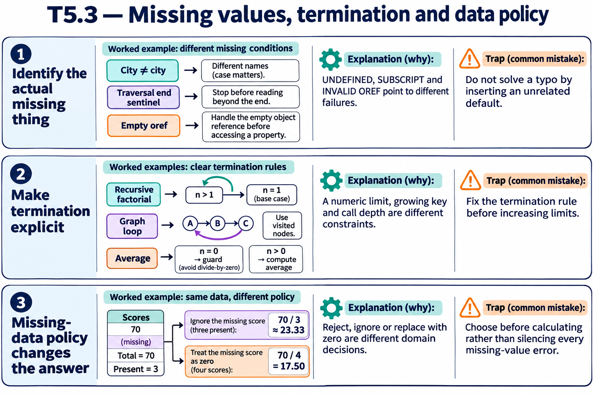

# T5.3 · 02 — Un algoritmo deve avere un’uscita e un dominio valido

[Indice degli approfondimenti](README.md) · [Quiz originale](../quiz.md) · [Teoria](../study.md)

**Esercizi di partenza:** [Q4](../quiz.md#question-4-single) · [Q16](../quiz.md#question-16-single) · [Q17](../quiz.md#question-17-single). L’approfondimento rielabora il concetto e aggiunge una variante; non riproduce soltanto la risposta del quiz.

## Il caso concreto

Una ricorsione manca del caso base, un collegamento torna al nodo già visitato, oppure una media riceve zero valori.

## Ragionamento passo per passo

Per una ricorsione identifica il caso base e una quantità che diminuisce. Per un grafo con cicli mantieni un insieme dei visitati o un limite giustificato. Per una media controlla n>0 prima di dividere: il risultato su un insieme vuoto è una decisione di contratto, non un valore da inventare. Un ciclo infinito non deve necessariamente generare subito un errore di stack.

## Perché il distrattore è plausibile

Aspettare un’eccezione per interrompere un ciclo logico o attribuire a tutte le forme di mancata terminazione lo stesso errore.

## Lo spunto da portare oltre l’esercizio

Definisci precondizione e prova di avanzamento prima di fidarti del caso felice.

*Leggi il pannello 2; gli altri due collegano il caso agli altri approfondimenti del capitolo.*

## Variante: prova prima di leggere la soluzione

La lista collegata fa 1→2→3→1. Basta attendere che current diventi vuoto?

Soluzione ragionata

No: non lo diventerà. Rileva un nodo già visitato e gestisci il ciclo.

## Riferimenti e precisazioni

- [Diagnosi degli errori](https://docs.intersystems.com/irislatest/csp/docbook/DocBook.UI.Page.cls?KEY=RCOS_vzerror)
- [$GET](https://docs.intersystems.com/irislatest/csp/docbook/DocBook.UI.Page.cls?KEY=RCOS_fget)
- [$LISTGET](https://docs.intersystems.com/irislatest/csp/docbook/DocBook.UI.Page.cls?KEY=RCOS_flistget)
- [FOR](https://docs.intersystems.com/irislatest/csp/docbook/DocBook.UI.Page.cls?KEY=RCOS_cfor)
- [Namespace e database, incluso read-only](https://docs.intersystems.com/irislatest/csp/docbook/DocBook.UI.Page.cls?KEY=GORIENT_enviro)
- [Definizione e chiamata dei metodi](https://docs.intersystems.com/irislatest/csp/docbook/DocBook.UI.Page.cls?KEY=GOBJ_methods)
- [Limiti di sistema](https://docs.intersystems.com/irislatest/csp/docbook/DocBook.UI.Page.cls?KEY=RCOS_appx_limits)

[Note specifiche del capitolo](README.md#precisazioni-rispetto-al-quiz) · [Metodo e limiti della revisione](../../../approfondimenti-esercizi.md#metodo-e-limiti)
