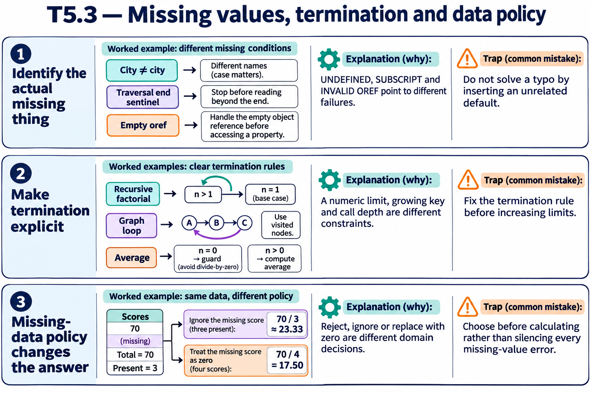

# T5.3 · 03 — Un valore opzionale richiede una politica esplicita

[Indice degli approfondimenti](README.md) · [Quiz originale](../quiz.md) · [Teoria](../study.md)

**Esercizi di partenza:** [Q1](../quiz.md#question-1-single) · [Q7](../quiz.md#question-7-multiple) · [Q9](../quiz.md#question-9-single) · [Q10](../quiz.md#question-10-single) · [Q11](../quiz.md#question-11-multiple) · [Q12](../quiz.md#question-12-single) · [Q15](../quiz.md#question-15-multiple). L’approfondimento rielabora il concetto e aggiunge una variante; non riproduce soltanto la risposta del quiz.

## Il caso concreto

La lista 10,20,omesso,40 fallisce alla terza lettura stretta. Usare un default può evitare l’errore, ma cambia il significato del calcolo.

```objectscript
set x=$LISTBUILD(10,20,,40)
set item=$LISTGET(x,3,0)
```

## Ragionamento passo per passo

$LISTGET qui restituisce zero, ma decidere che un dato mancante valga zero è una regola del problema. Puoi invece rifiutare il record o escluderlo dalla media con un conteggio separato. Analogamente, un errore di accesso ai global richiede distinguere permessi, destinazione e modalità del database: non si risolve cambiando il default della lettura.

## Perché il distrattore è plausibile

Nascondere ogni problema con $GET/$LISTGET oppure concedere privilegi estesi senza identificare risorsa e percorso.

## Lo spunto da portare oltre l’esercizio

Un fallback è corretto quando il dominio lo autorizza; altrimenti rende silenzioso un errore di qualità del dato.



*Leggi il pannello 3; gli altri due collegano il caso agli altri approfondimenti del capitolo.*

## Variante: prova prima di leggere la soluzione

Per la media di 10,20,omesso,40, ignorare il mancante e sostituirlo con zero danno la stessa risposta?

<details>
<summary>Soluzione ragionata</summary>

No: 70/3 contro 70/4. Devi scegliere e documentare la politica.

</details>

## Riferimenti e precisazioni

- [Diagnosi degli errori](https://docs.intersystems.com/irislatest/csp/docbook/DocBook.UI.Page.cls?KEY=RCOS_vzerror)
- [$GET](https://docs.intersystems.com/irislatest/csp/docbook/DocBook.UI.Page.cls?KEY=RCOS_fget)
- [$LISTGET](https://docs.intersystems.com/irislatest/csp/docbook/DocBook.UI.Page.cls?KEY=RCOS_flistget)
- [FOR](https://docs.intersystems.com/irislatest/csp/docbook/DocBook.UI.Page.cls?KEY=RCOS_cfor)
- [Namespace e database, incluso read-only](https://docs.intersystems.com/irislatest/csp/docbook/DocBook.UI.Page.cls?KEY=GORIENT_enviro)
- [Definizione e chiamata dei metodi](https://docs.intersystems.com/irislatest/csp/docbook/DocBook.UI.Page.cls?KEY=GOBJ_methods)
- [Limiti di sistema](https://docs.intersystems.com/irislatest/csp/docbook/DocBook.UI.Page.cls?KEY=RCOS_appx_limits)

[Note specifiche del capitolo](README.md#precisazioni-rispetto-al-quiz) · [Metodo e limiti della revisione](../../../approfondimenti-esercizi.md#metodo-e-limiti)
