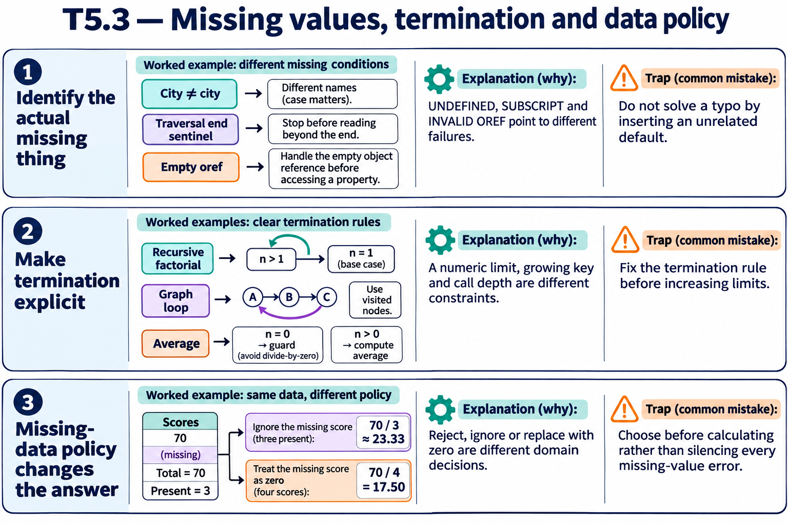
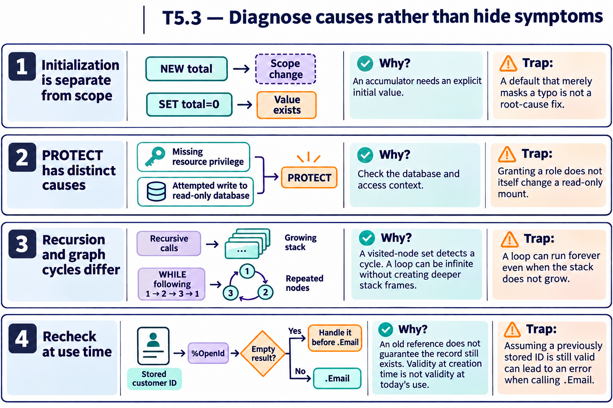

# T5.3 — Approfondimenti dagli esercizi

## Tutte le 18 domande approfondite

[Apri le schede domanda per domanda](<Domanda per domanda/README.md>) · [Tavole spiegate in inglese](tavole-esercizi.md)

Ogni domanda dispone ora di un commento specifico, un concetto ulteriore e una variante con soluzione. I tre casi seguenti sono percorsi tematici aggiuntivi. Le immagini sono in inglese.

[Teoria](../study.md) · [Quiz](../quiz.md) · [Tutti gli approfondimenti](../../../approfondimenti-esercizi.md)

Tre percorsi trasversali, da affiancare alle schede individuali, per capire il meccanismo dietro le risposte: scenario, ragionamento, distrattore, regola riutilizzabile e variante con soluzione. I riferimenti Q rimandano al quiz scaricato; la numerazione è locale al capitolo.

[Leggi esempi e spiegazioni dei pannelli](tavole-esercizi.md).

## Percorso consigliato

1. [La prima causa si cerca nel nome e nel valore effettivi](<01 - La prima causa si cerca nel nome e nel valore effettivi.md>) — Q2, Q3, Q5, Q6, Q8, Q13, Q14, Q18
2. [Un algoritmo deve avere un’uscita e un dominio valido](<02 - Un algoritmo deve avere un’uscita e un dominio valido.md>) — Q4, Q16, Q17
3. [Un valore opzionale richiede una politica esplicita](<03 - Un valore opzionale richiede una politica esplicita.md>) — Q1, Q7, Q9, Q10, Q11, Q12, Q15

[Indice di tutte le 18 domande del capitolo](mappa-domande.md). I percorsi sono tematici; ogni domanda ha inoltre una scheda individuale nella sottocartella dedicata.

## Precisazioni rispetto al quiz

Q3: l’esito dell’accesso data("") dipende anche dalle regole dei subscript nulli del processo; distinguere un nodo senza valore da un subscript vietato. Q7: PROTECT può derivare sia da privilegi insufficienti sia da un database read-only; verificare entrambe le cause. Q16: leggere un conteggio variadico non definito può produrre UNDEFINED; per l’insieme vuoto usare $GET(scores,0) e gestire n=0 prima della divisione. Non usare 511 byte come limite universale: locali, global e PPG hanno limiti diversi.

Queste precisazioni si applicano agli approfondimenti nuovi. Il testo delle risposte scaricate rimane una testimonianza della fonte e non viene riscritto silenziosamente.

## Documentazione

- [Diagnosi degli errori](https://docs.intersystems.com/irislatest/csp/docbook/DocBook.UI.Page.cls?KEY=RCOS_vzerror)
- [$GET](https://docs.intersystems.com/irislatest/csp/docbook/DocBook.UI.Page.cls?KEY=RCOS_fget)
- [$LISTGET](https://docs.intersystems.com/irislatest/csp/docbook/DocBook.UI.Page.cls?KEY=RCOS_flistget)
- [FOR](https://docs.intersystems.com/irislatest/csp/docbook/DocBook.UI.Page.cls?KEY=RCOS_cfor)
- [Namespace e database, incluso read-only](https://docs.intersystems.com/irislatest/csp/docbook/DocBook.UI.Page.cls?KEY=GORIENT_enviro)
- [Definizione e chiamata dei metodi](https://docs.intersystems.com/irislatest/csp/docbook/DocBook.UI.Page.cls?KEY=GOBJ_methods)
- [Limiti di sistema](https://docs.intersystems.com/irislatest/csp/docbook/DocBook.UI.Page.cls?KEY=RCOS_appx_limits)

Gli snippet sono frammenti didattici: quando usano classi di esempio o macro, presuppongono le relative definizioni e include. Non costituiscono implementazioni complete né sono stati eseguiti in IRIS.
