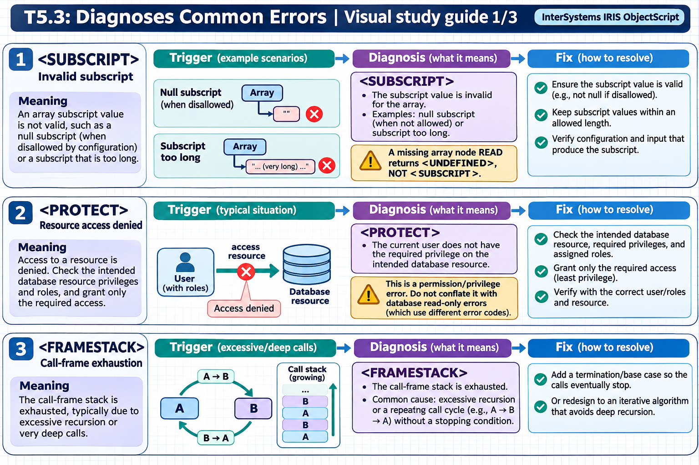
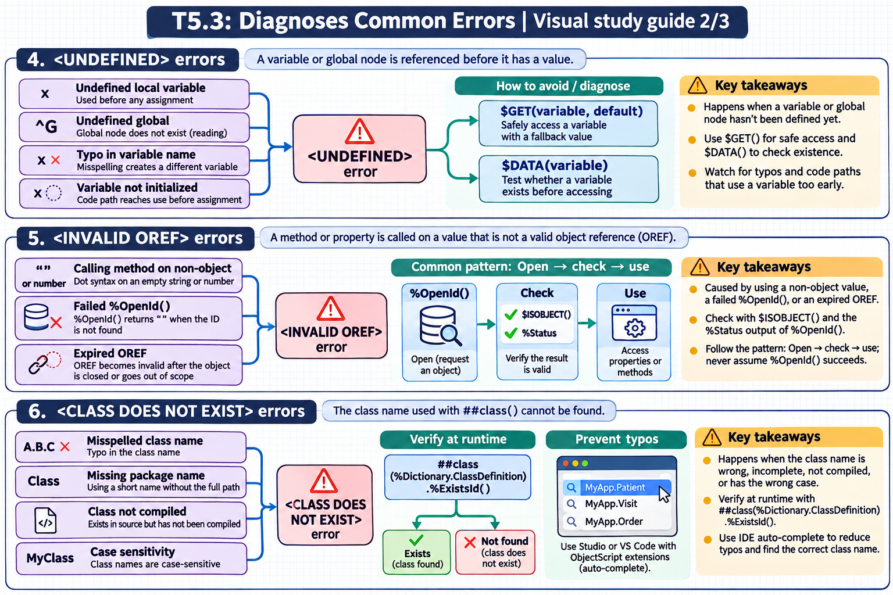
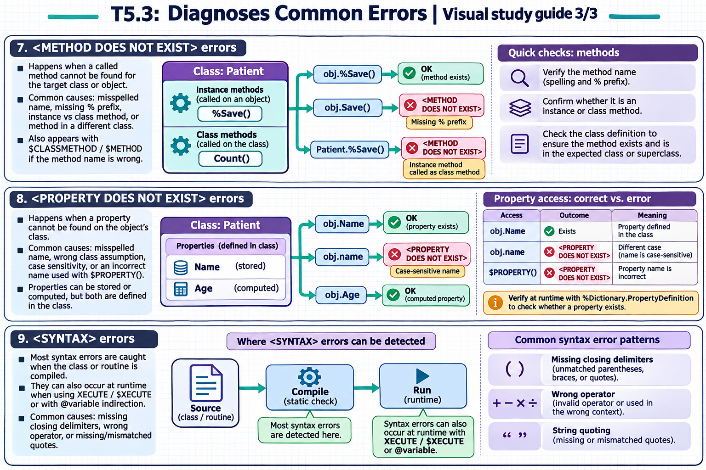

# T5.3: Diagnoses Common Errors — visual study guides

[Approfondimenti dagli esercizi](<Approfondimenti esercizi/README.md>)

[Chapter contents](index.md) · [Full guide](study.md) · [Practice questions](quiz.md)

Generated learning summaries. Read the full notes for detailed explanations and exact code. [Technical review notes](../../visual-technical-notes.md).

## Visual guide — sections 1–3

Covers:

- 1. <SUBSCRIPT> errors
- 2. <PROTECT> errors
- 3. <FRAMESTACK> errors

## Visual guide — sections 4–6

Covers:

- 4. <UNDEFINED> errors
- 5. <INVALID OREF> errors
- 6. <CLASS DOES NOT EXIST> errors

## Visual guide — sections 7–9

Covers:

- 7. <METHOD DOES NOT EXIST> errors
- 8. <PROPERTY DOES NOT EXIST> errors
- 9. <SYNTAX> errors
