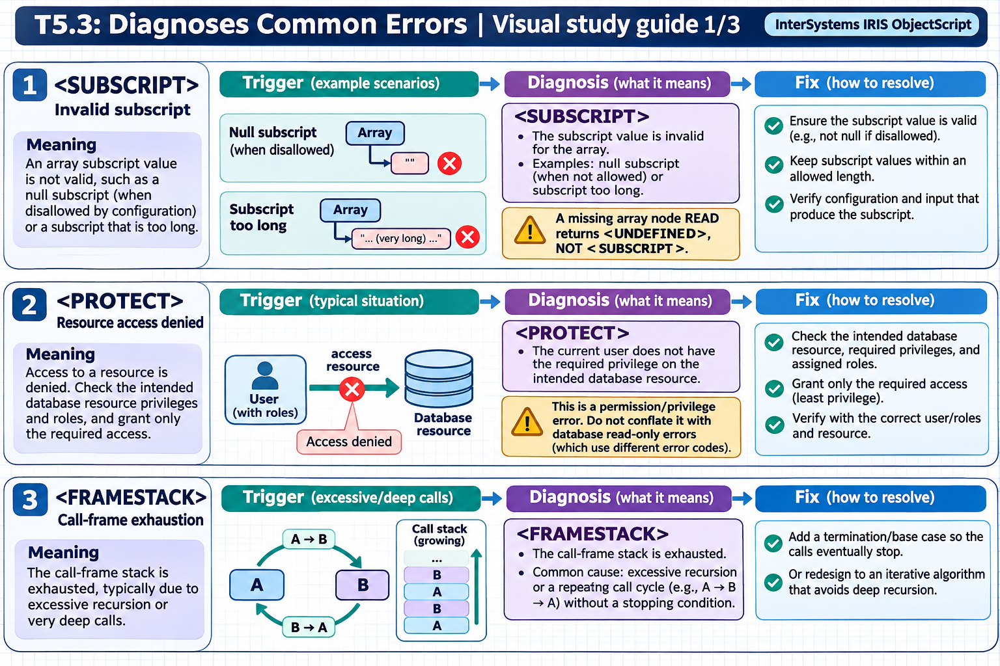
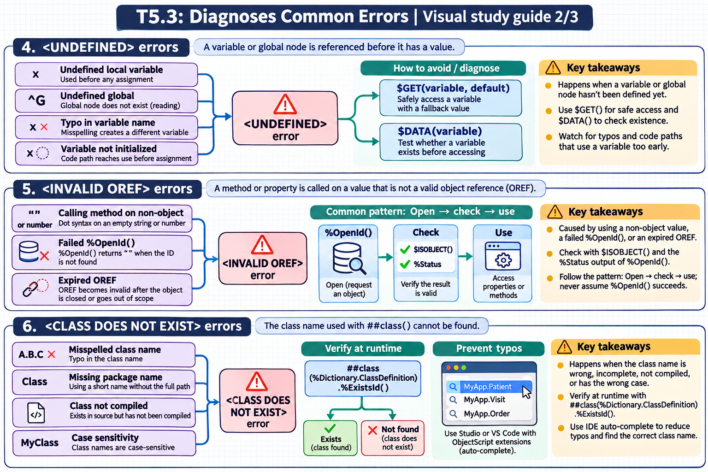
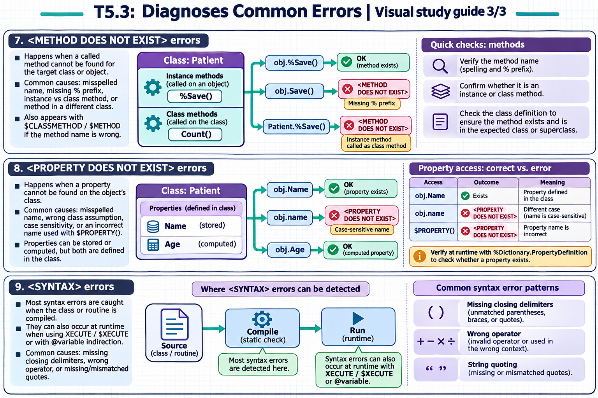

[All topics](../../index.md) · [Practice quiz](quiz.md)

# T5.3: Diagnoses Common Errors

[Approfondimenti dagli esercizi](<Approfondimenti esercizi/README.md>)

Saved 2 November 2026 from [exam-prep.es](https://exam-prep.es/exams/objectscript/knowledge/T5.3.html). Reference links require internet access.

### Contents

1. [&lt;SUBSCRIPT&gt; errors](#1-subscript-errors)
2. [&lt;PROTECT&gt; errors](#2-protect-errors)
3. [&lt;FRAMESTACK&gt; errors](#3-framestack-errors)
4. [&lt;UNDEFINED&gt; errors](#4-undefined-errors)
5. [&lt;INVALID OREF&gt; errors](#5-invalid-oref-errors)
6. [&lt;CLASS DOES NOT EXIST&gt; errors](#6-class-does-not-exist-errors)
7. [&lt;METHOD DOES NOT EXIST&gt; errors](#7-method-does-not-exist-errors)
8. [&lt;PROPERTY DOES NOT EXIST&gt; errors](#8-property-does-not-exist-errors)
9. [&lt;SYNTAX&gt; errors](#9-syntax-errors)

### Visual study guide — sections 1–3



[View all chapter diagrams](visuals.md) · [Technical review notes](../../visual-technical-notes.md)

## 1. &lt;SUBSCRIPT&gt; errors

### Key Points

- **Accessing undefined subscript**: Referencing a global or local array node that does not exist
- **Out-of-range $LIST access**: Using $LIST or $LISTGET with a position beyond the list length
- **Empty string as subscript**: Global subscripts cannot be the empty string ""
- **Wrong number of arguments**: Passing fewer arguments than expected can cause subscript errors in called code
- **$DATA and $GET**: Use these to check existence before accessing subscripts
- **$LISTLENGTH**: Check list length before accessing specific positions

### Detailed Notes

#### Overview

`<SUBSCRIPT>` errors occur when code attempts to use an invalid subscript to reference a global or local array node, or when `$LIST` operations reference positions that do not exist in a list structure. These are among the most common runtime errors in ObjectScript.

#### Accessing Undefined Subscript Nodes

```objectscript
// ERROR: Accessing a subscript that doesn't exist
Kill ^Data
Set ^Data(1) = "First"
Set ^Data(3) = "Third"

// This causes <SUBSCRIPT> if ^Data(2) doesn't exist
// and you use it in certain contexts
Write ^Data(2)    // <SUBSCRIPT> error - node 2 doesn't exist

// FIX: Use $GET with a default value
Write $GET(^Data(2), "N/A"), !   // Returns "N/A" safely

// FIX: Check with $DATA first
If $DATA(^Data(2)) {
    Write ^Data(2), !
}
Else {
    Write "No data for subscript 2", !
}
```

#### Empty String as Subscript

```objectscript
// ERROR: Empty string is not a valid global subscript
Set key = ""
Set ^Data(key) = "value"    // <SUBSCRIPT> error

// FIX: Validate before use
ClassMethod StoreValue(key As %String, value As %String) As %Status
{
    If key = "" {
        Return $$$ERROR($$$GeneralError, "Key cannot be empty")
    }
    Set ^Data(key) = value
    Return $$$OK
}
```

#### Out-of-Range $LIST Access

```objectscript
// ERROR: $LIST with out-of-range position
Set myList = $LISTBUILD("Apple", "Banana", "Cherry")
// myList has 3 elements

// Accessing position 5 causes <SUBSCRIPT> error with $LIST
Write $LIST(myList, 5)    // <SUBSCRIPT> error

// FIX: Use $LISTGET (returns "" for missing positions)
Write $LISTGET(myList, 5), !          // Returns ""
Write $LISTGET(myList, 5, "N/A"), !   // Returns "N/A"

// FIX: Check length first
If $LISTLENGTH(myList) >= 5 {
    Write $LIST(myList, 5), !
}
Else {
    Write "List has only ", $LISTLENGTH(myList), " elements", !
}
```

#### $LIST vs $LISTGET Comparison

```objectscript
Set list = $LISTBUILD("A", "B", "C")

// $LIST - throws <SUBSCRIPT> if position invalid
// Use when you KNOW the position exists
Set first = $LIST(list, 1)      // "A" - safe
// Set fifth = $LIST(list, 5)   // <SUBSCRIPT> error!

// $LISTGET - returns default if position invalid
// Use when position may not exist
Set first = $LISTGET(list, 1)        // "A"
Set fifth = $LISTGET(list, 5)        // "" (empty string)
Set fifth = $LISTGET(list, 5, "?")   // "?" (custom default)
```

#### Wrong Number of Arguments

```objectscript
// ERROR: Method expects data in a subscripted array
ClassMethod ProcessItems(ByRef items)
{
    // Expects items(1), items(2), etc.
    For i = 1:1:items {
        Write items(i), !  // <SUBSCRIPT> if items(i) doesn't exist
    }
}

// Caller passes wrong structure
ClassMethod CallerBug()
{
    Set data = 3           // Set count
    Set data(1) = "Apple"
    Set data(2) = "Banana"
    // Forgot to set data(3)!
    Do ..ProcessItems(.data)  // <SUBSCRIPT> at items(3)
}

// FIX: Defensive coding with $GET
ClassMethod ProcessItemsSafe(ByRef items)
{
    For i = 1:1:$GET(items, 0) {
        Set value = $GET(items(i), "")
        If value '= "" {
            Write value, !
        }
    }
}
```

### Documentation References

- [&lt;SUBSCRIPT&gt; Error](https://docs.intersystems.com/irislatest/csp/docbook/DocBook.UI.Page.cls?KEY=RERR_gen#RERR_SUBSCRIPT)
- [$GET Function](https://docs.intersystems.com/irislatest/csp/docbook/DocBook.UI.Page.cls?KEY=RCOS_fget)
- [$DATA Function](https://docs.intersystems.com/irislatest/csp/docbook/DocBook.UI.Page.cls?KEY=RCOS_fdata)
- [$LIST Function](https://docs.intersystems.com/irislatest/csp/docbook/DocBook.UI.Page.cls?KEY=RCOS_flist)
- [$LISTGET Function](https://docs.intersystems.com/irislatest/csp/docbook/DocBook.UI.Page.cls?KEY=RCOS_flistget)

## 2. &lt;PROTECT&gt; errors

### Key Points

- **Database read-only**: Writing to a global in a read-only or mounted read-only database
- **Insufficient permissions**: Process lacks the required resource privileges to access a database
- **Namespace access denied**: Process not permitted to switch to or operate in a namespace
- **Role missing database resource**: User's roles do not include Read-Write access to the database resource
- **System globals**: Certain system globals are protected and cannot be modified by application code
- **Resolution**: Check database properties, user roles, and resource allocations in Management Portal

### Detailed Notes

#### Overview

`<PROTECT>` errors occur when a process attempts an operation that violates security constraints or database access permissions. These errors are security-related and require understanding of the InterSystems IRIS security model: resources, roles, and database permissions.

#### Writing to a Read-Only Database

```objectscript
// ERROR: Database is mounted read-only
// (e.g., IRISSYS or a database mounted for backup)
Set ^SomeGlobal = "value"   // <PROTECT> if database is read-only

// Checking if you can write to the current namespace:
ClassMethod CanWrite() As %Boolean
{
    TRY {
        Set testKey = "##TEST##" _ $JOB
        Set ^CacheTemp(testKey) = 1
        Kill ^CacheTemp(testKey)
        Return 1
    }
    CATCH ex {
        If ex.Name = "<PROTECT>" {
            Return 0
        }
        THROW ex
    }
}
```

#### Handling in Application Code

```objectscript
ClassMethod SaveData(key As %String, value As %String) As %Status
{
    TRY {
        Set ^AppData(key) = value
        Return $$$OK
    }
    CATCH ex {
        If ex.Name = "<PROTECT>" {
            // Provide a clear message to the user
            Return $$$ERROR($$$GeneralError,
                "Cannot write to database. Check that the database " _
                "is not read-only and that your account has " _
                "Read-Write access to the database resource.")
        }
        Return ex.AsStatus()
    }
}
```

#### Common Causes and Resolutions

```text
Cause: Database is read-only
  Check: Management Portal > System Administration > Configuration >
         System Configuration > Local Databases
  Fix:   Change database from Read-Only to Read-Write

Cause: User lacks database resource permission
  Check: Management Portal > System Administration > Security >
         Users > [user] > Roles tab
  Fix:   Add a role that has Read-Write on the database resource

Cause: Application runs as UnknownUser with minimal privileges
  Check: Management Portal > System Administration > Security >
         Users > UnknownUser
  Fix:   Assign appropriate roles or configure application to
         authenticate properly

Cause: Namespace default database differs from expectation
  Check: Management Portal > System Administration > Configuration >
         System Configuration > Namespaces
  Fix:   Verify the global database mapping for the namespace
```

#### Programmatic Security Check

```objectscript
ClassMethod CheckDatabaseAccess(namespace As %String) As %String
{
    // Get the default database for a namespace
    Set db = ##class(%SYS.Namespace).GetGlobalDest(namespace)
    Write "Global database: ", db, !

    // Check current user's roles
    Write "Current user: ", $USERNAME, !
    Write "Current roles: ", $ROLES, !

    Return db
}
```

### Documentation References

- [&lt;PROTECT&gt; Error](https://docs.intersystems.com/irislatest/csp/docbook/DocBook.UI.Page.cls?KEY=RERR_gen#RERR_PROTECT)
- [Database Security](https://docs.intersystems.com/irislatest/csp/docbook/DocBook.UI.Page.cls?KEY=GCAS_dbsecurity)
- [Resources, Roles, and Privileges](https://docs.intersystems.com/irislatest/csp/docbook/DocBook.UI.Page.cls?KEY=GCAS_roles)
- [Managing Databases](https://docs.intersystems.com/irislatest/csp/docbook/DocBook.UI.Page.cls?KEY=GCAS_dbsrv)

## 3. &lt;FRAMESTACK&gt; errors

### Key Points

- **Infinite recursion**: Most common cause; a method calls itself without a proper base case
- **Excessive call depth**: Even non-recursive code can exhaust the frame stack with deeply nested call chains
- **Indirect recursion**: Method A calls Method B, which calls Method A, creating an infinite loop
- **Frame stack**: Fixed-size stack that stores return addresses and context for each method call
- **Base case**: Every recursive method must have a condition that stops the recursion
- **Iterative alternatives**: Convert deep recursion to iterative loops when possible

### Detailed Notes

#### Overview

`<FRAMESTACK>` errors occur when the execution call stack overflows. Each method call, DO command, or XECUTE pushes a frame onto the stack. When the stack is exhausted (typically after thousands of nested calls), IRIS raises a `<FRAMESTACK>` error. The most common cause is infinite recursion.

#### Infinite Recursion - Direct

```objectscript
// ERROR: No base case - infinite recursion
ClassMethod BadFactorial(n As %Integer) As %Integer
{
    // Missing: If n <= 1 Return 1
    Return n * ..BadFactorial(n - 1)   // Never stops!
    // Calls: BadFactorial(5) -> BadFactorial(4) -> ... -> BadFactorial(-9999) -> <FRAMESTACK>
}

// FIX: Add a proper base case
ClassMethod Factorial(n As %Integer) As %Integer
{
    If n <= 1 {
        Return 1    // BASE CASE - stops recursion
    }
    Return n * ..Factorial(n - 1)
}
```

#### Infinite Recursion - Indirect

```objectscript
// ERROR: Indirect recursion - A calls B, B calls A
ClassMethod ProcessA(data As %String)
{
    // Some processing...
    Set data = data _ "A"
    Do ..ProcessB(data)     // Calls B
}

ClassMethod ProcessB(data As %String)
{
    // Some processing...
    Set data = data _ "B"
    Do ..ProcessA(data)     // Calls A -> infinite loop!
}

// FIX: Add termination condition
ClassMethod ProcessA(data As %String, depth As %Integer = 0)
{
    If depth > 100 {
        Write "Maximum processing depth reached", !
        Return
    }
    Set data = data _ "A"
    Do ..ProcessB(data, depth + 1)
}

ClassMethod ProcessB(data As %String, depth As %Integer = 0)
{
    If depth > 100 {
        Write "Maximum processing depth reached", !
        Return
    }
    Set data = data _ "B"
    Do ..ProcessA(data, depth + 1)
}
```

#### Converting Recursion to Iteration

```objectscript
// RECURSIVE version - may cause <FRAMESTACK> for deep trees
ClassMethod TraverseTree(node As %String)
{
    Quit:node=""
    Write node, !
    Set child = $ORDER(^Tree(node, ""))
    While child '= "" {
        Do ..TraverseTree(child)    // Recursive call
        Set child = $ORDER(^Tree(node, child))
    }
}

// ITERATIVE version - uses an explicit stack (no <FRAMESTACK> risk)
ClassMethod TraverseTreeIterative(startNode As %String)
{
    // Use a local array as an explicit stack
    Set stackTop = 1
    Set stack(stackTop) = startNode

    While stackTop > 0 {
        // Pop from stack
        Set node = stack(stackTop)
        Set stackTop = stackTop - 1

        If node = "" Continue

        Write node, !

        // Push children onto stack
        Set child = $ORDER(^Tree(node, ""))
        While child '= "" {
            Set stackTop = stackTop + 1
            Set stack(stackTop) = child
            Set child = $ORDER(^Tree(node, child))
        }
    }
}
```

#### Catching Errors

```objectscript
ClassMethod SafeRecursion(data As %String) As %Status
{
    TRY {
        Do ..DeepRecursiveProcess(data, 0)
        Return $$$OK
    }
    CATCH ex {
        If ex.Name = "<FRAMESTACK>" {
            Return $$$ERROR($$$GeneralError,
                "Operation exceeded maximum recursion depth. " _
                "Data may be too deeply nested.")
        }
        Return ex.AsStatus()
    }
}

ClassMethod DeepRecursiveProcess(data As %String, depth As %Integer)
{
    // Guard clause: prevent <FRAMESTACK> with explicit limit
    If depth > 500 {
        Throw ##class(%Exception.General).%New(
            "MaxDepth", 5001, , "Recursion depth exceeded 500")
    }
    // ... recursive processing ...
}
```

### Documentation References

- [&lt;FRAMESTACK&gt; Error](https://docs.intersystems.com/irislatest/csp/docbook/DocBook.UI.Page.cls?KEY=RERR_gen#RERR_FRAMESTACK)
- [Process Memory](https://docs.intersystems.com/irislatest/csp/docbook/DocBook.UI.Page.cls?KEY=GSTU_process)
- [Maximum Per-Process Memory](https://docs.intersystems.com/irislatest/csp/docbook/DocBook.UI.Page.cls?KEY=GSTU_process)

### Visual study guide — sections 4–6



[View all chapter diagrams](visuals.md) · [Technical review notes](../../visual-technical-notes.md)

## 4. &lt;UNDEFINED&gt; errors

### Key Points

- **Undefined local variable**: Using a variable that was never assigned a value
- **Undefined global**: Referencing a global node that does not exist (reading, not setting)
- **Typo in variable name**: Misspelling a variable name creates a different (undefined) variable
- **Variable not initialized**: Code path reaches a variable use before its assignment
- **$GET to prevent**: Use $GET(variable, default) to safely access potentially undefined variables
- **$DATA to check**: Use $DATA(variable) to test existence before accessing

### Detailed Notes

#### Overview

`<UNDEFINED>` is the most common runtime error in ObjectScript. It occurs when code attempts to read the value of a variable (local or global) that has no value assigned. The error message includes the variable name, making it relatively easy to diagnose. Prevention relies on defensive coding practices.

#### Undefined Local Variable

```objectscript
// ERROR: Variable never assigned
ClassMethod UndefinedExample()
{
    // Write result  // <UNDEFINED> - 'result' was never set

    // Common pattern: conditional assignment
    Set inputValue = ""
    If inputValue '= "" {
        Set processed = $ZCONVERT(inputValue, "U")
    }
    // ERROR: If inputValue was "", 'processed' was never set
    Write processed   // <UNDEFINED> *processed

    // FIX: Initialize before conditional
    Set processed = ""
    If inputValue '= "" {
        Set processed = $ZCONVERT(inputValue, "U")
    }
    Write processed, !   // Safe - always has a value
}
```

#### Typos in Variable Names

```objectscript
// ERROR: Typo creates a different variable
ClassMethod TypoExample()
{
    Set customerName = "John Doe"

    // ... many lines later ...

    // Typo: 'custormerName' instead of 'customerName'
    Write custormerName   // <UNDEFINED> *custormerName

    // ObjectScript is case-sensitive for variable names!
    Set myValue = 42
    Write MyValue         // <UNDEFINED> *MyValue  (capital M!)
    Write myvalue         // <UNDEFINED> *myvalue  (lowercase v!)
    Write myValue, !      // Correct: 42
}
```

#### Variable Not Initialized on All Code Paths

```objectscript
// ERROR: Variable only set on some branches
ClassMethod ConditionalBug(type As %String) As %String
{
    If type = "A" {
        Set result = "Type A processing"
    }
    ElseIf type = "B" {
        Set result = "Type B processing"
    }
    // What if type = "C"? 'result' is never set!
    Return result    // <UNDEFINED> *result when type = "C"

    // FIX: Initialize with default before conditionals
}

ClassMethod ConditionalFixed(type As %String) As %String
{
    Set result = "Unknown type: " _ type    // Default value

    If type = "A" {
        Set result = "Type A processing"
    }
    ElseIf type = "B" {
        Set result = "Type B processing"
    }
    Return result    // Always has a value
}
```

#### Using $GET to Prevent

```objectscript
ClassMethod SafeAccessExamples()
{
    // $GET with local variables
    Set name = $GET(undefinedVar)           // Returns ""
    Set name = $GET(undefinedVar, "N/A")   // Returns "N/A"

    // $GET with global variables
    Set config = $GET(^Config("timeout"), 30)  // Default 30 if not set

    // $GET with object properties (when object might be "")
    Set obj = ##class(MyApp.Person).%OpenId(999)
    // If ID 999 doesn't exist, obj = ""
    // obj.Name would cause an error, but:
    If obj '= "" {
        Set name = obj.Name
    }
    Else {
        Set name = "Not found"
    }

    // $GET with multidimensional array
    Set data(1) = "first"
    Set data(3) = "third"
    // data(2) is not set
    For i = 1:1:3 {
        Write i, ": ", $GET(data(i), "(empty)"), !
    }
    // Output:
    // 1: first
    // 2: (empty)
    // 3: third
}
```

#### Using $DATA to Check Existence

```objectscript
ClassMethod DataCheckExamples()
{
    Set ^Config("host") = "localhost"
    Set ^Config("port") = 8080
    // ^Config("password") is not set

    // $DATA returns:
    // 0 - node does not exist
    // 1 - node has data, no children
    // 10 - node has children, no data
    // 11 - node has both data and children

    If $DATA(^Config("password")) {
        Set pw = ^Config("password")
    }
    Else {
        Write "Password not configured!", !
    }

    // Compact form using $DATA's truthiness
    Set host = $SELECT($DATA(^Config("host")):^Config("host"), 1:"127.0.0.1")
}
```

#### Undefined Global Reference

```objectscript
// ERROR: Reading a global that doesn't exist
Kill ^TempData
Write ^TempData(1)    // <UNDEFINED> *^TempData(1)

// FIX: Use $GET
Write $GET(^TempData(1), "not set"), !

// FIX: Use $DATA
If $DATA(^TempData(1)) {
    Write ^TempData(1), !
}

// NOTE: Setting a global never causes <UNDEFINED>
Set ^TempData(1) = "value"   // Always works (assuming no <PROTECT>)
```

#### Comprehensive Defensive Pattern

```objectscript
Include %occStatus

ClassMethod ProcessRecord(id As %Integer) As %Status
{
    TRY {
        // Defensive: validate inputs
        If '$DATA(id) || (id = "") {
            Return $$$ERROR($$$GeneralError, "ID is required")
        }

        // Defensive: check object exists before using
        Set obj = ##class(MyApp.Record).%OpenId(id, , .sc)
        $$$ThrowOnError(sc)
        If obj = "" {
            Return $$$ERROR($$$GeneralError, "Record not found: " _ id)
        }

        // Defensive: use $GET for optional properties
        Set category = $GET(obj.Category, "General")
        Set priority = $GET(obj.Priority, 3)

        // Defensive: use $GET for global lookups
        Set config = $GET(^AppConfig("maxRetries"), 5)

        Return $$$OK
    }
    CATCH ex {
        If ex.Name = "<UNDEFINED>" {
            Return $$$ERROR($$$GeneralError,
                "Undefined variable: " _ ex.Data _ " at " _ ex.Location)
        }
        Return ex.AsStatus()
    }
}
```

### Documentation References

- [&lt;UNDEFINED&gt; Error](https://docs.intersystems.com/irislatest/csp/docbook/DocBook.UI.Page.cls?KEY=RERR_gen#RERR_UNDEFINED)
- [$GET Function](https://docs.intersystems.com/irislatest/csp/docbook/DocBook.UI.Page.cls?KEY=RCOS_fget)
- [$DATA Function](https://docs.intersystems.com/irislatest/csp/docbook/DocBook.UI.Page.cls?KEY=RCOS_fdata)
- [Local Variables](https://docs.intersystems.com/irislatest/csp/docbook/DocBook.UI.Page.cls?KEY=GCOS_variables)

## 5. &lt;INVALID OREF&gt; errors

### Key Points

- **Calling method on non-object**: Using dot syntax on a value that is not a valid object reference (empty string, number)
- **Failed %OpenId**: `%OpenId()` returns `""` when the ID doesn't exist; calling a method on that result triggers the error
- **Expired OREF**: Object reference becomes invalid after the object is closed or goes out of scope
- **$ISOBJECT check**: Always verify an OREF is valid with `$ISOBJECT()` before accessing properties or methods
- **%Status checking**: Use the status output parameter of `%OpenId()` to detect and handle open failures
- **Common pattern**: Open → check → use; never assume `%OpenId()` succeeds

### Detailed Notes

#### Overview

`<INVALID OREF>` errors occur when code attempts to call a method or access a property on a value that is not a valid object reference. The most common cause is using the result of `%OpenId()` without checking whether it returned a valid object. If the requested ID does not exist, `%OpenId()` returns `""`, and any subsequent dot-syntax access on that value triggers `<INVALID OREF>`.

#### Failed %OpenId Leading to INVALID OREF

```objectscript
// ERROR: %OpenId returns "" when ID doesn't exist
ClassMethod DisplayPerson(id As %Integer)
{
    Set person = ##class(MyApp.Person).%OpenId(id)
    // If id 999 doesn't exist, person = ""
    Write person.Name, !    // <INVALID OREF> error!
}

// FIX: Check with $ISOBJECT before use
ClassMethod DisplayPersonSafe(id As %Integer) As %Status
{
    Set person = ##class(MyApp.Person).%OpenId(id)
    If '$ISOBJECT(person) {
        Write "Person not found: ", id, !
        Return $$$ERROR($$$GeneralError, "Person not found: " _ id)
    }
    Write person.Name, !
    Return $$$OK
}
```

#### Expired or Killed Object Reference

```objectscript
// ERROR: OREF becomes invalid after object is killed
ClassMethod OrefScopeIssue()
{
    Set obj = ##class(%ArrayOfDataTypes).%New()
    Do obj.SetAt("value1", "key1")

    // Kill the object
    Set obj = ""

    // Now obj is "" (empty string), not an OREF
    Do obj.SetAt("value2", "key2")    // <INVALID OREF> error!

    // FIX: Check before use
    If $ISOBJECT(obj) {
        Do obj.SetAt("value2", "key2")
    }
}
```

#### Using %Status Output Parameter

```objectscript
// BEST PRACTICE: Use the status parameter of %OpenId
ClassMethod ProcessRecord(id As %Integer) As %Status
{
    Set record = ##class(MyApp.Record).%OpenId(id, , .sc)
    If $$$ISERR(sc) {
        // Open failed - sc contains the reason
        Return sc
    }
    If '$ISOBJECT(record) {
        Return $$$ERROR($$$GeneralError, "Record not found: " _ id)
    }

    // Safe to use record
    Set record.Status = "Processed"
    Return record.%Save()
}
```

### Documentation References

- [&lt;INVALID OREF&gt; Error](https://docs.intersystems.com/irislatest/csp/docbook/DocBook.UI.Page.cls?KEY=RERR_gen#RERR_INVALID_OREF)
- [$ISOBJECT Function](https://docs.intersystems.com/irislatest/csp/docbook/DocBook.UI.Page.cls?KEY=RCOS_fisobject)
- [%OpenId Method](https://docs.intersystems.com/irislatest/csp/docbook/DocBook.UI.Page.cls?KEY=RCOS_openid)

## 6. &lt;CLASS DOES NOT EXIST&gt; errors

### Key Points

- **Misspelled class name**: Typo in the class name used with `##class()` causes immediate failure
- **Missing package name**: Using a short class name without the full package path
- **Class not compiled**: The class exists in source but has not been compiled yet
- **Case sensitivity**: Class names in ObjectScript are case-sensitive
- **Verify with %Dictionary**: Use `##class(%Dictionary.ClassDefinition).%ExistsId()` to check at runtime
- **IDE auto-complete**: Use Studio or VS Code with ObjectScript extensions to prevent typos

### Detailed Notes

#### Overview

`<CLASS DOES NOT EXIST>` errors occur when code references a class that cannot be found in the class dictionary. This typically happens due to typos in `##class()` calls, missing package prefixes, or referencing a class that has not been compiled. The error includes the class name that was not found, making diagnosis straightforward.

#### Typo in Class Name

```objectscript
// ERROR: Misspelled class name
ClassMethod CreatePerson() As %Status
{
    // Typo: "Perso" instead of "Person"
    Set person = ##class(MyApp.Perso).%New()    // <CLASS DOES NOT EXIST>

    // FIX: Correct the class name
    Set person = ##class(MyApp.Person).%New()
}
```

#### Missing Package Prefix

```objectscript
// ERROR: Missing the full package path
ClassMethod OpenRecord() As %Status
{
    // Missing "MyApp." package prefix
    Set obj = ##class(Person).%New()    // <CLASS DOES NOT EXIST>

    // FIX: Include the full package name
    Set obj = ##class(MyApp.Person).%New()
}
```

#### Wrong Class Path in System Calls

```objectscript
// ERROR: Wrong class hierarchy for system utilities
// Common mistake with SQL statistics gathering
Do $SYSTEM.SQL.Stats.GatherTableStats("MyApp.Person")
// <CLASS DOES NOT EXIST> if the correct path differs

// FIX: Use the correct class path
Do $SYSTEM.SQL.Stats.Table.GatherTableStats("MyApp.Person")
```

#### Runtime Class Existence Check

```objectscript
// Checking if a class exists before using it
ClassMethod SafeCreateObject(className As %String) As %RegisteredObject
{
    // Check if the class exists in the dictionary
    If '##class(%Dictionary.ClassDefinition).%ExistsId(className) {
        Write "Class does not exist: ", className, !
        Return ""
    }

    // Safe to create an instance
    Set obj = $CLASSMETHOD(className, "%New")
    Return obj
}
```

### Documentation References

- [&lt;CLASS DOES NOT EXIST&gt; Error](https://docs.intersystems.com/irislatest/csp/docbook/DocBook.UI.Page.cls?KEY=RERR_gen#RERR_CLASS_DOES_NOT_EXIST)
- [##class Syntax](https://docs.intersystems.com/irislatest/csp/docbook/DocBook.UI.Page.cls?KEY=GCOS_commands#GCOS_commands_class)
- [%Dictionary.ClassDefinition](https://docs.intersystems.com/irislatest/csp/docbook/DocBook.UI.Page.cls?KEY=RCOS_cdictclassdef)

### Visual study guide — sections 7–9



[View all chapter diagrams](visuals.md) · [Technical review notes](../../visual-technical-notes.md)

## 7. &lt;METHOD DOES NOT EXIST&gt; errors

### Key Points

- **Misspelled method name**: Typo in the method name when calling it on an object or class
- **Missing % prefix**: Many system methods start with `%` (e.g., `%Save()` not `Save()`)
- **Instance vs class method**: Calling an instance method as a class method or vice versa
- **Method not in class**: Method exists in a different class or superclass than expected
- **$CLASSMETHOD/$METHOD**: These system functions can trigger this error with wrong method names
- **Check class definition**: Verify method exists and its type (instance vs class) before calling

### Detailed Notes

#### Overview

`<METHOD DOES NOT EXIST>` errors occur when code attempts to call a method that is not defined in the target class (or any of its superclasses). The most common causes are typos in method names, forgetting the `%` prefix on system methods, and confusing instance methods with class methods. The error message includes both the method name and the class name.

#### Missing % Prefix on System Methods

```objectscript
// ERROR: Forgetting the % prefix on system methods
ClassMethod SavePerson() As %Status
{
    Set person = ##class(MyApp.Person).%New()
    Set person.Name = "John"

    // Wrong: Save() does not exist - the method is %Save()
    Set sc = person.Save()    // <METHOD DOES NOT EXIST>

    // FIX: Use the correct method name with % prefix
    Set sc = person.%Save()
    Return sc
}
```

#### Instance Method Called as Class Method

```objectscript
// ERROR: Calling an instance method as a class method
ClassMethod ProcessExample()
{
    // %Save is an instance method, not a class method
    Set sc = ##class(MyApp.Person).%Save()    // <METHOD DOES NOT EXIST>

    // FIX: Create or open an instance first, then call the method
    Set person = ##class(MyApp.Person).%New()
    Set person.Name = "Jane"
    Set sc = person.%Save()    // Correct: called on instance
}
```

#### Typo in Method Name

```objectscript
// ERROR: Misspelled method name
ClassMethod QueryExample()
{
    Set stmt = ##class(%SQL.Statement).%New()

    // Wrong: "Preapre" instead of "Prepare"
    Set sc = stmt.Preapre("SELECT Name FROM MyApp.Person")    // <METHOD DOES NOT EXIST>

    // FIX: Correct spelling
    Set sc = stmt.%Prepare("SELECT Name FROM MyApp.Person")
}
```

#### Using $CLASSMETHOD Safely

```objectscript
// Dynamic method dispatch - verify method exists first
ClassMethod DynamicCall(className As %String, methodName As %String) As %String
{
    // Check if the method exists in the class
    Set methodDef = className _ "||" _ methodName
    If '##class(%Dictionary.MethodDefinition).%ExistsId(methodDef) {
        Write "Method does not exist: ", className, ".", methodName, !
        Return ""
    }

    // Safe to call
    Return $CLASSMETHOD(className, methodName)
}
```

### Documentation References

- [&lt;METHOD DOES NOT EXIST&gt; Error](https://docs.intersystems.com/irislatest/csp/docbook/DocBook.UI.Page.cls?KEY=RERR_gen#RERR_METHOD_DOES_NOT_EXIST)
- [$CLASSMETHOD Function](https://docs.intersystems.com/irislatest/csp/docbook/DocBook.UI.Page.cls?KEY=RCOS_fclassmethod)
- [$METHOD Function](https://docs.intersystems.com/irislatest/csp/docbook/DocBook.UI.Page.cls?KEY=RCOS_fmethod)

## 8. &lt;PROPERTY DOES NOT EXIST&gt; errors

### Key Points

- **Misspelled property name**: Typo in the property name when accessing via dot syntax
- **Wrong class assumption**: Object is of a different class than expected, lacking the property
- **Case sensitivity**: Property names are case-sensitive in ObjectScript
- **Dynamic property access**: Using `$PROPERTY()` with an incorrect property name
- **Check class definition**: Use `%Dictionary.PropertyDefinition` to verify property existence at runtime
- **Computed properties**: Some properties may be calculated and not stored — but they still exist in the class definition

### Detailed Notes

#### Overview

`<PROPERTY DOES NOT EXIST>` errors occur when code attempts to access a property that is not defined in the object's class. This is similar to `<METHOD DOES NOT EXIST>` but for properties. The error message includes the property name and the class name. Common causes include typos, case-sensitivity issues, and accessing a property on the wrong class.

#### Typo in Property Name

```objectscript
// ERROR: Misspelled property name
ClassMethod DisplayPerson(id As %Integer)
{
    Set person = ##class(MyApp.Person).%OpenId(id)
    If '$ISOBJECT(person) Return

    // Wrong: "Naem" instead of "Name"
    Write person.Naem, !    // <PROPERTY DOES NOT EXIST>

    // FIX: Correct the property name
    Write person.Name, !
}
```

#### Wrong Class Assumption

```objectscript
// ERROR: Assuming the wrong class
ClassMethod ProcessItem(item As %RegisteredObject)
{
    // Caller passes a %ArrayOfDataTypes but code assumes MyApp.Person
    Write item.Name, !    // <PROPERTY DOES NOT EXIST> if item is not a Person

    // FIX: Check the class before accessing specific properties
    If item.%IsA("MyApp.Person") {
        Write item.Name, !
    }
    Else {
        Write "Unexpected object type: ", item.%ClassName(1), !
    }
}
```

#### Dynamic Property Access with $PROPERTY

```objectscript
// ERROR: Wrong property name in dynamic access
ClassMethod GetPropertyValue(obj As %RegisteredObject, propName As %String) As %String
{
    // If propName is wrong, this triggers <PROPERTY DOES NOT EXIST>
    Return $PROPERTY(obj, propName)
}

// FIX: Validate property existence first
ClassMethod GetPropertyValueSafe(obj As %RegisteredObject, propName As %String) As %String
{
    Set className = obj.%ClassName(1)
    Set propDef = className _ "||" _ propName
    If '##class(%Dictionary.PropertyDefinition).%ExistsId(propDef) {
        Write "Property does not exist: ", className, ".", propName, !
        Return ""
    }
    Return $PROPERTY(obj, propName)
}
```

### Documentation References

- [&lt;PROPERTY DOES NOT EXIST&gt; Error](https://docs.intersystems.com/irislatest/csp/docbook/DocBook.UI.Page.cls?KEY=RERR_gen#RERR_PROPERTY_DOES_NOT_EXIST)
- [$PROPERTY Function](https://docs.intersystems.com/irislatest/csp/docbook/DocBook.UI.Page.cls?KEY=RCOS_fproperty)
- [%Dictionary.PropertyDefinition](https://docs.intersystems.com/irislatest/csp/docbook/DocBook.UI.Page.cls?KEY=RCOS_cdictpropdef)

## 9. &lt;SYNTAX&gt; errors

### Key Points

- **Compile-time detection**: Most syntax errors are caught when the class or routine is compiled
- **Runtime with XECUTE**: Syntax errors in dynamically executed code (`XECUTE`, `$XECUTE`) occur at runtime
- **Missing closing delimiters**: Unmatched parentheses, braces, or quotes are common causes
- **Wrong operator**: Using an invalid operator or operator in the wrong context
- **String quoting**: Missing or mismatched quotes in string literals
- **Indirection**: Syntax errors in `@variable` indirection expressions are detected at runtime

### Detailed Notes

#### Overview

`<SYNTAX>` errors indicate that the ObjectScript parser cannot interpret the code due to a structural problem. Most syntax errors are caught at compile time, preventing the code from running at all. However, syntax errors can also occur at runtime when using dynamic code execution (`XECUTE` command, `$XECUTE` function) or indirection (`@`), since these construct and parse code strings at runtime.

#### Missing Closing Parenthesis

```objectscript
// ERROR: Missing closing parenthesis (caught at compile time)
ClassMethod CompileError()
{
    Set x = $LENGTH("hello"    // <SYNTAX> - missing closing )

    // FIX: Match all parentheses
    Set x = $LENGTH("hello")
}
```

#### Unbalanced Braces

```objectscript
// ERROR: Missing closing brace (caught at compile time)
ClassMethod BraceError()
{
    If x = 1 {
        Write "one", !
    // Missing closing }     // <SYNTAX>

    // FIX: Ensure every { has a matching }
    If x = 1 {
        Write "one", !
    }
}
```

#### Runtime Syntax Error with XECUTE

```objectscript
// ERROR: Syntax error in dynamic code (caught at RUNTIME)
ClassMethod DynamicCodeError()
{
    Set code = "Set x = $LENGTH(""hello"""    // Missing closing )

    // This compiles fine - the string is valid
    // But executing it causes <SYNTAX> at runtime
    XECUTE code    // <SYNTAX> error at runtime!

    // FIX: Validate dynamic code carefully
    Set code = "Set x = $LENGTH(""hello"")"
    XECUTE code    // Works correctly
}
```

#### Syntax Error with Indirection

```objectscript
// ERROR: Invalid expression in indirection
ClassMethod IndirectionError()
{
    Set expr = "1 + + 2"    // Invalid expression
    Set result = @expr       // <SYNTAX> at runtime

    // FIX: Validate the expression
    Set expr = "1 + 2"
    Set result = @expr       // Works: result = 3
}
```

#### Common Syntax Mistakes

```objectscript
// Common syntax errors and their fixes:

// 1. Missing dot before method call in same class
//    Do MyMethod()     // <SYNTAX> in instance context
//    Do ..MyMethod()   // Correct for instance methods

// 2. Wrong string quoting (doubling quotes inside strings)
//    Set x = "He said "hello""    // <SYNTAX>
//    Set x = "He said ""hello"""  // Correct

// 3. Missing comma in function arguments
//    Set x = $EXTRACT(str 1 3)    // <SYNTAX>
//    Set x = $EXTRACT(str, 1, 3)  // Correct

// 4. Using = instead of == in expressions (not an error but a logic bug)
//    Note: ObjectScript uses = for both assignment and comparison
//    depending on context, so this is valid syntax
```

### Documentation References

- [&lt;SYNTAX&gt; Error](https://docs.intersystems.com/irislatest/csp/docbook/DocBook.UI.Page.cls?KEY=RERR_gen#RERR_SYNTAX)
- [XECUTE Command](https://docs.intersystems.com/irislatest/csp/docbook/DocBook.UI.Page.cls?KEY=RCOS_cxecute)
- [Indirection](https://docs.intersystems.com/irislatest/csp/docbook/DocBook.UI.Page.cls?KEY=GCOS_commands)

## Exam Preparation Summary

### Critical Concepts to Master:

1. : Know that $LIST throws  for out-of-range but $LISTGET returns "" safely
2. : Understand the relationship between databases, resources, roles, and access permissions
3. : Recognize infinite recursion (direct and indirect) as the primary cause
4. : Know that reading (not setting) an undefined variable causes the error, and ex.Data contains the variable name
5. : Occurs when calling a method or property on a non-object; always check `$ISOBJECT()` after `%OpenId()`
6. : Typos in `##class()`, missing package names, or uncompiled classes
7. : Missing `%` prefix on system methods, instance vs class method confusion
8. : Typos in property names, wrong class assumption, case sensitivity
9. : Usually caught at compile time, but can occur at runtime with `XECUTE` or indirection
10. **$GET as prevention**: $GET is the primary defensive tool for both  and  prevention
11. **$DATA for checking**: $DATA returns 0 for non-existent nodes, non-zero for existing
12. **Error names in ex.Name**: Know the angle-bracket format: , , , , , etc.
13. **Base cases**: Every recursive method must have a condition that terminates recursion

### Common Exam Scenarios:

- Given code that accesses a global subscript, determine if a  error can occur
- Identifying the cause of a  error (read-only database, missing role, resource permission)
- Spotting infinite recursion in code and identifying the fix (add base case)
- Recognizing that a variable used in one branch of an IF but not another can cause
- Choosing between $GET and $DATA for a given defensive coding scenario
- Determining which $LIST function is safe for potentially out-of-range access ($LISTGET)
- Identifying case-sensitivity issues in variable names that lead to
- Recognizing that `%OpenId()` can return `""` and that using dot syntax on it causes
- Spotting typos in class names, method names, or property names that cause "DOES NOT EXIST" errors
- Distinguishing between compile-time  errors and runtime  from XECUTE/indirection
- Knowing that `Save()` is wrong but `%Save()` is correct (missing % prefix pattern)

### Hands-On Practice Recommendations:

- Deliberately cause each error type and examine the exception object
- Write recursive methods with and without base cases to observe
- Create code that uses $GET and $DATA defensively, then remove the guards to see the errors
- Set up a read-only database and try writing to it to observe
- Write a method with a typo in a variable name and observe the  error with ex.Data
- Practice converting recursive algorithms to iterative ones using explicit stacks
- Use $LISTGET vs $LIST with out-of-range positions to understand the difference
- Open a non-existent ID with `%OpenId()` and try accessing a property to see
- Deliberately misspell a class name in `##class()` to see
- Call `Save()` instead of `%Save()` to see
- Use XECUTE with malformed code to observe runtime  errors
- Build a comprehensive error handler that identifies each error type and provides specific guidance
